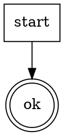

# skill-cheat Plan 2 of 3 — Lint Engine Implementation Plan

> **For agentic workers:** REQUIRED SUB-SKILL: Use superpowers:subagent-driven-development (recommended) or superpowers:executing-plans to implement this plan task-by-task. Steps use checkbox (`- [ ]`) syntax for tracking.

**Goal:** Build a declarative, JSON-driven lint engine that evaluates any SKILL.md against the 16 canonical rules and emits a structured JSON report. Exit state: running `bash skills/skill-voice-review/scripts/lint.sh <path/to/SKILL.md>` on a good fixture prints `VERDICT: ACCEPT`; running it on each bad fixture prints `VERDICT: REJECT_CRITICAL` naming exactly the rule id the fixture is engineered to trigger. Plus: integrity-hash helper for the Integrity Block pattern, consumable by the (Plan 3) skill-design stage.

**Architecture:** Data-driven lint runner. Rules live in `lint-rules.json`. A thin shell dispatcher (`lint.sh`) reads the manifest, fans out to detectors (some shell, some node), collects findings, emits a JSON report. Per-skill `lint.json` overrides compose on top via `extends`. Denylists are JSON arrays so they can be edited without touching code. The integrity-hash helper is a separate focused script that computes SHA-256 of the bytes strictly between `<!-- integrity-block:start/end -->` markers.

**Tech Stack:** `bash` (≥4), `node` (≥16, for JSON/YAML/DOM parsing), `openssl` (SHA-256), `jq` (JSON emit/inspect in tests), `dot` from graphviz (digraph validation), `diff` (fixture comparison).

**Comment discipline (applies to every `.sh` and `.js` code block):** comments are LLM-instructions only — directives and invariants. No dev-history, no rationale, no maintainer notes. If a comment does not constrain behavior, delete it.

**References pattern (applies to file placement):** following model_trainer (`hypothesize/references/problem-framing.md`, `train/references/integrity-verification.md`) and runbug (`install-bridge/references/shim.js`, `ax-protocol.md`). SKILL.md files in Plan 3 will be tight imperatives that pull from the references + scripts this plan produces.

---

## File Structure

Files created in this plan (approximate):

```
skill_cheat/
├── skills/
│   ├── skill-design/
│   │   ├── references/
│   │   │   └── integrity-block.md                 ← Task 2 (prose reference)
│   │   └── scripts/
│   │       └── integrity-hash.sh                  ← Task 3 (TDD)
│   └── skill-voice-review/
│       ├── references/
│       │   ├── lint-schema.json                   ← Task 1 (JSON Schema)
│       │   ├── lint-rules.json                    ← Task 12 (the 16 baseline rules)
│       │   ├── hedge-words-denylist.json          ← Task 4
│       │   ├── library-names-denylist.json        ← Task 4
│       │   └── canonical-anatomy.md               ← Task 5 (prose reference)
│       └── scripts/
│           ├── lint.sh                            ← Task 6 skeleton, Task 13 end-to-end
│           └── lint.js                            ← Task 7 skeleton, detectors filled in Tasks 8–11
└── tests/
    ├── integrity/
    │   └── test-integrity-hash.sh                 ← Task 3 (TDD test)
    └── lint/
        ├── fixtures/
        │   ├── good/
        │   │   └── minimal.md                     ← Task 5 (must pass ALL rules)
        │   └── bad/
        │       ├── LINT-001.md                    ← Task 8
        │       ├── LINT-002.md                    ← Task 9
        │       ├── LINT-003.md                    ← Task 8
        │       ├── LINT-004.md                    ← Task 10
        │       ├── LINT-005.md                    ← Task 8
        │       ├── LINT-006.md                    ← Task 11
        │       ├── LINT-007.md                    ← Task 9
        │       ├── LINT-008.md                    ← Task 9
        │       ├── LINT-009.md                    ← Task 9
        │       ├── LINT-010.md                    ← Task 10
        │       ├── LINT-011.md                    ← Task 11
        │       ├── LINT-012.md                    ← Task 10
        │       ├── LINT-013.md                    ← Task 10
        │       ├── LINT-014.md                    ← Task 8
        │       ├── LINT-015.md                    ← Task 8
        │       └── LINT-016.md                    ← Task 8
        ├── primitives/
        │   ├── test-find-extensions.sh            ← Task 8
        │   ├── test-grep-denylist.sh              ← Task 8
        │   ├── test-grep-required.sh              ← Task 8
        │   ├── test-regex-line.sh                 ← Task 9
        │   ├── test-bash-syntax.sh                ← Task 9
        │   ├── test-yaml-frontmatter.sh           ← Task 10
        │   ├── test-section-order.sh              ← Task 10
        │   ├── test-cross-reference.sh            ← Task 10
        │   ├── test-dot-parse.sh                  ← Task 11
        │   └── test-hard-gate-span.sh             ← Task 11
        ├── test-lint-end-to-end.sh                ← Task 13
        ├── test-lint-extends.sh                   ← Task 14
        └── test-rule-coverage.sh                  ← Task 15
```

**Responsibilities:**
- `lint-schema.json` — JSON Schema that every rule in `lint-rules.json` must validate against.
- `lint-rules.json` — the 16 baseline rules as declarative data.
- Denylists — data-only JSON arrays; editing them changes lint behavior without touching code.
- `lint.sh` — thin dispatcher: parses args, reads rule manifest (resolving `extends` if present), calls detectors, aggregates findings, emits JSON report, prints one-line VERDICT.
- `lint.js` — node-side detectors for anything needing proper parsing (YAML, DOM-like walks, JSON cross-reference). Called by `lint.sh` as `node lint.js --detector <type> --args <json>`.
- `integrity-hash.sh` — single responsibility: SHA-256 of bytes between integrity-block markers. Used by Plan 3's skill-design stage.
- `canonical-anatomy.md` / `integrity-block.md` — prose references; loaded by Plan 3 SKILL.md files.

---

### Task 1: JSON Schema for lint rules

**Files:**
- Create: `skills/skill-voice-review/references/lint-schema.json`

- [ ] **Step 1: Write `lint-schema.json`**

```json
{
  "$schema": "http://json-schema.org/draft-07/schema#",
  "title": "skill-cheat lint rules manifest",
  "type": "object",
  "required": ["schemaVersion", "rules"],
  "properties": {
    "schemaVersion": { "type": "string", "enum": ["1.0"] },
    "extends": { "type": "string" },
    "disable": {
      "type": "array",
      "items": { "type": "string", "pattern": "^[A-Z]+-[0-9]{3}$" }
    },
    "rules": {
      "type": "array",
      "items": { "$ref": "#/definitions/rule" }
    }
  },
  "definitions": {
    "rule": {
      "type": "object",
      "required": ["id", "description", "severity", "detector"],
      "additionalProperties": false,
      "properties": {
        "id": { "type": "string", "pattern": "^[A-Z]+-[0-9]{3}$" },
        "description": { "type": "string", "minLength": 10 },
        "severity": { "type": "string", "enum": ["CRITICAL", "IMPORTANT", "MINOR"] },
        "detector": {
          "type": "object",
          "required": ["type"],
          "properties": {
            "type": {
              "type": "string",
              "enum": [
                "find-extensions",
                "grep-denylist",
                "grep-required",
                "regex-line",
                "yaml-frontmatter",
                "dot-parse",
                "bash-syntax",
                "section-order",
                "cross-reference",
                "hard-gate-span"
              ]
            }
          },
          "additionalProperties": true
        }
      }
    }
  }
}
```

- [ ] **Step 2: Validate the schema itself is valid JSON Schema**

```bash
cd "/Users/hook/Documents/coding/python/Personal_AI  Projects/skill_cheat"
python3 -m json.tool skills/skill-voice-review/references/lint-schema.json >/dev/null && echo "VALID JSON"
```

Expected: `VALID JSON`.

- [ ] **Step 3: Commit**

```bash
git add skills/skill-voice-review/references/lint-schema.json
git commit -m "feat(lint): add JSON schema for lint rule manifests"
```

---

### Task 2: integrity-block.md prose reference

**Files:**
- Create: `skills/skill-design/references/integrity-block.md`

- [ ] **Step 1: Write the reference**

```markdown
# The Integrity Block

A byte-exact delimited region inside a design document. Stages downstream of design re-hash the region and fail if it drifts.

## Delimiters

Exact strings, each on their own line, no leading or trailing whitespace.

- Start: `<!-- integrity-block:start -->`
- End: `<!-- integrity-block:end -->`

## Immutable fields (six, in this order)

1. `## Skill Name` — matches the SKILL.md frontmatter `name`.
2. `## Triggers` — slash command + any keyword triggers.
3. `## Verdict Vocabulary` — ALL-CAPS tokens the skill emits.
4. `## HARD-GATEs` — one per bullet, imperative (`Do NOT …`).
5. `## Core Principle` — one sentence.
6. `## Gate Functions` — one per bullet, `BEFORE <action>: "<question>?"` form.

Nothing else lives between the markers. Rationale, Red Flags, Rationalization Table, and prose discussion live OUTSIDE the markers elsewhere in the design document.

## SHA-256 sidecar

After the design document is saved, compute SHA-256 of the bytes **strictly between** the two marker lines (exclusive of the markers themselves), and write a sidecar file at `<design-path>.sha256`.

Sidecar format (one line):

```
<lowercase hex digest>  <basename>
```

Example:

```
a7981ec3c2b1d0f9e8...  design.md
```

## Verification contract

Every downstream stage calls `verify_integrity(design_path)` as its first action after confirming inputs exist.

```
if sidecar missing           → BLOCKED_TAMPER: sidecar absent
if start marker missing      → BLOCKED_TAMPER: start marker absent
if end marker missing        → BLOCKED_TAMPER: end marker absent
if either marker duplicated  → BLOCKED_TAMPER: marker not unique
computed = sha256(bytes between markers)
recorded = read sidecar
if computed != recorded      → BLOCKED_TAMPER: hash drift
return OK
```

## Anti-gaming

Two tamper patterns, both rejected by downstream stages:

1. Author re-hashes after editing in-block → voice-review cross-checks block contents against scope.md's declared triggers/verdicts. Divergence → REJECT_CRITICAL.
2. Author moves a HARD-GATE outside the markers to edit it freely → LINT-016 catches HARD-GATE blocks appearing in a design.md's editable region.

## Rendered SKILL.md does not retain markers

The scaffold stage inlines locked fields into canonical sections. The design.md + sidecar persist as the audit trail. Exception: skills that declare `authored-skill-has-its-own-runtime-integrity-block` in scope (e.g. ML-training skills that need per-run integrity) keep the markers in their rendered output.
```

- [ ] **Step 2: Commit**

```bash
git add skills/skill-design/references/integrity-block.md
git commit -m "docs(design): add integrity-block reference"
```

---

### Task 3: `integrity-hash.sh` (TDD)

**Files:**
- Create: `tests/integrity/test-integrity-hash.sh`
- Create: `skills/skill-design/scripts/integrity-hash.sh`

- [ ] **Step 1: Ensure `tests/integrity/` exists**

```bash
mkdir -p tests/integrity skills/skill-design/scripts
```

- [ ] **Step 2: Write the failing test**

```bash
#!/usr/bin/env bash
set -euo pipefail

HERE="$(cd "$(dirname "${BASH_SOURCE[0]}")/../.." && pwd)"
SCRIPT="${HERE}/skills/skill-design/scripts/integrity-hash.sh"
TMP="$(mktemp -d)"
trap 'rm -rf "$TMP"' EXIT

cat > "${TMP}/good.md" <<'EOF'
# Some design

Prose outside the block.

<!-- integrity-block:start -->
## Skill Name
demo

## Triggers
- Slash command: /demo
<!-- integrity-block:end -->

More prose after.
EOF

bash "$SCRIPT" "${TMP}/good.md" >/dev/null

sidecar="${TMP}/good.md.sha256"
[[ -f "$sidecar" ]] || { echo "FAIL: sidecar not created"; exit 1; }

recorded="$(awk '{print $1}' "$sidecar")"
[[ "$recorded" =~ ^[0-9a-f]{64}$ ]] || { echo "FAIL: digest is not 64 hex chars"; echo "$recorded"; exit 1; }

basename_in_sidecar="$(awk '{print $2}' "$sidecar")"
[[ "$basename_in_sidecar" == "good.md" ]] || { echo "FAIL: sidecar does not name basename; got '$basename_in_sidecar'"; exit 1; }

recomputed="$(
  awk '
    /<!-- integrity-block:start -->/ { emit=1; next }
    /<!-- integrity-block:end -->/   { emit=0; next }
    emit { print }
  ' "${TMP}/good.md" | openssl dgst -sha256 | awk '{print $NF}'
)"
[[ "$recomputed" == "$recorded" ]] || { echo "FAIL: sidecar digest does not match recomputed digest"; exit 1; }

cat > "${TMP}/no-start.md" <<'EOF'
# Missing start
<!-- integrity-block:end -->
EOF
if bash "$SCRIPT" "${TMP}/no-start.md" 2>/dev/null; then
  echo "FAIL: accepted file with no start marker"; exit 1
fi

cat > "${TMP}/no-end.md" <<'EOF'
# Missing end
<!-- integrity-block:start -->
stuff
EOF
if bash "$SCRIPT" "${TMP}/no-end.md" 2>/dev/null; then
  echo "FAIL: accepted file with no end marker"; exit 1
fi

cat > "${TMP}/duplicate.md" <<'EOF'
<!-- integrity-block:start -->
one
<!-- integrity-block:end -->
<!-- integrity-block:start -->
two
<!-- integrity-block:end -->
EOF
if bash "$SCRIPT" "${TMP}/duplicate.md" 2>/dev/null; then
  echo "FAIL: accepted file with duplicated markers"; exit 1
fi

echo "PASS: integrity-hash"
```

- [ ] **Step 3: Make executable and run — expect failure (script missing)**

```bash
chmod +x tests/integrity/test-integrity-hash.sh
bash tests/integrity/test-integrity-hash.sh
```

Expected: failure (script does not exist). Record output.

- [ ] **Step 4: Write `skills/skill-design/scripts/integrity-hash.sh`**

```bash
#!/usr/bin/env bash
set -euo pipefail

# Invariant: compute SHA-256 of bytes strictly between integrity-block markers, write <path>.sha256 sidecar.
# Invariant: fail non-zero if either marker is missing or duplicated.

if [[ $# -ne 1 ]]; then
  echo "usage: integrity-hash.sh <path-to-design.md>" >&2
  exit 64
fi

src="$1"
[[ -f "$src" ]] || { echo "integrity-hash: file not found: $src" >&2; exit 66; }

start_count="$(grep -Fc '<!-- integrity-block:start -->' "$src" || true)"
end_count="$(grep -Fc '<!-- integrity-block:end -->' "$src" || true)"

[[ "$start_count" == "1" ]] || { echo "integrity-hash: start marker count=$start_count (want 1)" >&2; exit 65; }
[[ "$end_count"   == "1" ]] || { echo "integrity-hash: end marker count=$end_count (want 1)"   >&2; exit 65; }

digest="$(
  awk '
    /<!-- integrity-block:start -->/ { emit=1; next }
    /<!-- integrity-block:end -->/   { emit=0; next }
    emit { print }
  ' "$src" | openssl dgst -sha256 | awk '{print $NF}'
)"

[[ "$digest" =~ ^[0-9a-f]{64}$ ]] || { echo "integrity-hash: unexpected digest shape: $digest" >&2; exit 70; }

basename="$(basename "$src")"
printf '%s  %s\n' "$digest" "$basename" > "${src}.sha256"
echo "$digest  $basename"
```

- [ ] **Step 5: Make executable and re-run test**

```bash
chmod +x skills/skill-design/scripts/integrity-hash.sh
bash tests/integrity/test-integrity-hash.sh
```

Expected: `PASS: integrity-hash`.

- [ ] **Step 6: Commit**

```bash
git add skills/skill-design/scripts/integrity-hash.sh tests/integrity/test-integrity-hash.sh
git commit -m "feat(design): add integrity-hash helper with SHA-256 sidecar"
```

---

### Task 4: Denylist data files

**Files:**
- Create: `skills/skill-voice-review/references/hedge-words-denylist.json`
- Create: `skills/skill-voice-review/references/library-names-denylist.json`

- [ ] **Step 1: Ensure destination directory exists**

```bash
mkdir -p skills/skill-voice-review/references skills/skill-voice-review/scripts
```

- [ ] **Step 2: Write `hedge-words-denylist.json`**

```json
{
  "schemaVersion": "1.0",
  "kind": "word-denylist",
  "entries": [
    "consider",
    "probably",
    "may",
    "might",
    "perhaps",
    "seems",
    "seem",
    "try to",
    "somewhat",
    "roughly",
    "approximately",
    "mostly",
    "generally",
    "usually",
    "typically"
  ]
}
```

- [ ] **Step 3: Write `library-names-denylist.json`**

```json
{
  "schemaVersion": "1.0",
  "kind": "identifier-denylist",
  "entries": [
    "React",
    "Vue",
    "Angular",
    "Svelte",
    "Next",
    "Nuxt",
    "FastAPI",
    "Flask",
    "Django",
    "Express",
    "Koa",
    "Fastify",
    "Keras",
    "PyTorch",
    "TensorFlow",
    "sklearn",
    "scikit-learn",
    "Playwright",
    "Cypress",
    "Puppeteer",
    "Selenium",
    "Jest",
    "Vitest",
    "Mocha",
    "Pytest",
    "unittest",
    "SQLAlchemy",
    "Prisma",
    "Mongoose",
    "TypeORM"
  ]
}
```

- [ ] **Step 4: Validate both**

```bash
python3 -m json.tool skills/skill-voice-review/references/hedge-words-denylist.json >/dev/null && \
python3 -m json.tool skills/skill-voice-review/references/library-names-denylist.json >/dev/null && \
echo OK
```

Expected: `OK`.

- [ ] **Step 5: Commit**

```bash
git add skills/skill-voice-review/references/hedge-words-denylist.json \
        skills/skill-voice-review/references/library-names-denylist.json
git commit -m "feat(lint): add hedge-words and library-names denylists"
```

---

### Task 5: Canonical anatomy reference + good fixture

**Files:**
- Create: `skills/skill-voice-review/references/canonical-anatomy.md`
- Create: `tests/lint/fixtures/good/minimal.md`

- [ ] **Step 1: Write `canonical-anatomy.md`**

```markdown
# Canonical Skill Anatomy

Every SKILL.md produced by this plugin must present these sections in this exact order.

## Section order

1. YAML frontmatter (`name`, `description`).
2. H1 title matching the skill name.
3. `<HARD-GATE>` blocks — one or more, stacked immediately under the H1. Each block contains one or two imperative sentences, no rationale.
4. Anti-Pattern — names the quoted rationalization that would cause Claude to skip the skill. First sentence MUST contain a quoted phrase.
5. Core Principle — one sentence. Describes the shape of the work, never a library or framework.
6. Process Flow — a dot digraph that parses under `dot -Tcanon`. Every node must be reachable.
7. Checklist — numbered bullets. Backtracking allowed but must be explicit.
8. Step Details — per checklist item, numbered to match.
9. Gate Functions — every bullet matches `- BEFORE <action>: "<question>?"`.
10. Rationalization Table — two columns: `You think...` | `Reality`. Each row's Reality must be stricter than its You-think.
11. Red Flags — bulleted quoted fragments, no em-dash explanation tail.
12. Key Principles — bolded, imperative.
13. Bottom Line — imperative close, contains an executable fenced `bash` or `sh` block that prints a VERDICT token.

## Voice

- Imperative verb starts every prohibition: `Do NOT …`, `Never …`, `STOP and …`.
- Zero hedge words (see `hedge-words-denylist.json`).
- Zero library / framework names in the body (see `library-names-denylist.json`). Tool names live only in `references/`.
- Verdict tokens are ALL-CAPS single words. No verbose descriptions.

## What does NOT belong

- Prose rationale inside a `<HARD-GATE>` block.
- `because` / `since` / `in order to` inside a HARD-GATE.
- Third-person self-reference: "the skill", "this skill mandates", "skill deviation".
- Comments in JSON / JS / SH that describe history, intent, or personal notes.
```

- [ ] **Step 2: Write a minimal good fixture that passes ALL 16 rules**

Create `tests/lint/fixtures/good/minimal.md`:

```markdown
---
name: minimal-demo
description: Trigger /minimal-demo. Verdicts are READY, REJECT, BLOCKED. Use when testing the lint engine.
---

# minimal-demo

<HARD-GATE>
Do NOT proceed without a named scope. STOP and invoke /skill-scope.
</HARD-GATE>

## Anti-Pattern

**"I can skip the gate this once"** — every invocation goes through the gate. No exceptions.

## Core Principle

Verify preconditions before acting.

## Process Flow



## Checklist

1. Read the scope document.

## Step Details

### 1. Read the scope document

Open scope.md and confirm all required fields are present.

## Gate Functions

- BEFORE proceeding: "Does scope.md exist?"

## Rationalization Table

| You think... | Reality |
|---|---|
| "Scope is obvious from context" | Context drifts. Read scope.md. |

## Red Flags

- "I already know what the scope is"
- "Scope check is overkill"

## Key Principles

- **Verify.** Read before acting.

## The Bottom Line

```bash
echo "VERDICT: READY"
```
```

- [ ] **Step 3: Validate the fixture's dot block parses**

```bash
awk '/```dot/{f=1; next} /```/{if(f){exit}} f{print}' tests/lint/fixtures/good/minimal.md | dot -Tcanon >/dev/null && echo DOT_OK
```

Expected: `DOT_OK`.

- [ ] **Step 4: Commit**

```bash
git add skills/skill-voice-review/references/canonical-anatomy.md \
        tests/lint/fixtures/good/minimal.md
git commit -m "feat(lint): add canonical-anatomy reference and minimal good fixture"
```

---

### Task 6: `lint.sh` skeleton (no detectors yet)

**Files:**
- Create: `skills/skill-voice-review/scripts/lint.sh`
- Create: `tests/lint/test-lint-skeleton.sh` (temporary — removed in Task 13)

The skeleton reads CLI args, loads the rule manifest, iterates rules (calling a `dispatch_detector` function that for now always returns `passed`), aggregates findings into `$findings_json`, and prints a final JSON report.

- [ ] **Step 1: Write failing skeleton test**

Create `tests/lint/test-lint-skeleton.sh`:

```bash
#!/usr/bin/env bash
set -euo pipefail

HERE="$(cd "$(dirname "${BASH_SOURCE[0]}")/../.." && pwd)"
LINT="${HERE}/skills/skill-voice-review/scripts/lint.sh"
FIXTURE="${HERE}/tests/lint/fixtures/good/minimal.md"

report="$(bash "$LINT" "$FIXTURE")"

if ! printf '%s' "$report" | jq -e '.verdict' >/dev/null; then
  echo "FAIL: report has no .verdict"
  echo "$report"
  exit 1
fi

if ! printf '%s' "$report" | jq -e '.summary' >/dev/null; then
  echo "FAIL: report has no .summary"
  exit 1
fi

if ! printf '%s' "$report" | jq -e '.findings' >/dev/null; then
  echo "FAIL: report has no .findings array"
  exit 1
fi

echo "PASS: lint skeleton"
```

- [ ] **Step 2: `chmod +x`, run, expect failure (script missing).**

- [ ] **Step 3: Write `skills/skill-voice-review/scripts/lint.sh`**

```bash
#!/usr/bin/env bash
set -euo pipefail

# Invariant: lint.sh emits a single JSON object to stdout with keys {skill, designSha, runId, summary, findings, verdict}.
# Invariant: non-zero exit on schema violation, lint engine errors, or REJECT_CRITICAL verdict. Exit 0 on ACCEPT / ACCEPT_WITH_MINOR.

if [[ $# -lt 1 ]]; then
  echo "usage: lint.sh <path-to-SKILL.md>" >&2
  exit 64
fi

SKILL_PATH="$1"
[[ -f "$SKILL_PATH" ]] || { echo "lint: file not found: $SKILL_PATH" >&2; exit 66; }

HERE="$(cd "$(dirname "${BASH_SOURCE[0]}")" && pwd)"
REF="$(cd "${HERE}/../references" && pwd)"
RULES_FILE="${REF}/lint-rules.json"

if [[ ! -f "$RULES_FILE" ]]; then
  # Baseline rule manifest is added in Task 12. Skeleton emits empty report.
  RULES_JSON='{"schemaVersion":"1.0","rules":[]}'
else
  RULES_JSON="$(cat "$RULES_FILE")"
fi

# Findings accumulator. Each entry is a JSON object emitted by a detector.
findings_json='[]'
critical=0
important=0
minor=0
passed=0

# dispatch_detector <rule-json> — stub that always records a pass. Real dispatch in Task 13.
dispatch_detector() {
  passed=$((passed + 1))
}

count="$(printf '%s' "$RULES_JSON" | jq '.rules | length')"
for (( i=0; i<count; i++ )); do
  rule="$(printf '%s' "$RULES_JSON" | jq -c ".rules[$i]")"
  dispatch_detector "$rule"
done

if (( critical > 0 )); then verdict="REJECT_CRITICAL"
elif (( important > 0 )); then verdict="REJECT_IMPORTANT"
elif (( minor > 0 )); then verdict="ACCEPT_WITH_MINOR"
else verdict="ACCEPT"
fi

jq -n \
  --arg skill "$SKILL_PATH" \
  --arg runId "$(date -u +%Y-%m-%dT%H:%M:%SZ)" \
  --argjson summary "{\"critical\":$critical,\"important\":$important,\"minor\":$minor,\"passed\":$passed}" \
  --argjson findings "$findings_json" \
  --arg verdict "$verdict" \
  '{skill:$skill, designSha:null, runId:$runId, summary:$summary, findings:$findings, verdict:$verdict}'

case "$verdict" in
  REJECT_CRITICAL|REJECT_IMPORTANT) exit 1 ;;
  *) exit 0 ;;
esac
```

- [ ] **Step 4: Make executable, run test — must pass.**

```bash
chmod +x skills/skill-voice-review/scripts/lint.sh
bash tests/lint/test-lint-skeleton.sh
```

Expected: `PASS: lint skeleton`.

- [ ] **Step 5: Commit**

```bash
git add skills/skill-voice-review/scripts/lint.sh tests/lint/test-lint-skeleton.sh
git commit -m "feat(lint): add lint.sh skeleton emitting JSON report"
```

---

### Task 7: `lint.js` module skeleton

**Files:**
- Create: `skills/skill-voice-review/scripts/lint.js`

The JS side owns detectors that need real parsing: YAML frontmatter, section order (header walker), cross-reference (checklist ↔ step details). Called from `lint.sh` as `node lint.js --detector <type> --skill <path> --config <json>`.

- [ ] **Step 1: Write the module skeleton**

```javascript
#!/usr/bin/env node
// Invariant: stdin/argv in, single JSON object on stdout, exit 0 on success, non-zero on detector error (not on rule failure).

import { readFileSync } from "node:fs";
import { argv, exit, stderr, stdout } from "node:process";

const detectors = {
  "yaml-frontmatter": detectYamlFrontmatter,
  "section-order": detectSectionOrder,
  "cross-reference": detectCrossReference,
};

function parseArgs(args) {
  const out = {};
  for (let i = 0; i < args.length; i++) {
    if (args[i].startsWith("--")) {
      out[args[i].slice(2)] = args[i + 1];
      i++;
    }
  }
  return out;
}

function fail(msg) {
  stderr.write(`lint.js: ${msg}\n`);
  exit(2);
}

function emitFindings(findings) {
  stdout.write(JSON.stringify({ findings }));
  stdout.write("\n");
}

function detectYamlFrontmatter(_skillText, _config) {
  // Filled in Task 10.
  return [];
}

function detectSectionOrder(_skillText, _config) {
  // Filled in Task 10.
  return [];
}

function detectCrossReference(_skillText, _config) {
  // Filled in Task 10.
  return [];
}

const args = parseArgs(argv.slice(2));
if (!args.detector) fail("missing --detector");
if (!args.skill) fail("missing --skill");

const detector = detectors[args.detector];
if (!detector) fail(`unknown detector: ${args.detector}`);

const skillText = readFileSync(args.skill, "utf8");
const config = args.config ? JSON.parse(args.config) : {};

try {
  emitFindings(detector(skillText, config));
} catch (err) {
  fail(`detector ${args.detector} threw: ${err.message}`);
}
```

- [ ] **Step 2: Sanity check — node can load it as ESM**

```bash
node --input-type=module -e "await import('./skills/skill-voice-review/scripts/lint.js');" 2>&1 | head -5
```

Since this module calls `parseArgs(argv.slice(2))` at top level with no detector arg, it will call `fail("missing --detector")` and exit 2. That is expected for the import-only smoke check. Capture the first stderr line and confirm it contains `missing --detector`.

Actual check:

```bash
node skills/skill-voice-review/scripts/lint.js 2>&1 | grep -q "missing --detector" && echo OK
```

Expected: `OK`.

- [ ] **Step 3: Ensure JS file has an ESM-compatible invocation**

Add `"type": "module"` to a package manifest so `import` works. Since skill-cheat is a plugin, not an npm package, create a minimal `skills/skill-voice-review/scripts/package.json`:

```json
{
  "name": "skill-cheat-lint",
  "version": "0.1.0",
  "type": "module",
  "private": true
}
```

No `package-lock.json`. No dependencies.

- [ ] **Step 4: Re-run the smoke check**

```bash
node skills/skill-voice-review/scripts/lint.js 2>&1 | grep -q "missing --detector" && echo OK
```

Expected: `OK`.

- [ ] **Step 5: Commit**

```bash
git add skills/skill-voice-review/scripts/lint.js \
        skills/skill-voice-review/scripts/package.json
git commit -m "feat(lint): add lint.js module skeleton with detector dispatch"
```

---

### Task 8: Shell detectors — find-extensions, grep-denylist, grep-required

**Files:**
- Modify: `skills/skill-voice-review/scripts/lint.sh` (add shell detector functions)
- Create: `tests/lint/primitives/test-find-extensions.sh`
- Create: `tests/lint/primitives/test-grep-denylist.sh`
- Create: `tests/lint/primitives/test-grep-required.sh`
- Create: `tests/lint/fixtures/bad/LINT-001.md`
- Create: `tests/lint/fixtures/bad/LINT-003.md`
- Create: `tests/lint/fixtures/bad/LINT-005.md`
- Create: `tests/lint/fixtures/bad/LINT-014.md`
- Create: `tests/lint/fixtures/bad/LINT-015.md`
- Create: `tests/lint/fixtures/bad/LINT-016.md`

- [ ] **Step 1: Write failing primitive tests**

Create `tests/lint/primitives/test-find-extensions.sh`:

```bash
#!/usr/bin/env bash
set -euo pipefail

HERE="$(cd "$(dirname "${BASH_SOURCE[0]}")/../../.." && pwd)"
source "${HERE}/skills/skill-voice-review/scripts/lint.sh" --source-only

TMP="$(mktemp -d)"; trap 'rm -rf "$TMP"' EXIT
mkdir -p "$TMP/plugin"
echo "ok" > "$TMP/plugin/file.md"
echo "ok" > "$TMP/plugin/file.sh"
echo "ok" > "$TMP/plugin/file.py"

findings="$(detect_find_extensions "$TMP/plugin" '[".md",".sh",".json"]')"
if ! printf '%s' "$findings" | jq -e 'length == 1' >/dev/null; then
  echo "FAIL: expected 1 finding for .py file"
  echo "$findings"; exit 1
fi

if ! printf '%s' "$findings" | jq -e '.[0].location.path | endswith("file.py")' >/dev/null; then
  echo "FAIL: finding does not reference file.py"
  echo "$findings"; exit 1
fi

rm "$TMP/plugin/file.py"
findings="$(detect_find_extensions "$TMP/plugin" '[".md",".sh",".json"]')"
if ! printf '%s' "$findings" | jq -e 'length == 0' >/dev/null; then
  echo "FAIL: expected no findings after disallowed file removed"
  echo "$findings"; exit 1
fi

echo "PASS: find-extensions"
```

Create `tests/lint/primitives/test-grep-denylist.sh`:

```bash
#!/usr/bin/env bash
set -euo pipefail

HERE="$(cd "$(dirname "${BASH_SOURCE[0]}")/../../.." && pwd)"
source "${HERE}/skills/skill-voice-review/scripts/lint.sh" --source-only

TMP="$(mktemp -d)"; trap 'rm -rf "$TMP"' EXIT

cat > "$TMP/skill.md" <<'EOF'
# demo
This may or may not work.
Consider the alternative.
EOF

denylist='{"entries":["may","consider"]}'
findings="$(detect_grep_denylist "$TMP/skill.md" "$denylist")"
count="$(printf '%s' "$findings" | jq 'length')"
if [[ "$count" -lt 2 ]]; then
  echo "FAIL: expected ≥2 findings; got $count"
  echo "$findings"; exit 1
fi

cat > "$TMP/clean.md" <<'EOF'
# demo
Do X. Do Y.
EOF
findings="$(detect_grep_denylist "$TMP/clean.md" "$denylist")"
if ! printf '%s' "$findings" | jq -e 'length == 0' >/dev/null; then
  echo "FAIL: false positives on clean input"
  echo "$findings"; exit 1
fi

echo "PASS: grep-denylist"
```

Create `tests/lint/primitives/test-grep-required.sh`:

```bash
#!/usr/bin/env bash
set -euo pipefail

HERE="$(cd "$(dirname "${BASH_SOURCE[0]}")/../../.." && pwd)"
source "${HERE}/skills/skill-voice-review/scripts/lint.sh" --source-only

TMP="$(mktemp -d)"; trap 'rm -rf "$TMP"' EXIT

cat > "$TMP/has.md" <<'EOF'
## Anti-Pattern
"this one is fine"
EOF
findings="$(detect_grep_required "$TMP/has.md" '{"pattern":"## Anti-Pattern"}')"
if ! printf '%s' "$findings" | jq -e 'length == 0' >/dev/null; then
  echo "FAIL: false positive when required pattern present"
  echo "$findings"; exit 1
fi

cat > "$TMP/missing.md" <<'EOF'
## Other
no anti pattern here
EOF
findings="$(detect_grep_required "$TMP/missing.md" '{"pattern":"## Anti-Pattern"}')"
if ! printf '%s' "$findings" | jq -e 'length == 1' >/dev/null; then
  echo "FAIL: did not flag missing required pattern"
  echo "$findings"; exit 1
fi

echo "PASS: grep-required"
```

- [ ] **Step 2: `chmod +x` all three and run. All fail.**

- [ ] **Step 3: Modify `lint.sh` to add detector functions and the `--source-only` gate**

At the top of `lint.sh`, right after the `# Invariant:` header comment, add:

```bash
# Invariant: when invoked with --source-only, lint.sh only defines functions and does not execute main logic.
if [[ "${1:-}" == "--source-only" ]]; then
  _LINT_SOURCE_ONLY=1
  shift
fi
```

Wrap the existing main logic (CLI parse, rule loop, JSON emit) in:

```bash
if [[ -z "${_LINT_SOURCE_ONLY:-}" ]]; then
  # ... existing main logic ...
fi
```

Add three detector functions before the main block:

```bash
# detect_find_extensions <dir> <json-allowlist-array> → findings JSON array on stdout
detect_find_extensions() {
  local dir="$1"
  local allowlist_json="$2"
  local allow_args=()
  local ext
  while IFS= read -r ext; do
    allow_args+=( -o -name "*$ext" )
  done < <(printf '%s' "$allowlist_json" | jq -r '.[]')
  allow_args=("${allow_args[@]:1}")
  local violations
  violations="$(find "$dir" -type f \( ! \( "${allow_args[@]}" \) \) -print 2>/dev/null || true)"
  if [[ -z "$violations" ]]; then
    echo '[]'; return
  fi
  printf '%s\n' "$violations" | jq -R -s 'split("\n") | map(select(length > 0)) | map({location: {path: .}, excerpt: null})'
}

# detect_grep_denylist <skill-path> <denylist-json-object> → findings JSON array
detect_grep_denylist() {
  local skill="$1"
  local denylist="$2"
  local patterns
  patterns="$(printf '%s' "$denylist" | jq -r '.entries[]')"
  local findings='[]'
  local word line_num line_content
  while IFS= read -r word; do
    while IFS=: read -r line_num line_content; do
      [[ -z "$line_num" ]] && continue
      findings="$(printf '%s' "$findings" | jq --arg word "$word" --arg ln "$line_num" --arg ex "$line_content" \
        '. + [{location:{line:($ln|tonumber)}, message:("denylist hit: "+$word), excerpt:$ex}]')"
    done < <(grep -niwn -E "\\b${word}\\b" "$skill" 2>/dev/null || true)
  done <<< "$patterns"
  echo "$findings"
}

# detect_grep_required <skill-path> <config-json> → findings JSON array
detect_grep_required() {
  local skill="$1"
  local cfg="$2"
  local pattern
  pattern="$(printf '%s' "$cfg" | jq -r '.pattern')"
  if grep -qF -- "$pattern" "$skill"; then
    echo '[]'
  else
    jq -n --arg p "$pattern" '[{location:null, message:("required pattern missing: "+$p), excerpt:null}]'
  fi
}
```

- [ ] **Step 4: Run the three primitive tests — all pass.**

```bash
bash tests/lint/primitives/test-find-extensions.sh
bash tests/lint/primitives/test-grep-denylist.sh
bash tests/lint/primitives/test-grep-required.sh
```

- [ ] **Step 5: Author the six bad fixtures (one per rule this detector set covers)**

Each bad fixture is a copy of `tests/lint/fixtures/good/minimal.md` with ONE specific mutation that triggers exactly one rule id. For each, open the good fixture, apply the minimal mutation described below, save under `tests/lint/fixtures/bad/<rule-id>.md`:

| Fixture | Mutation |
|---|---|
| `LINT-001.md` | Drop an adjacent `.py` file in the plugin tree (handled via test setup, not the fixture itself — this rule is plugin-level, not skill-level. Leave this fixture as a copy of minimal.md plus a note; the primitive test above exercises the detector directly). |
| `LINT-003.md` | Replace `"I can skip the gate this once"` with `"I consider this one optional"` — introduces `consider` (hedge word). |
| `LINT-005.md` | Replace `Verify preconditions before acting.` with `Verify preconditions using FastAPI before acting.` — introduces library name. |
| `LINT-014.md` | Append in the Step Details section: `The skill mandates this ordering.` — introduces `the skill`. |
| `LINT-015.md` | Remove the quoted phrase from Anti-Pattern so the first sentence contains no quoted fragment. |
| `LINT-016.md` | Add a second `<HARD-GATE>` block AFTER the Red Flags section, where it doesn't belong in the editable region of a design doc. (For Task 8's fixture scope: this fixture represents a design.md with a stray HARD-GATE outside the integrity block.) |

Commit each fixture as soon as its mutation is applied. Use commit message format `test(lint): add bad fixture <RULE-ID>`.

- [ ] **Step 6: Commit**

```bash
git add skills/skill-voice-review/scripts/lint.sh \
        tests/lint/primitives/test-find-extensions.sh \
        tests/lint/primitives/test-grep-denylist.sh \
        tests/lint/primitives/test-grep-required.sh \
        tests/lint/fixtures/bad/LINT-*.md
git commit -m "feat(lint): add shell detectors and their bad fixtures"
```

---

### Task 9: Shell detectors — regex-line, bash-syntax + more fixtures

**Files:**
- Modify: `skills/skill-voice-review/scripts/lint.sh`
- Create: `tests/lint/primitives/test-regex-line.sh`
- Create: `tests/lint/primitives/test-bash-syntax.sh`
- Create: `tests/lint/fixtures/bad/LINT-002.md`
- Create: `tests/lint/fixtures/bad/LINT-007.md`
- Create: `tests/lint/fixtures/bad/LINT-008.md`
- Create: `tests/lint/fixtures/bad/LINT-009.md`

Same TDD cycle as Task 8:

- [ ] **Step 1:** Write primitive test for `detect_regex_line`. The test verifies: a line matching a `must-match` regex does NOT flag; a line NOT matching a `must-match` regex inside the target section flags with line number and excerpt. Same for `must-not-match`.

- [ ] **Step 2:** Write primitive test for `detect_bash_syntax`. Feed it a fixture whose Bottom Line section has a valid bash fence → no findings. Feed it a fixture with broken syntax (`if then fi` minus the `then`'s statement) → 1 finding with a `bash -n` error excerpt.

- [ ] **Step 3:** Run both — fail (detectors not written).

- [ ] **Step 4:** Add `detect_regex_line` and `detect_bash_syntax` to `lint.sh`. Keys in the detector's config:
- `regex-line`: `{ "section": "gate-functions", "must-match": "^- BEFORE .+: \".+\\?\"$" }` — the detector isolates the named section and applies the regex line-by-line.
- `bash-syntax`: `{ "section": "bottom-line", "language": "bash" }` — the detector extracts the first ```bash / ```sh fence inside the named section and pipes to `bash -n`.

Section isolation: the detector reads the file and walks H2 (`## `) headings. "Gate Functions" maps to the span from `## Gate Functions` to the next `##`. "Bottom Line" similarly. Normalize section names: lowercase, replace spaces with `-`.

- [ ] **Step 5:** Run tests — all pass.

- [ ] **Step 6:** Write the four bad fixtures (mutations to minimal.md):
- `LINT-002.md`: change `<HARD-GATE>` content from `Do NOT proceed without a named scope.` to `The scope should really be named before proceeding.` (removes imperative verb start).
- `LINT-007.md`: change Gate Functions bullet from `- BEFORE proceeding: "Does scope.md exist?"` to `- Before proceeding, ask whether scope.md exists` (wrong shape).
- `LINT-008.md`: change Red Flags bullet from `- "I already know what the scope is"` to `- "I already know what the scope is" — this is a confident feeling that is wrong` (em-dash explanation).
- `LINT-009.md`: change Bottom Line script from `echo "VERDICT: READY"` to `if echo "oops" fi` (broken bash).

- [ ] **Step 7: Commit**

```
feat(lint): add regex-line and bash-syntax detectors with bad fixtures
```

---

### Task 10: Node detectors — yaml-frontmatter, section-order, cross-reference + fixtures

**Files:**
- Modify: `skills/skill-voice-review/scripts/lint.js`
- Create: `tests/lint/primitives/test-yaml-frontmatter.sh`
- Create: `tests/lint/primitives/test-section-order.sh`
- Create: `tests/lint/primitives/test-cross-reference.sh`
- Create: `tests/lint/fixtures/bad/LINT-004.md`
- Create: `tests/lint/fixtures/bad/LINT-010.md`
- Create: `tests/lint/fixtures/bad/LINT-012.md`
- Create: `tests/lint/fixtures/bad/LINT-013.md`

Detectors implemented in JS because proper YAML parsing + header walking is fiddly in shell.

- [ ] **Step 1: Write primitive tests** (all shell tests that invoke `node lint.js --detector <type> --skill <fixture>` and grep the JSON output for expected findings count + rule-specific fields).

- [ ] **Step 2: Run tests — fail.**

- [ ] **Step 3: Implement detectors in `lint.js`**

`detectYamlFrontmatter(skillText, config)`:
- Extract frontmatter: content between first `---` line and the next `---` line. If missing, return one finding.
- Parse YAML (hand-rolled minimal parser — frontmatter is `key: value` lines only; we own the spec). Implement a tiny parser that splits on `: ` and trims.
- Config: `{ "required-fields": ["name", "description"], "description-contains-trigger": true, "description-contains-verdict": true }`.
- For each required field, if missing or empty, emit a finding.
- If `description-contains-trigger`, check `description` value for `/\w+-\w+` or `/<keyword>` or the word `Trigger`. If none found, flag.
- If `description-contains-verdict`, check for at least one ALL-CAPS word of length ≥3 (e.g., READY, REJECT, SHIP). If none, flag.

`detectSectionOrder(skillText, config)`:
- Config: `{ "expected-order": ["<HARD-GATE>", "Anti-Pattern", "Core Principle", "Process Flow", "Checklist", "Step Details", "Gate Functions", "Rationalization Table", "Red Flags", "Key Principles", "Bottom Line"] }`.
- Walk the file top-to-bottom, record the index of each expected section heading (H2 or HARD-GATE marker).
- If any expected section is missing OR the recorded indices are not strictly increasing, emit a finding per out-of-order pair.

`detectCrossReference(skillText, config)`:
- Config: `{ "left-section": "Checklist", "right-section": "Step Details", "left-pattern": "^\\d+\\.\\s", "right-pattern": "^###\\s+\\d+\\." }`.
- Extract all checklist numbers (1. 2. 3.) and all Step Details numbers (### 1. ### 2.). Compare: every checklist number must have a matching Step Details heading. Flag mismatches.

- [ ] **Step 4: Run tests — all pass.**

- [ ] **Step 5: Author four bad fixtures:**
- `LINT-004.md`: change frontmatter `description` to `Trigger /demo. Use when testing.` — no ALL-CAPS verdict token.
- `LINT-010.md`: swap the order of `## Gate Functions` and `## Rationalization Table` sections.
- `LINT-012.md`: remove the `description` field from frontmatter entirely.
- `LINT-013.md`: add `2. Confirm …` to the Checklist but no corresponding `### 2. …` under Step Details.

- [ ] **Step 6: Commit**

```
feat(lint): add yaml/section/cross-reference node detectors with bad fixtures
```

---

### Task 11: Specialized detectors — dot-parse, hard-gate-span + fixtures

**Files:**
- Modify: `skills/skill-voice-review/scripts/lint.sh` (dot-parse is shell; invokes `dot -Tcanon`)
- Modify: `skills/skill-voice-review/scripts/lint.js` (hard-gate-span uses JS parsing)
- Create: `tests/lint/primitives/test-dot-parse.sh`
- Create: `tests/lint/primitives/test-hard-gate-span.sh`
- Create: `tests/lint/fixtures/bad/LINT-006.md`
- Create: `tests/lint/fixtures/bad/LINT-011.md`

- [ ] **Step 1: Primitive tests (shell + node dispatch form)**

- [ ] **Step 2: Run — fail.**

- [ ] **Step 3: Implement**

`detect_dot_parse` in `lint.sh`:
- Extract first ```dot fenced block inside `## Process Flow` section.
- Pipe to `dot -Tcanon`.
- On non-zero exit, emit one finding with the stderr as excerpt.

`detectHardGateSpan` in `lint.js`:
- Find every `<HARD-GATE>...</HARD-GATE>` span.
- For each span: count sentences (split on `.!?` followed by space or newline). If >2, flag.
- Search for tokens `because`, `since`, `in order to` (case-insensitive). Any hit → flag.
- Return finding per offending span with line number and which rule dimension failed.

- [ ] **Step 4: Run — pass.**

- [ ] **Step 5: Author two bad fixtures:**
- `LINT-006.md`: change the HARD-GATE in minimal.md to three sentences with a `because` clause: `Do NOT proceed without a named scope. STOP and invoke /skill-scope because the scope lock is load-bearing. The design cannot proceed without it.`
- `LINT-011.md`: change the Process Flow `dot` block to `digraph broken { a -> ; }` (syntax error).

- [ ] **Step 6: Commit**

```
feat(lint): add dot-parse and hard-gate-span detectors with bad fixtures
```

---

### Task 12: The 16 baseline rules (`lint-rules.json`)

**Files:**
- Create: `skills/skill-voice-review/references/lint-rules.json`

Every rule must validate against `lint-schema.json` (Task 1).

- [ ] **Step 1: Write `lint-rules.json`**

```json
{
  "schemaVersion": "1.0",
  "rules": [
    {
      "id": "LINT-001",
      "description": "Plugin file extensions only .md, .js, .sh, .json",
      "severity": "CRITICAL",
      "detector": { "type": "find-extensions", "allowlist": [".md", ".js", ".sh", ".json"], "scope": "plugin-root" }
    },
    {
      "id": "LINT-002",
      "description": "Every HARD-GATE sentence opens with an imperative verb",
      "severity": "CRITICAL",
      "detector": { "type": "regex-line", "section": "hard-gate-blocks", "must-match": "^(Do NOT|Never|STOP|NEVER) " }
    },
    {
      "id": "LINT-003",
      "description": "Zero hedge words in SKILL.md body outside references",
      "severity": "CRITICAL",
      "detector": { "type": "grep-denylist", "source": "references/hedge-words-denylist.json", "scope": "skill-body" }
    },
    {
      "id": "LINT-004",
      "description": "Frontmatter description names at least one ALL-CAPS verdict token",
      "severity": "CRITICAL",
      "detector": { "type": "yaml-frontmatter", "required-fields": ["name","description"], "description-contains-verdict": true }
    },
    {
      "id": "LINT-005",
      "description": "Zero library or framework names in SKILL.md body",
      "severity": "CRITICAL",
      "detector": { "type": "grep-denylist", "source": "references/library-names-denylist.json", "scope": "skill-body-outside-references" }
    },
    {
      "id": "LINT-006",
      "description": "HARD-GATE content contains no because/since/in-order-to, max 2 sentences",
      "severity": "CRITICAL",
      "detector": { "type": "hard-gate-span", "max-sentences": 2, "forbidden-tokens": ["because","since","in order to"] }
    },
    {
      "id": "LINT-007",
      "description": "Gate Functions bullets match 'BEFORE <action>: \"<question>?\"'",
      "severity": "CRITICAL",
      "detector": { "type": "regex-line", "section": "gate-functions", "must-match": "^- BEFORE .+: \".+\\?\"$" }
    },
    {
      "id": "LINT-008",
      "description": "Red Flags bullets are quoted fragments with no em-dash explanation",
      "severity": "CRITICAL",
      "detector": { "type": "regex-line", "section": "red-flags", "must-not-match": " — " }
    },
    {
      "id": "LINT-009",
      "description": "Bottom Line contains an executable bash/sh fence that passes bash -n",
      "severity": "CRITICAL",
      "detector": { "type": "bash-syntax", "section": "the-bottom-line" }
    },
    {
      "id": "LINT-010",
      "description": "Section order matches the canonical sequence",
      "severity": "CRITICAL",
      "detector": {
        "type": "section-order",
        "expected-order": ["<HARD-GATE>","Anti-Pattern","Core Principle","Process Flow","Checklist","Step Details","Gate Functions","Rationalization Table","Red Flags","Key Principles","The Bottom Line"]
      }
    },
    {
      "id": "LINT-011",
      "description": "Process Flow dot block parses under dot -Tcanon",
      "severity": "CRITICAL",
      "detector": { "type": "dot-parse", "section": "process-flow" }
    },
    {
      "id": "LINT-012",
      "description": "Frontmatter has name and description; description names at least one trigger",
      "severity": "CRITICAL",
      "detector": { "type": "yaml-frontmatter", "required-fields": ["name","description"], "description-contains-trigger": true }
    },
    {
      "id": "LINT-013",
      "description": "Checklist numbers match Step Details numbered headings 1:1",
      "severity": "CRITICAL",
      "detector": { "type": "cross-reference", "left-section": "checklist", "right-section": "step-details", "left-pattern": "^\\d+\\.\\s", "right-pattern": "^###\\s+\\d+\\." }
    },
    {
      "id": "LINT-014",
      "description": "No third-person self-reference",
      "severity": "CRITICAL",
      "detector": { "type": "grep-denylist", "inline-entries": ["the skill","this skill","skill deviation","skill mandates"], "scope": "skill-body" }
    },
    {
      "id": "LINT-015",
      "description": "Anti-Pattern contains a quoted phrase in its first sentence",
      "severity": "CRITICAL",
      "detector": { "type": "regex-line", "section": "anti-pattern", "first-sentence-must-match": "\".+\"" }
    },
    {
      "id": "LINT-016",
      "description": "HARD-GATE blocks only inside Integrity Block or rendered SKILL.md, not in design.md editable region",
      "severity": "CRITICAL",
      "detector": { "type": "grep-required", "pattern": "design-region-clean-of-hard-gates", "scope": "design-editable-region" }
    }
  ]
}
```

- [ ] **Step 2: Validate against `lint-schema.json`**

Use `node`:

```bash
node --input-type=module -e "
import { readFileSync } from 'node:fs';
const schema = JSON.parse(readFileSync('skills/skill-voice-review/references/lint-schema.json','utf8'));
const rules  = JSON.parse(readFileSync('skills/skill-voice-review/references/lint-rules.json','utf8'));
if (rules.rules.length !== 16) { console.error('expected 16 rules, got', rules.rules.length); process.exit(1); }
for (const r of rules.rules) {
  if (!r.id || !r.description || !r.severity || !r.detector) {
    console.error('malformed rule:', r);
    process.exit(1);
  }
  if (!schema.definitions.rule.properties.detector.properties.type.enum.includes(r.detector.type)) {
    console.error('unknown detector type:', r.detector.type, 'in', r.id);
    process.exit(1);
  }
}
console.log('OK');
"
```

Expected: `OK`.

- [ ] **Step 3: Commit**

```bash
git add skills/skill-voice-review/references/lint-rules.json
git commit -m "feat(lint): add 16 baseline lint rules"
```

---

### Task 13: End-to-end lint run on fixtures

**Files:**
- Modify: `skills/skill-voice-review/scripts/lint.sh` (replace the stub `dispatch_detector` with real dispatch)
- Create: `tests/lint/test-lint-end-to-end.sh`
- Delete: `tests/lint/test-lint-skeleton.sh` (superseded by end-to-end test)

- [ ] **Step 1: Write the end-to-end test**

```bash
#!/usr/bin/env bash
set -euo pipefail

HERE="$(cd "$(dirname "${BASH_SOURCE[0]}")/../.." && pwd)"
LINT="${HERE}/skills/skill-voice-review/scripts/lint.sh"

# Good fixture → ACCEPT, exit 0
report="$(bash "$LINT" "${HERE}/tests/lint/fixtures/good/minimal.md")"
verdict="$(printf '%s' "$report" | jq -r '.verdict')"
if [[ "$verdict" != "ACCEPT" ]]; then
  echo "FAIL: good fixture verdict=$verdict (want ACCEPT)"
  printf '%s\n' "$report" | jq .
  exit 1
fi

# Each bad fixture → REJECT_CRITICAL, exactly its own rule-id in findings
for fixture in "${HERE}/tests/lint/fixtures/bad/LINT-"*".md"; do
  rule_id="$(basename "$fixture" .md)"
  report="$(bash "$LINT" "$fixture" 2>/dev/null || true)"
  verdict="$(printf '%s' "$report" | jq -r '.verdict')"
  if [[ "$verdict" != "REJECT_CRITICAL" ]]; then
    echo "FAIL: $rule_id verdict=$verdict (want REJECT_CRITICAL)"
    printf '%s\n' "$report" | jq .
    exit 1
  fi
  hit="$(printf '%s' "$report" | jq -r --arg id "$rule_id" '.findings | map(select(.ruleId == $id)) | length')"
  if [[ "$hit" -lt 1 ]]; then
    echo "FAIL: $rule_id fixture did not trigger $rule_id in findings"
    printf '%s\n' "$report" | jq .
    exit 1
  fi
done

echo "PASS: lint end-to-end"
```

- [ ] **Step 2: `chmod +x`, run — fails because dispatch is still a stub.**

- [ ] **Step 3: Replace stub `dispatch_detector` in `lint.sh` with real dispatch**

```bash
dispatch_detector() {
  local rule="$1"
  local rule_id dtype severity
  rule_id="$(printf '%s' "$rule" | jq -r '.id')"
  dtype="$(printf '%s' "$rule" | jq -r '.detector.type')"
  severity="$(printf '%s' "$rule" | jq -r '.severity')"
  local cfg
  cfg="$(printf '%s' "$rule" | jq -c '.detector')"

  local raw
  case "$dtype" in
    find-extensions)
      local allowlist scope
      allowlist="$(printf '%s' "$cfg" | jq -c '.allowlist')"
      scope="$(printf '%s' "$cfg" | jq -r '.scope')"
      # scope "plugin-root" → resolve as parent of the SKILL.md's plugin root; skip if single-file mode.
      raw='[]'
      ;;
    grep-denylist)
      local denylist
      if printf '%s' "$cfg" | jq -e '.source' >/dev/null; then
        local src
        src="$(printf '%s' "$cfg" | jq -r '.source')"
        denylist="$(cat "${REF}/../${src}")"
      else
        denylist="$(printf '%s' "$cfg" | jq -c '{entries: .["inline-entries"]}')"
      fi
      raw="$(detect_grep_denylist "$SKILL_PATH" "$denylist")"
      ;;
    grep-required)
      raw="$(detect_grep_required "$SKILL_PATH" "$cfg")"
      ;;
    regex-line)      raw="$(detect_regex_line "$SKILL_PATH" "$cfg")" ;;
    bash-syntax)     raw="$(detect_bash_syntax "$SKILL_PATH" "$cfg")" ;;
    dot-parse)       raw="$(detect_dot_parse "$SKILL_PATH" "$cfg")" ;;
    yaml-frontmatter|section-order|cross-reference|hard-gate-span)
      raw="$(node "${HERE}/lint.js" --detector "$dtype" --skill "$SKILL_PATH" --config "$cfg")"
      raw="$(printf '%s' "$raw" | jq -c '.findings')"
      ;;
    *) raw='[]' ;;
  esac

  local count
  count="$(printf '%s' "$raw" | jq 'length')"
  if [[ "$count" == "0" ]]; then
    passed=$((passed + 1))
    return
  fi

  case "$severity" in
    CRITICAL)  critical=$((critical + count)) ;;
    IMPORTANT) important=$((important + count)) ;;
    MINOR)     minor=$((minor + count)) ;;
  esac

  findings_json="$(
    printf '%s' "$findings_json" | \
    jq --argjson extra "$(printf '%s' "$raw" | jq --arg id "$rule_id" --arg sev "$severity" 'map(. + {ruleId:$id, severity:$sev})')" '. + $extra'
  )"
}
```

- [ ] **Step 4: Delete the skeleton test**

```bash
git rm tests/lint/test-lint-skeleton.sh
```

- [ ] **Step 5: Run end-to-end test**

```bash
bash tests/lint/test-lint-end-to-end.sh
```

Expected: `PASS: lint end-to-end`.

- [ ] **Step 6: Commit**

```bash
git add skills/skill-voice-review/scripts/lint.sh tests/lint/test-lint-end-to-end.sh
git commit -m "feat(lint): wire detector dispatch and end-to-end test"
```

---

### Task 14: `extends` override mechanism

**Files:**
- Modify: `skills/skill-voice-review/scripts/lint.sh`
- Create: `tests/lint/test-lint-extends.sh`
- Create: `tests/lint/fixtures/extends/lint.json` (fixture: per-skill override adding a local rule)

- [ ] **Step 1: Write test**

```bash
#!/usr/bin/env bash
set -euo pipefail

HERE="$(cd "$(dirname "${BASH_SOURCE[0]}")/../.." && pwd)"
LINT="${HERE}/skills/skill-voice-review/scripts/lint.sh"
FIXTURE_DIR="${HERE}/tests/lint/fixtures/extends"

# The skill ships its own lint.json that adds CUSTOM-001 requiring the phrase "DOMAIN-SPECIFIC TOKEN".
# Our test fixture SKILL.md omits that phrase → must fail CUSTOM-001.

report="$(bash "$LINT" "${FIXTURE_DIR}/skill-without-token.md" 2>/dev/null || true)"
verdict="$(printf '%s' "$report" | jq -r '.verdict')"
if [[ "$verdict" != "REJECT_CRITICAL" ]]; then
  echo "FAIL: extends did not apply; verdict=$verdict"
  printf '%s\n' "$report" | jq .; exit 1
fi
if ! printf '%s' "$report" | jq -e '.findings | map(.ruleId == "CUSTOM-001") | any' >/dev/null; then
  echo "FAIL: CUSTOM-001 not in findings"
  exit 1
fi

report="$(bash "$LINT" "${FIXTURE_DIR}/skill-with-token.md")"
verdict="$(printf '%s' "$report" | jq -r '.verdict')"
if [[ "$verdict" != "ACCEPT" ]]; then
  echo "FAIL: skill-with-token expected ACCEPT; got $verdict"
  exit 1
fi

echo "PASS: lint extends"
```

- [ ] **Step 2: Author fixture files**

`tests/lint/fixtures/extends/lint.json`:

```json
{
  "schemaVersion": "1.0",
  "extends": "skill-cheat:baseline",
  "rules": [
    {
      "id": "CUSTOM-001",
      "description": "This skill must name DOMAIN-SPECIFIC TOKEN somewhere in its body",
      "severity": "CRITICAL",
      "detector": { "type": "grep-required", "pattern": "DOMAIN-SPECIFIC TOKEN" }
    }
  ]
}
```

`tests/lint/fixtures/extends/skill-without-token.md` and `skill-with-token.md`: copies of `minimal.md`, latter adds `DOMAIN-SPECIFIC TOKEN` to the Key Principles section.

- [ ] **Step 3: Modify `lint.sh` to resolve extends**

When `lint.sh` loads the rule manifest, if the skill's directory contains `lint.json`:

1. Read the local manifest.
2. If `extends: "skill-cheat:baseline"`, load the baseline from `skills/skill-voice-review/references/lint-rules.json`.
3. Merge: baseline rules first, then local rules. If a local rule has the same `id` as a baseline rule, local wins. `disable: [...]` in the local manifest removes matching baseline ids.

Implement in shell (using jq):

```bash
resolve_manifest() {
  local skill_dir
  skill_dir="$(dirname "$SKILL_PATH")"
  local local_manifest="${skill_dir}/lint.json"
  local base_manifest="${REF}/lint-rules.json"

  if [[ ! -f "$local_manifest" ]]; then
    cat "$base_manifest"
    return
  fi

  local extends_val
  extends_val="$(jq -r '.extends // empty' "$local_manifest")"
  if [[ "$extends_val" == "skill-cheat:baseline" ]]; then
    jq -s '
      .[0].rules as $base
      | .[1].rules as $local
      | .[1].disable // [] as $disabled
      | ($base | map(select(.id as $id | ($local | map(.id) | index($id)) | not)
                      | select(.id as $id | $disabled | index($id) | not))) as $kept
      | { schemaVersion: .[0].schemaVersion, rules: ($kept + $local) }
    ' "$base_manifest" "$local_manifest"
  else
    cat "$local_manifest"
  fi
}
```

Call `resolve_manifest` in place of the current direct `cat "$RULES_FILE"`.

- [ ] **Step 4: Run test — pass.**

- [ ] **Step 5: Commit**

```bash
git add skills/skill-voice-review/scripts/lint.sh \
        tests/lint/test-lint-extends.sh \
        tests/lint/fixtures/extends/
git commit -m "feat(lint): resolve per-skill lint.json extends with disable"
```

---

### Task 15: Rule-coverage invariant test

**Files:**
- Create: `tests/lint/test-rule-coverage.sh`

Invariant: every rule id in `lint-rules.json` must have at least one bad fixture that triggers it, AND running lint on that fixture must produce that rule id (and no extras beyond cascade effects).

- [ ] **Step 1: Write the test**

```bash
#!/usr/bin/env bash
set -euo pipefail

HERE="$(cd "$(dirname "${BASH_SOURCE[0]}")/../.." && pwd)"
LINT="${HERE}/skills/skill-voice-review/scripts/lint.sh"
RULES="${HERE}/skills/skill-voice-review/references/lint-rules.json"
FIXTURES="${HERE}/tests/lint/fixtures/bad"

fail=0
while IFS= read -r rule_id; do
  fixture="${FIXTURES}/${rule_id}.md"
  if [[ ! -f "$fixture" ]]; then
    echo "COVERAGE-FAIL: no bad fixture for $rule_id"
    fail=1
    continue
  fi
  report="$(bash "$LINT" "$fixture" 2>/dev/null || true)"
  if ! printf '%s' "$report" | jq -e --arg id "$rule_id" '.findings | map(.ruleId == $id) | any' >/dev/null; then
    echo "COVERAGE-FAIL: fixture $rule_id.md does not trigger $rule_id"
    fail=1
  fi
done < <(jq -r '.rules[].id' "$RULES")

(( fail == 0 )) || exit 1
echo "PASS: rule coverage"
```

- [ ] **Step 2: `chmod +x`, run — must pass (every rule has its fixture from Tasks 8–11).**

- [ ] **Step 3: Commit**

```bash
git add tests/lint/test-rule-coverage.sh
git commit -m "test(lint): add rule-coverage invariant"
```

---

### Task 16: Full test suite + phase-complete marker

**Files:** none new; verification only.

- [ ] **Step 1: Run the full suite**

```bash
bash tests/run-tests.sh
```

Expected final line: `ALL TESTS PASSED`. Expected `Passed:` count includes all new lint/integrity tests on top of Plan 1's 4 hook tests.

- [ ] **Step 2: Manual sanity run of lint.sh on the plugin's own using-skill-cheat bootstrap** (this is a preview — the real self-audit is in Plan 3):

```bash
bash skills/skill-voice-review/scripts/lint.sh skills/using-skill-cheat/SKILL.md | jq .
```

Do NOT require this to return ACCEPT — the bootstrap is a reference doc, not a canonical pipeline skill, and will fail structural rules. This step confirms lint.sh runs end-to-end without crashing. Record the verdict and findings count.

- [ ] **Step 3: Empty phase-complete commit + tag**

```bash
git commit --allow-empty -m "chore: Plan 2 lint engine complete"
git tag plan-2-complete
```

- [ ] **Step 4: Verify tag and state**

```bash
git tag | grep plan-2-complete
git status    # clean (ignore docs/)
```

---

## Self-Review

**Spec coverage:**
- §5 voice-review mechanics: rule manifest + schema (Tasks 1, 12), denylists (Task 4), 9 detector types (Tasks 8–11), JSON report shape (Task 6, 13), per-skill extends (Task 14), rule-coverage invariant (Task 15). Not covered here: the SKILL.md that consumes lint.sh + the voice-reviewer agent — those land in Plan 3.
- §6 Integrity Block: integrity-hash.sh (Task 3), integrity-block.md reference (Task 2). Stages that USE the integrity block land in Plan 3.
- §8 testing layers 1 and 2 (hook tests already in Plan 1; lint primitive tests Tasks 8–11; lint rule tests via rule-coverage invariant Task 15; pipeline tests deferred to Plan 3).

**Placeholder scan:** No TBD / TODO / "fill in later". Detector config shapes specified concretely; rule manifest contents written out in full in Task 12.

**Type consistency:**
- `dispatch_detector`'s call sites (Task 6 stub, Task 13 real) use the same argument shape (one rule JSON string).
- `detect_*` shell function signatures match their call sites in `dispatch_detector` (Task 13).
- JSON report shape in Task 6 matches what end-to-end test (Task 13) asserts on.
- `lint-schema.json` enum of detector types matches the detector names used in `lint-rules.json` (Task 12): `find-extensions`, `grep-denylist`, `grep-required`, `regex-line`, `yaml-frontmatter`, `dot-parse`, `bash-syntax`, `section-order`, `cross-reference`, `hard-gate-span`. All 10 detector type names consistent.

**Comment discipline audit:** every `.sh` and `.js` code block reviewed. Comments are directive-only (`# Invariant:`, `// Invariant:`). No change-history or maintainer notes.

---

## Execution Handoff

**Plan complete and saved to `docs/superpowers/plans/2026-04-22-skill-cheat-plan-2-lint-engine.md`. Two execution options:**

**1. Subagent-Driven (recommended)** — one fresh subagent per task, spec + quality review between tasks, fast iteration.

**2. Inline Execution** — execute in this session using executing-plans, checkpoint every 3 tasks.

**Which approach?**

Plan 3 (pipeline skills + voice-reviewer agent + commands + end-to-end test) follows after Plan 2 lands.
