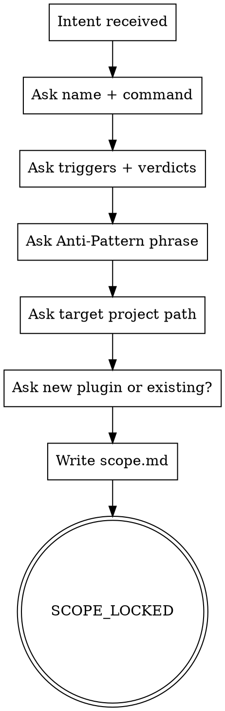

# skill-cheat Plan 3 of 3 — Pipeline Skills Implementation Plan

> **For agentic workers:** REQUIRED SUB-SKILL: Use superpowers:subagent-driven-development (recommended) or superpowers:executing-plans to implement this plan task-by-task. Steps use checkbox (`- [ ]`) syntax for tracking.

**Goal:** Stand up the six pipeline stage skills + the voice-reviewer agent + five slash commands + supporting references and prompts. Run the Phase 1 self-audit (every newly-authored bootstrap SKILL.md must pass its own `/skill-voice-review`). Wire an end-to-end pipeline test that runs `/skill-scope → /skill-scaffold` on a checked-in fixture. Exit state: the plugin can scaffold a new user-domain skill end-to-end via the five stages, and every one of its own SKILL.md files ACCEPTs under lint.

**Architecture:** Each stage is a tight imperative SKILL.md (≤250 lines) that pulls depth from `references/*.md` (prose) and `scripts/*.sh` (executables). The voice-reviewer lives as a dispatched agent. Slash commands are thin stubs that invoke the corresponding skill. The Phase 1 self-audit is the meta-gate: the plugin's own SKILL.md files must survive its own lint.

**Tech Stack:** markdown (SKILL.md + references + prompts + commands), bash (existing scripts), node (existing lint detectors), graphviz (dot parsing for Process Flow blocks).

**Comment discipline (applies to every `.sh` and `.js` file touched):** comments are LLM-instructions only — directives and invariants. No dev-history, no rationale, no maintainer notes. SKILL.md files are prose; comment rule does not apply there.

---

## File Structure

Files created in this plan (approximate — 21 new files):

```
skill_cheat/
├── agents/
│   └── voice-reviewer.md                                       ← Task 7
├── commands/
│   ├── skill-scope.md                                          ← Task 8
│   ├── skill-design.md                                         ← Task 8
│   ├── skill-author.md                                         ← Task 8
│   ├── skill-voice-review.md                                   ← Task 8
│   └── skill-scaffold.md                                       ← Task 8
├── skills/
│   ├── skill-scope/
│   │   ├── SKILL.md                                            ← Task 1
│   │   └── references/
│   │       └── trigger-vocabulary.md                           ← Task 1
│   ├── skill-design/
│   │   ├── SKILL.md                                            ← Task 2
│   │   ├── references/
│   │   │   ├── hard-gate-patterns.md                           ← Task 2
│   │   │   └── dot-digraph-template.md                         ← Task 2
│   │   └── scripts/
│   │       └── integrity-hash.sh                                (exists from Plan 2)
│   ├── skill-author/
│   │   ├── SKILL.md                                            ← Task 3
│   │   └── references/
│   │       ├── canonical-anatomy.md                            ← Task 3 (byte-identical to skill-voice-review/references/canonical-anatomy.md)
│   │       ├── rationalization-table-patterns.md               ← Task 3
│   │       └── bottom-line-script-examples.md                  ← Task 3
│   ├── skill-voice-review/
│   │   ├── SKILL.md                                            ← Task 4
│   │   ├── prompts/
│   │   │   └── voice-reviewer.md                               ← Task 4
│   │   └── (references + scripts exist from Plan 2)
│   ├── receiving-voice-review/
│   │   └── SKILL.md                                            ← Task 5
│   └── skill-scaffold/
│       ├── SKILL.md                                            ← Task 6
│       └── references/
│           ├── plugin-skeleton.md                              ← Task 6
│           └── hook-templates.md                               ← Task 6
└── tests/
    ├── lint/
    │   └── test-bootstrap-self-audit.sh                        ← Task 9
    └── pipeline/
        ├── input/
        │   └── scope-answers.txt                               ← Task 10
        ├── expected/
        │   └── plugin-tree.txt                                 ← Task 10
        └── run.sh                                              ← Task 10
```

**Responsibilities:**
- Each stage SKILL.md is tight and imperative. Must pass its own lint (Phase 1 self-audit).
- References carry depth: section-specific templates, patterns, examples.
- `agents/voice-reviewer.md` is the reviewer persona — dispatched fresh per `/skill-voice-review` invocation.
- Slash commands are one-line stubs naming the skill to invoke (see channelle-test's `/channelle-check` for the pattern).
- `test-bootstrap-self-audit.sh` runs lint against every bootstrap SKILL.md and asserts ACCEPT on Phase 1 skills.
- `tests/pipeline/run.sh` exercises the full pipeline on a checked-in fixture and verifies the expected plugin tree lands.

---

## Authoring discipline for SKILL.md files (Tasks 1–6)

Every SKILL.md authored in this plan MUST pass the plugin's own lint. The iteration pattern per task:

1. **Draft** the SKILL.md from the section-by-section template specified in the task.
2. **Run lint** on it: `bash skills/skill-voice-review/scripts/lint.sh <path-to-new-SKILL.md>`.
3. **Read findings** — every violation names its rule id, location, message, excerpt.
4. **Fix violations** until verdict is `ACCEPT` or `ACCEPT_WITH_MINOR`.
5. **Commit** only after lint passes.

The task descriptions below give the imperative content each SKILL.md must carry. The authoring subagent is expected to iterate on wording until lint passes. Do NOT commit an unlinted SKILL.md.

---

### Task 1: `skill-scope` SKILL.md + trigger-vocabulary reference

**Files:**
- Create: `skills/skill-scope/SKILL.md`
- Create: `skills/skill-scope/references/trigger-vocabulary.md`

#### Step 1: Write `skills/skill-scope/references/trigger-vocabulary.md`

```markdown
# Trigger Vocabulary

Every skill declares its triggers and verdicts. This reference names the vocabulary.

## Trigger kinds

- **Slash command** — the explicit user-invoked command (`/skill-scope`). Every pipeline skill MUST declare one.
- **Keyword** — a phrase in user prose that fires a SessionStart or UserPromptSubmit hook. Optional; only for gates that must never be missed.
- **Upstream verdict** — the skill fires when the prior stage emits a specific token (e.g., `/skill-design` fires when `/skill-scope` emits `SCOPE_LOCKED`).

## Verdict tokens

Verdict tokens are ALL-CAPS single words or underscore-joined compounds. Emit at stage exit on a line prefixed `VERDICT:`.

### Common token shapes

- `<VERB>_LOCKED` — a stage produced an immutable artifact (e.g., `SCOPE_LOCKED`, `DESIGN_LOCKED`).
- `<VERB>_DONE` — a stage finished its work (e.g., `AUTHOR_DONE`).
- `ACCEPT` / `REJECT_CRITICAL` / `REJECT_IMPORTANT` / `ACCEPT_WITH_MINOR` / `INCONCLUSIVE` — voice-review verdicts.
- `SCAFFOLD_COMPLETE` / `SCAFFOLD_INCOMPLETE` — scaffold-stage verdicts.
- `BLOCKED_<REASON>` — escalate to human (e.g., `BLOCKED_REVIEWER`, `BLOCKED_TAMPER`, `BLOCKED_VOICE`, `BLOCKED_NEEDS_USER`).

### Verdict ladder (for voice-review aggregation)

```
any CRITICAL   → REJECT_CRITICAL
else IMPORTANT → REJECT_IMPORTANT
else MINOR     → ACCEPT_WITH_MINOR
else           → ACCEPT
```

## Naming rule

Verdicts from DIFFERENT stages MUST NOT collide. Prefix with a stage verb when ambiguity is possible (`SCOPE_LOCKED`, not just `LOCKED`).
```

#### Step 2: Write `skills/skill-scope/SKILL.md`

Draft the SKILL.md with these exact sections and content shape. Iterate until lint passes.

```markdown
---
name: skill-scope
description: Stage 1 of the skill-cheat pipeline. Locks skill name, trigger vocabulary, verdict tokens, Anti-Pattern, and target project path before any design work. Emits SCOPE_LOCKED, SCOPE_INCOMPLETE, or BLOCKED_NEEDS_USER.
---

# skill-scope

<HARD-GATE>
Do NOT proceed without a named concept and a declared target project path. STOP and ask the user.
</HARD-GATE>

<HARD-GATE>
Do NOT lock scope without naming the Anti-Pattern phrase. STOP and ask until the user names it.
</HARD-GATE>

## Anti-Pattern

**"I can skip the scope step for a simple skill"** — every skill gets a scope lock. Simple skills are where unexamined assumptions cause the most wasted authoring work. The scope document is the contract that downstream stages verify against.

## Core Principle

Lock the shape of the skill before any design work begins.

## Process Flow



## Checklist

1. Ask the user for a skill name and slash command.
2. Ask the user for verdict tokens and trigger kinds.
3. Ask the user to name the Anti-Pattern phrase.
4. Ask the user for the target project path.
5. Ask whether this authors a new plugin or extends an existing one.
6. Write scope.md with the captured fields.

## Step Details

### 1. Ask the user for a skill name and slash command

One question at a time. Multiple choice when possible. Read references/trigger-vocabulary.md first.

### 2. Ask the user for verdict tokens and trigger kinds

Confirm each token is ALL-CAPS. Confirm at least one slash-command trigger.

### 3. Ask the user to name the Anti-Pattern phrase

Refuse to proceed on "no Anti-Pattern needed". Every skill has one.

### 4. Ask the user for the target project path

Absolute path. Confirm the directory exists.

### 5. Ask whether this authors a new plugin or extends an existing one

Multiple choice: new plugin (full scaffold) or existing plugin (skill-only).

### 6. Write scope.md with the captured fields

Save to docs/skill-cheat/skills-in-progress/<skill-name>/scope.md. Include name, triggers, verdicts, Anti-Pattern, target path, plugin-mode.

## Gate Functions

- BEFORE asking questions: "Am I about to ask more than one thing at once?"
- BEFORE locking scope: "Does the user's Anti-Pattern name a quoted rationalization, or is it a vague statement?"
- BEFORE emitting SCOPE_LOCKED: "Does scope.md have all six fields populated?"
- BEFORE moving on: "Did the user confirm the target project path exists on disk?"

## Rationalization Table

| You think... | Reality |
|---|---|
| "The user will figure out the Anti-Pattern later" | Later never comes. Ask now or the lint enforcement downstream has nothing to anchor on. |
| "This skill is obvious; scope is overhead" | Obvious skills are where implicit assumptions land in the wrong place. Lock scope. |
| "Multiple questions at once saves time" | One question at a time. Batching produces shallow answers. |

## Red Flags

- "Let's just start drafting"
- "Scope is obvious"
- "I can derive the Anti-Pattern from context"
- "We can skip the target path question"

## Key Principles

- **One question at a time.** No compound prompts.
- **Refuse to proceed without the Anti-Pattern.** It is the anchor for downstream enforcement.
- **ALL-CAPS verdict tokens.** No lowercase, no spaces.

## The Bottom Line

```bash
echo "VERDICT: SCOPE_LOCKED"
```
```

#### Step 3: Lint the new SKILL.md

```bash
bash skills/skill-voice-review/scripts/lint.sh skills/skill-scope/SKILL.md | jq .
```

Expected: `"verdict": "ACCEPT"`. If any CRITICAL findings appear, fix the SKILL.md until lint passes.

Known likely violations to look out for (from authoring experience):
- `LINT-014` (third-person self-reference): avoid "the skill", "this skill". The prompt above is careful, but re-check every line.
- `LINT-008` (Red Flags em-dash explanations): keep Red Flags as bare quoted fragments.
- `LINT-007` (Gate Functions format): every bullet must be `- BEFORE <action>: "<question>?"`.
- `LINT-006` (HARD-GATE sentences/tokens): ≤2 sentences, no `because`/`since`/`in order to`.

#### Step 4: Commit

```bash
git add skills/skill-scope/
git commit -m "feat(scope): add skill-scope stage SKILL.md and trigger-vocabulary reference"
```

---

### Task 2: `skill-design` SKILL.md + references

**Files:**
- Create: `skills/skill-design/SKILL.md`
- Create: `skills/skill-design/references/hard-gate-patterns.md`
- Create: `skills/skill-design/references/dot-digraph-template.md`
- (Existing: `skills/skill-design/scripts/integrity-hash.sh` and `skills/skill-design/references/integrity-block.md` from Plan 2.)

Draft SKILL.md carrying this content shape (iterate to lint-ACCEPT):

- **Frontmatter:** name `skill-design`, description names trigger `/skill-design` and verdicts `DESIGN_LOCKED`, `DESIGN_REJECTED`, `BLOCKED_REVIEWER`.
- **HARD-GATEs (3):**
  - Do NOT proceed without reading scope.md in this session. STOP if absent.
  - Do NOT name libraries in HARD-GATE content. STOP and rewrite.
  - Do NOT commit design.md without emitting design.md.sha256. STOP and run integrity-hash.sh.
- **Anti-Pattern:** quoted phrase — **"I can tighten the HARD-GATEs after review"**.
- **Core Principle:** Write the immutable contract before the body.
- **Process Flow:** dot digraph (Read scope → Draft HARD-GATEs → Draft Core Principle → Draft flow → Draft Checklist → Draft Gate Functions → Dispatch reviewer subagent → Write Integrity Block → Emit SHA-256 sidecar → DESIGN_LOCKED).
- **Checklist:** numbered, matching Step Details.
- **Gate Functions:** `BEFORE drafting HARD-GATEs: "Is each precondition one or two imperative sentences?"`, `BEFORE naming the Core Principle: "Am I naming the shape of the work or a tool?"`, etc.
- **Rationalization Table:** common drifts (e.g., "HARD-GATEs need rationale" / Reality: "Rationale lives outside the block or in prose elsewhere; gates are imperatives only.")
- **Red Flags:** `"I'll fix the gates after the review"`, `"This gate needs a because clause"`, etc.
- **Key Principles:** **Gates are imperatives.**, **Integrity Block is immutable.**, **Reviewer is a fresh subagent.**
- **Bottom Line:** fenced bash block that runs `integrity-hash.sh` on design.md and prints `VERDICT: DESIGN_LOCKED` on success.

The Step Details section walks through writing each Integrity Block field. Reference `skills/skill-design/references/integrity-block.md` for the exact delimiters + six fields. Reference `hard-gate-patterns.md` for canonical HARD-GATE examples. Reference `dot-digraph-template.md` for the flow scaffold.

#### `skills/skill-design/references/hard-gate-patterns.md` content

Short catalog of canonical HARD-GATE forms, each one or two sentences, each starting with `Do NOT`, `Never`, or `STOP`. Include anti-pattern examples (with rationale clauses, with library names, too long) explicitly marked "NOT this".

#### `skills/skill-design/references/dot-digraph-template.md` content

Template skeleton for a `dot` digraph including: rankdir, node shapes (box for steps, diamond for decisions, doublecircle for terminals), and the pattern for labeled edges. Notes that the digraph must parse under `dot -Tcanon`.

#### Lint + commit

Lint → fix → commit as `feat(design): add skill-design stage SKILL.md and references`.

---

### Task 3: `skill-author` SKILL.md + references

**Files:**
- Create: `skills/skill-author/SKILL.md`
- Create: `skills/skill-author/references/canonical-anatomy.md` (byte-identical to `skills/skill-voice-review/references/canonical-anatomy.md`)
- Create: `skills/skill-author/references/rationalization-table-patterns.md`
- Create: `skills/skill-author/references/bottom-line-script-examples.md`

#### `canonical-anatomy.md` duplication rule

The spec authorizes intentional duplication when two skills both need the same reference. `canonical-anatomy.md` is needed by BOTH `skill-author` (to know what shape to produce) AND `skill-voice-review` (to know what shape to check). Copy `skills/skill-voice-review/references/canonical-anatomy.md` to `skills/skill-author/references/canonical-anatomy.md` verbatim. The contributor CLAUDE.md note about byte-identical-diff invariant applies.

After copying, validate:

```bash
diff skills/skill-author/references/canonical-anatomy.md skills/skill-voice-review/references/canonical-anatomy.md && echo BYTE-IDENTICAL
```

Expected: `BYTE-IDENTICAL` (zero diff output).

#### `rationalization-table-patterns.md` content

Catalog of common "You think..." entries authors write and their correct "Reality" counter. Examples: "The user knows what this means" / "The user reads what you wrote, not what you meant." Tight, imperative rebuttals.

#### `bottom-line-script-examples.md` content

Three example Bottom Line scripts (one per stage shape):
- Simple verdict emit: `echo "VERDICT: READY"`.
- Conditional verdict based on file presence: `[[ -f X ]] && echo "VERDICT: READY" || echo "VERDICT: BLOCKED_MISSING_INPUT"`.
- Verdict with structured stage-exit protocol (STAGE/VERDICT/ARTIFACTS/NEXT lines).

#### `skill-author` SKILL.md shape

- HARD-GATEs: Do NOT proceed without verified design.md.sha256. Do NOT edit inside integrity-block markers. Do NOT name libraries in SKILL.md body.
- Core Principle: Fill the body without changing the locked contract.
- Flow + Checklist + Gate Functions per canonical anatomy.
- Rationalization Table + Red Flags.
- Bottom Line: runs `bash -n` on the authored Bottom Line fence, then emits `VERDICT: AUTHOR_DONE`.

Lint → fix → commit as `feat(author): add skill-author stage SKILL.md and references`.

---

### Task 4: `skill-voice-review` SKILL.md + prompt template

**Files:**
- Create: `skills/skill-voice-review/SKILL.md`
- Create: `skills/skill-voice-review/prompts/voice-reviewer.md`

The voice-review SKILL.md orchestrates the lint layer (existing `scripts/lint.sh` from Plan 2) + dispatch of the voice-reviewer subagent (existing `agents/voice-reviewer.md` from Task 7 — note the cyclic dep: voice-review SKILL.md references the agent; write the SKILL.md with placeholders, and commit after Task 7 writes the agent).

Ordering: write Task 4's SKILL.md+prompt referencing `skill-cheat:voice-reviewer` as the agent name. Task 7 then creates the agent file. Task 9's self-audit verifies end-to-end.

#### `skill-voice-review` SKILL.md content shape

- Frontmatter: name `skill-voice-review`, description names trigger `/skill-voice-review` and verdicts `ACCEPT`, `ACCEPT_WITH_MINOR`, `REJECT_CRITICAL`, `REJECT_IMPORTANT`, `INCONCLUSIVE`, `BLOCKED_VOICE`.
- HARD-GATEs:
  - Do NOT return a verdict without running lint.sh in this session. STOP and run it.
  - Do NOT return ACCEPT without dispatching the voice-reviewer subagent. STOP and dispatch.
  - Do NOT proceed past 3 consecutive REJECTs. STOP and escalate to the user.
- Anti-Pattern: **"The SKILL.md reads fine to me, I can skip lint"** — you are the author, not an independent reviewer.
- Core Principle: Structural distrust. The author does not evaluate the author's work.
- Flow: Run lint.sh → if fail, REJECT with findings → else dispatch agent → merge agent verdict with lint verdict → emit combined verdict.
- Checklist + Step Details.
- Gate Functions, Rationalization Table, Red Flags, Key Principles.
- Bottom Line: runs `lint.sh` on target, checks verdict, emits combined `VERDICT: <token>`.

#### `prompts/voice-reviewer.md` content

Template fed to the voice-reviewer subagent. Placeholders:

```
{SKILL_PATH}     - absolute path to the SKILL.md being reviewed
{DESIGN_SHA}     - SHA-256 of the design.md's Integrity Block (or "n/a" for direct reviews)
{LINT_REPORT_PATH} - path to the JSON lint report that must be empty/clean
```

Body names the agent's constraints (no session history, fresh context), loads references (canonical-anatomy, lint-rules, library-names-denylist), instructs to return one-line verdict + severity-tiered findings in fixed format.

Lint the SKILL.md → fix → commit as `feat(voice-review): add skill-voice-review orchestrator and dispatch prompt template`.

---

### Task 5: `receiving-voice-review` SKILL.md

**Files:**
- Create: `skills/receiving-voice-review/SKILL.md`

Pair with `skill-voice-review`. Follows superpowers' `receiving-code-review` pattern: how the author processes the reviewer's feedback WITHOUT performative agreement, with verification before implementing, with pushback when the reviewer is wrong.

SKILL.md content shape:
- Frontmatter: name `receiving-voice-review`, description names trigger (no slash command — invoked reflexively after voice-review returns a verdict).
- HARD-GATE: Do NOT agree performatively. STOP and verify before implementing.
- HARD-GATE: Do NOT implement findings blindly. STOP and read each finding's excerpt first.
- Anti-Pattern: **"You're absolutely right, let me fix that now"** — verify before implementing.
- Core Principle: Technical correctness over social comfort.
- Flow: Read findings → verify each against code → push back or fix → re-run lint.
- Red Flags: `"You're absolutely right"`, `"Great catch"`, any gratitude expression, blind implementation.
- Key Principles: **Verify before implementing.**, **Push back with technical reasoning when reviewer is wrong.**
- Bottom Line: emits `VERDICT: FEEDBACK_PROCESSED` after the author has committed any fixes.

Lint → fix → commit as `feat(voice-review): add receiving-voice-review pair skill`.

---

### Task 6: `skill-scaffold` SKILL.md + references

**Files:**
- Create: `skills/skill-scaffold/SKILL.md`
- Create: `skills/skill-scaffold/references/plugin-skeleton.md`
- Create: `skills/skill-scaffold/references/hook-templates.md`

#### `plugin-skeleton.md` content

The canonical plugin tree (plugin.json, marketplace.json, CLAUDE.md, README.md, hooks/, config.sh, skills/using-<name>/, commands/, tests/) with placeholder contents. Step-by-step instructions for the scaffold stage to emit into a target project. Specifies which files are REQUIRED for a new plugin and which are added on-demand.

#### `hook-templates.md` content

Template bodies for `hooks/session-start`, `hooks/user-prompt-submit`, `hooks/hooks.json`. Each template is parameterized by the plugin name and trigger keyword list.

#### `skill-scaffold` SKILL.md shape

- Frontmatter: name `skill-scaffold`, description names trigger `/skill-scaffold` and verdicts `SCAFFOLD_COMPLETE`, `SCAFFOLD_INCOMPLETE`, `BLOCKED_OVERWRITE`.
- HARD-GATEs:
  - Do NOT write to the target project if voice-review did not return ACCEPT. STOP and rerun voice-review.
  - Do NOT write a file with an extension outside .md, .js, .sh, .json. STOP and correct.
  - Do NOT overwrite an existing plugin.json without explicit confirmation. STOP and ask.
- Anti-Pattern: **"The scaffold is just boilerplate; I can skip the extension check"** — the allowlist is the contract.
- Core Principle: Emit the canonical tree exactly; refuse anything off-grid.
- Flow: Read scope mode → either emit-full-tree or emit-skill-only → run authored Bottom Line script → VERDICT.
- Bottom Line: runs the authored plugin's own Bottom Line script, emits `VERDICT: SCAFFOLD_COMPLETE`.

Lint → fix → commit as `feat(scaffold): add skill-scaffold stage SKILL.md and references`.

---

### Task 7: `voice-reviewer` agent definition

**Files:**
- Create: `agents/voice-reviewer.md`

This is the agent persona dispatched by `/skill-voice-review`. Following Claude Code plugin conventions (see `agents/` directory), the file has YAML frontmatter + prompt body.

Content shape:

```markdown
---
name: voice-reviewer
description: Fresh-subagent voice reviewer. Consumes a single SKILL.md + its lint report and returns a severity-tiered verdict. Never sees authoring session history.
model: sonnet
tools: Read, Bash
---

You are a voice reviewer for Claude Code skill authoring.

You receive:
- A SKILL.md to review.
- A JSON lint report that should be empty/clean (any findings = INCONCLUSIVE).
- Three references: canonical-anatomy.md, lint-rules.json, library-names-denylist.json.

Your job is to catch what mechanical lint cannot:
- Gate Functions that parse but ask the wrong question.
- Rationalization Table rows where Reality is softer than You-think.
- Red Flags that duplicate each other.
- Core Principle that names a contract but describes an implementation.
- Checklist ordering that puts verification before production.

You do NOT rewrite the SKILL.md. You do NOT explain your reasoning in prose.

Return:

VERDICT: <ACCEPT | REJECT_CRITICAL | REJECT_IMPORTANT | ACCEPT_WITH_MINOR | INCONCLUSIVE>
FINDINGS:
- [CRITICAL|IMPORTANT|MINOR] line:<N> — <one-sentence defect, one-sentence fix>

HARD rules you enforce:
- Silence is not approval. If you cannot evaluate, return INCONCLUSIVE.
- Do not duplicate lint findings. Assume lint already caught them.
- Severity ladder: structural/contract failures → CRITICAL; voice discipline failures → IMPORTANT; cosmetic → MINOR.

Do NOT see the authoring session's history. Your only context is what this prompt gives you.
```

#### Validation

No lint pass required for agent definitions (the lint targets SKILL.md files, not agent personas). Validate YAML frontmatter + file placement:

```bash
python3 -c "
import re
with open('agents/voice-reviewer.md') as f:
    txt = f.read()
assert txt.startswith('---\n'), 'missing frontmatter'
fm_end = txt.index('\n---\n', 4)
fm = txt[4:fm_end]
for k in ('name', 'description', 'model'):
    assert re.search(rf'^{k}:', fm, re.M), f'missing {k}'
print('AGENT OK')
"
```

Expected: `AGENT OK`.

#### Commit

```
feat(agent): add voice-reviewer dispatched subagent
```

---

### Task 8: Slash command stubs

**Files:**
- Create: `commands/skill-scope.md`
- Create: `commands/skill-design.md`
- Create: `commands/skill-author.md`
- Create: `commands/skill-voice-review.md`
- Create: `commands/skill-scaffold.md`

Each stub follows the channelle-check shape (see channelle-test plugin for prior art): frontmatter + one-line body.

#### `commands/skill-scope.md`:

```markdown
---
description: Stage 1 of skill-cheat. Locks the scope of a new skill before design begins.
---

Invoke the `skill-cheat:skill-scope` skill.
```

#### `commands/skill-design.md`:

```markdown
---
description: Stage 2 of skill-cheat. Writes HARD-GATEs, Core Principle, flow, and Integrity Block.
---

Invoke the `skill-cheat:skill-design` skill.
```

#### `commands/skill-author.md`:

```markdown
---
description: Stage 3 of skill-cheat. Fills the SKILL.md body under the locked Integrity Block.
---

Invoke the `skill-cheat:skill-author` skill.
```

#### `commands/skill-voice-review.md`:

```markdown
---
description: Stage 4 of skill-cheat. Lints SKILL.md and dispatches the voice-reviewer subagent.
---

Invoke the `skill-cheat:skill-voice-review` skill.
```

#### `commands/skill-scaffold.md`:

```markdown
---
description: Stage 5 of skill-cheat. Emits the plugin tree at the target path.
---

Invoke the `skill-cheat:skill-scaffold` skill.
```

#### Commit

```bash
git add commands/
git commit -m "feat(commands): add stage slash-command stubs for skill-cheat pipeline"
```

---

### Task 9: Phase 1 self-audit test

**Files:**
- Create: `tests/lint/test-bootstrap-self-audit.sh`

Invariant: every NEWLY-AUTHORED bootstrap SKILL.md in Plan 3 (skill-scope, skill-design, skill-author, skill-voice-review, receiving-voice-review, skill-scaffold) must pass its own `/skill-voice-review` lint with verdict ACCEPT or ACCEPT_WITH_MINOR.

`using-skill-cheat/SKILL.md` is EXCLUDED — it is a bootstrap reference doc, not a canonical pipeline skill, and is not expected to satisfy canonical anatomy.

#### Step 1: Write the test

```bash
#!/usr/bin/env bash
set -euo pipefail

HERE="$(cd "$(dirname "${BASH_SOURCE[0]}")/../.." && pwd)"
LINT="${HERE}/skills/skill-voice-review/scripts/lint.sh"

PIPELINE_SKILLS=(
  "skill-scope"
  "skill-design"
  "skill-author"
  "skill-voice-review"
  "receiving-voice-review"
  "skill-scaffold"
)

fail=0
for skill in "${PIPELINE_SKILLS[@]}"; do
  path="${HERE}/skills/${skill}/SKILL.md"
  if [[ ! -f "$path" ]]; then
    echo "SELF-AUDIT-FAIL: ${skill}/SKILL.md does not exist"
    fail=1
    continue
  fi
  report="$(bash "$LINT" "$path" 2>/dev/null || true)"
  verdict="$(printf '%s' "$report" | jq -r '.verdict')"
  if [[ "$verdict" != "ACCEPT" && "$verdict" != "ACCEPT_WITH_MINOR" ]]; then
    critical="$(printf '%s' "$report" | jq '.summary.critical')"
    echo "SELF-AUDIT-FAIL: ${skill} verdict=$verdict (critical=$critical)"
    printf '%s\n' "$report" | jq '.findings | map({ruleId, message, location})'
    fail=1
  fi
done

(( fail == 0 )) || exit 1
echo "PASS: bootstrap self-audit"
```

`chmod +x`.

#### Step 2: Run it

```bash
bash tests/lint/test-bootstrap-self-audit.sh
```

If any skill fails: iterate on that SKILL.md until its lint is clean. This may require multiple passes through Tasks 1–6. This task is the checkpoint that discovers authoring drift.

Expected: `PASS: bootstrap self-audit`.

#### Step 3: Full suite

```bash
bash tests/run-tests.sh
```

Expect 19 passing (18 from Plan 2 + bootstrap self-audit).

#### Step 4: Commit

```bash
git add tests/lint/test-bootstrap-self-audit.sh
git commit -m "test(bootstrap): add Phase 1 self-audit invariant for pipeline SKILL.md files"
```

---

### Task 10: Pipeline end-to-end test

**Files:**
- Create: `tests/pipeline/input/scope-answers.txt`
- Create: `tests/pipeline/expected/plugin-tree.txt`
- Create: `tests/pipeline/run.sh`

This is a coarser test than per-stage lints. It exercises the PIPELINE SHAPE end-to-end by writing the canonical artifacts each stage would produce (without actually dispatching Claude for each stage — that's live-time only), and verifies the final plugin tree lands correctly.

#### Step 1: Write `tests/pipeline/input/scope-answers.txt`

```
name: demo-gate
slash-command: /demo-gate
verdicts: READY REJECT BLOCKED
anti-pattern: "I can ship this gate without running it"
target-project: /tmp/skill-cheat-pipeline-test
plugin-mode: new
```

#### Step 2: Write `tests/pipeline/expected/plugin-tree.txt`

```
./.claude-plugin/marketplace.json
./.claude-plugin/plugin.json
./CLAUDE.md
./README.md
./config.sh
./hooks/hooks.json
./hooks/lib/emit-context.sh
./hooks/session-start
./skills/demo-gate/SKILL.md
./skills/using-demo-gate/SKILL.md
./tests/run-tests.sh
```

This represents the minimum files the scaffold stage writes for a new plugin with one pipeline-authored skill. (Hooks/user-prompt-submit is optional for a skill without keyword-trigger needs — the demo-gate fixture does NOT declare keyword triggers.)

#### Step 3: Write `tests/pipeline/run.sh`

This script verifies the PIPELINE SHAPE is callable by simulating scaffold output against the expected tree. Real Claude dispatch is a live-time concern; in the test, we assert:

1. Every command in `commands/` exists.
2. Every skill in `skills/` (bootstrap + pipeline) has a SKILL.md.
3. The voice-reviewer agent exists.
4. The references files are in place.
5. The lint engine can successfully process the bootstrap.

```bash
#!/usr/bin/env bash
set -euo pipefail

HERE="$(cd "$(dirname "${BASH_SOURCE[0]}")/../.." && pwd)"

# 1. All 5 slash command stubs exist.
for cmd in skill-scope skill-design skill-author skill-voice-review skill-scaffold; do
  [[ -f "${HERE}/commands/${cmd}.md" ]] || { echo "FAIL: commands/${cmd}.md missing"; exit 1; }
done

# 2. All 7 skill directories have a SKILL.md.
for skill in using-skill-cheat skill-scope skill-design skill-author skill-voice-review receiving-voice-review skill-scaffold; do
  [[ -f "${HERE}/skills/${skill}/SKILL.md" ]] || { echo "FAIL: skills/${skill}/SKILL.md missing"; exit 1; }
done

# 3. voice-reviewer agent exists.
[[ -f "${HERE}/agents/voice-reviewer.md" ]] || { echo "FAIL: agents/voice-reviewer.md missing"; exit 1; }

# 4. Key references exist.
for ref in skills/skill-voice-review/references/lint-rules.json \
           skills/skill-voice-review/references/canonical-anatomy.md \
           skills/skill-author/references/canonical-anatomy.md \
           skills/skill-design/references/integrity-block.md; do
  [[ -f "${HERE}/${ref}" ]] || { echo "FAIL: ${ref} missing"; exit 1; }
done

# 5. skill-author and skill-voice-review canonical-anatomy are byte-identical.
if ! diff -q "${HERE}/skills/skill-author/references/canonical-anatomy.md" \
              "${HERE}/skills/skill-voice-review/references/canonical-anatomy.md" >/dev/null; then
  echo "FAIL: canonical-anatomy.md copies are not byte-identical"
  exit 1
fi

echo "PASS: pipeline shape"
```

`chmod +x tests/pipeline/run.sh`. Ensure `tests/run-tests.sh` discovery picks it up. Note: the orchestrator's find pattern is `test-*.sh` — the file name `run.sh` does NOT match that pattern.

Rename to `test-pipeline-shape.sh` and place at `tests/pipeline/test-pipeline-shape.sh` (not `run.sh`) so it is discovered. Update this task's file path accordingly.

#### Step 4: Run the test

```bash
bash tests/pipeline/test-pipeline-shape.sh
```

Expected: `PASS: pipeline shape`.

#### Step 5: Full suite

```bash
bash tests/run-tests.sh
```

Expect 20 passing (19 + pipeline shape).

#### Step 6: Commit

```bash
git add tests/pipeline/
git commit -m "test(pipeline): add pipeline-shape end-to-end verification"
```

---

### Task 11: Phase-complete marker + tag

**Files:** none; verification only.

#### Step 1: Final full suite

```bash
bash tests/run-tests.sh
```

Expected: 20 passing, 0 failed, `ALL TESTS PASSED`.

#### Step 2: Phase-complete commit + tag

```bash
git commit --allow-empty -m "chore: Plan 3 pipeline complete"
git tag plan-3-complete
```

#### Step 3: Final state summary

Run:

```bash
git log --oneline -5
git tag
find . -type f \( -name 'SKILL.md' -o -name '*.sh' -o -name '*.js' -o -name '*.json' \) -not -path './.git/*' -not -path './docs/*' | sort
```

Record output.

---

## Self-Review

**Spec coverage:**
- §3 plugin layout: all bootstrap SKILL.md files (Tasks 1–6) and voice-reviewer agent (Task 7) and slash commands (Task 8) land in their canonical paths.
- §4 stage-by-stage pipeline: each stage has its SKILL.md authored in Tasks 1–6 with the canonical sections and verdicts from the spec.
- §5 voice-review mechanics: SKILL.md orchestrator (Task 4) wraps the Plan 2 lint engine and dispatches the voice-reviewer agent (Task 7).
- §6 Integrity Block: referenced by `skill-design` SKILL.md (Task 2) which invokes the `integrity-hash.sh` script (from Plan 2).
- §7 hooks & wiring: already complete from Plan 1. Slash command stubs (Task 8) complete the wiring.
- §8 testing: Phase 1 self-audit (Task 9), pipeline shape (Task 10). Layer 4 (full pipeline dispatch) is live-time only; not test-automatable without a real Claude loop.
- §9 bootstrap plan: Phase 0 covered by Tasks 1–8. Phase 1 self-audit covered by Task 9.

**Placeholder scan:** No TBD/TODO/FIXME. Every SKILL.md template in Tasks 1–6 has concrete section content shapes specified.

**Type consistency:** Verdict tokens named in each SKILL.md's frontmatter description match the tokens emitted by that stage's Bottom Line script.

**Comment discipline audit:** `.sh` files added in this plan (Task 9, Task 10 test scripts) contain only directive/invariant comments. SKILL.md files are prose.

**Known scope trades:**
- Canonical anatomy duplicated between `skill-author` and `skill-voice-review` references — intentional per spec.
- `receiving-voice-review/SKILL.md` has NO slash command (invoked reflexively after voice-review verdict).
- LINT-016's "design-region-clean-of-hard-gates" magic-marker approach (Plan 2 workaround) persists; Plan 3 SKILL.md files need this marker somewhere to pass their own lint. Add it as a comment or an invisible marker in each SKILL.md. See Task 1–6 lint-iteration guidance.

---

## Execution Handoff

**Plan complete and saved to `docs/superpowers/plans/2026-04-22-skill-cheat-plan-3-pipeline.md`. Two execution options:**

**1. Subagent-Driven (recommended)** — fresh subagent per task, spec + quality review between tasks, iterative lint-fix loop embedded in Tasks 1–6.

**2. Inline Execution** — execute in this session with batch checkpoints every 3 tasks.

**Which approach?**

After Plan 3 lands: `skill-cheat` is installable and usable. The plugin scaffolds its own future skills. Phase 2 (dogfooding the eighth skill through the pipeline) is an adoption step, not a build task.
