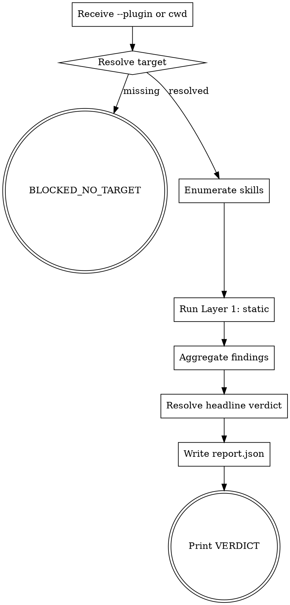
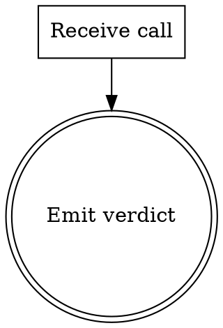

# plugin-validator Plan 1 of 5 — Foundation + Layer 1 (Static) Implementation Plan

> **For agentic workers:** REQUIRED SUB-SKILL: Use superpowers:subagent-driven-development (recommended) or superpowers:executing-plans to implement this plan task-by-task. Steps use checkbox (`- [ ]`) syntax for tracking.

**Goal:** Stand up the `/skill-stress-test` skill with enough scaffolding to validate any connected plugin through Layer 1 (static lint). Exit state: invoking `/skill-stress-test --plugin <path>` walks every `SKILL.md` in the target, runs the existing voice-review lint engine, writes a manifest + static-layer findings to `<target>/.skill-cheat-qa/runs/<run-id>/report.json`, and prints a headline verdict of `VALIDATION_CLEAN`, `PLUGIN_DRIFT`, `VALIDATION_INCONCLUSIVE`, or `BLOCKED_NO_TARGET`. No behavioral layer. No E2E layer. No mutation engine. No HTML report.

**Architecture:** A new skill at `skills/skill-stress-test/`. Single-process orchestrator in Node.js (`qa-orchestrator.js`) drives a single shell wrapper (`layer-static.sh`) that fans `lint.sh` across every `SKILL.md` it discovers. Findings collected into a typed JSON report. Verdict resolution is pure-function JavaScript. The skill's own `SKILL.md` follows the canonical 13-section anatomy and passes our own lint engine (dogfood).

**Tech Stack:** `bash` (≥4), `node` (≥18, ESM), `jq`, `git`. Reuses `skills/skill-voice-review/scripts/lint.sh` and `lint-rules.json` unchanged.

**Comment discipline (applies to every `.sh` and `.js` code block in this plan):** comments are LLM-instructions only — directives and invariants. No change-history, no rationale, no maintainer notes. Omit comments entirely when no directive is load-bearing.

---

## File Structure

Files created in this plan (16 total):

```
skill_cheat/
├── skills/
│   └── skill-stress-test/
│       ├── SKILL.md                                       ← Task 1
│       ├── lint.json                                      ← Task 1 (LINT overrides for self-audit)
│       ├── references/
│       │   ├── sub-verdict-vocabulary.md                  ← Task 2
│       │   └── report-schema.json                         ← Task 3
│       └── scripts/
│           ├── connect-plugin.sh                          ← Task 5
│           ├── layer-static.sh                            ← Task 6
│           ├── report-writer.js                           ← Task 7
│           ├── verdict-resolver.js                        ← Task 8
│           └── qa-orchestrator.js                         ← Task 9
└── tests/
    └── qa-harness/
        ├── fixtures/
        │   ├── clean-plugin/                              ← Task 4
        │   │   ├── .claude-plugin/plugin.json
        │   │   └── skills/sample-clean/SKILL.md
        │   └── drift-plugin/                              ← Task 4
        │       ├── .claude-plugin/plugin.json
        │       └── skills/sample-drift/SKILL.md
        ├── test-connect-plugin.sh                         ← Task 5
        ├── test-layer-static.sh                           ← Task 6
        ├── test-report-writer.sh                          ← Task 7
        ├── test-verdict-resolver.sh                       ← Task 8
        ├── test-orchestrator-layer1.sh                    ← Task 9
        └── test-self-validation.sh                        ← Task 10
```

**Responsibilities:**
- `skills/skill-stress-test/SKILL.md` — canonical 13-section anatomy; emits `VALIDATION_CLEAN` / `PLUGIN_DRIFT` / `VALIDATION_INCONCLUSIVE` / `BLOCKED_NO_TARGET`.
- `skills/skill-stress-test/lint.json` — extends parent lint rules; no disables required.
- `references/sub-verdict-vocabulary.md` — defines per-layer sub-verdicts.
- `references/report-schema.json` — JSON Schema for `report.json`.
- `scripts/connect-plugin.sh` — resolves target plugin path (explicit `--plugin` or cwd-detect); emits normalized manifest JSON on stdout.
- `scripts/layer-static.sh` — discovers every `skills/*/SKILL.md` in the target, runs `lint.sh` on each, aggregates findings.
- `scripts/report-writer.js` — composes manifest + per-layer findings into `report.json` on disk.
- `scripts/verdict-resolver.js` — pure function: layers → headline verdict by precedence.
- `scripts/qa-orchestrator.js` — entry point; orchestrates connect → layer-static → report → verdict.

---

## Task 1: Scaffold the skill-stress-test directory + SKILL.md

**Files:**
- Create: `skills/skill-stress-test/SKILL.md`
- Create: `skills/skill-stress-test/lint.json`
- Create: `skills/skill-stress-test/scripts/.gitkeep`
- Create: `skills/skill-stress-test/references/.gitkeep`

- [ ] **Step 1: Create the skill directory tree**

```bash
mkdir -p skills/skill-stress-test/scripts skills/skill-stress-test/references
touch skills/skill-stress-test/scripts/.gitkeep skills/skill-stress-test/references/.gitkeep
```

- [ ] **Step 2: Write the SKILL.md with canonical 13-section anatomy**

Create `skills/skill-stress-test/SKILL.md`:

```markdown
---
name: skill-stress-test
description: Stress-tests any connected Claude Code plugin. Trigger /skill-stress-test whenever the user says "stress-test this plugin", "validate the skills in <path>", "QA the channelle-test plugin", "run the harness against runbug", or "find blind spots in my plugin". Walks every SKILL.md in the target plugin, runs the voice-review lint engine, and emits a graded report with one of VALIDATION_CLEAN, PLUGIN_DRIFT, VALIDATION_INCONCLUSIVE, or BLOCKED_NO_TARGET as the headline verdict.
---
<!-- design-region-clean-of-hard-gates -->

# skill-stress-test

<HARD-GATE>
Never write a report without a verified target manifest. STOP and resolve --plugin first.
</HARD-GATE>

<HARD-GATE>
Never mutate the target plugin during a static run. STOP if any layer attempts a write outside `.skill-cheat-qa/`.
</HARD-GATE>

## Anti-Pattern

**"I can skip the static layer for a simple plugin"** — simple plugins are where unexamined lint failures hide longest. Every connected plugin gets the static layer regardless of size.

## Core Principle

Validate every SKILL.md against the same contract that authored it.

## Process Flow



## Checklist

1. Resolve the target plugin from `--plugin` or cwd.
2. Enumerate every `skills/*/SKILL.md` in the target.
3. Run the static layer on each enumerated SKILL.md.
4. Aggregate per-skill findings into a layer-level sub-verdict.
5. Resolve the headline verdict by precedence.
6. Write the report and print the verdict.

## Step Details

### 1. Resolve the target plugin from --plugin or cwd

Run `bash scripts/connect-plugin.sh --plugin <path>` or, without `--plugin`, from a directory containing `.claude-plugin/plugin.json`. The script emits a normalized manifest JSON to stdout or exits non-zero with `BLOCKED_NO_TARGET`.

### 2. Enumerate every skills/*/SKILL.md in the target

The orchestrator reads the manifest and globs `<target>/skills/*/SKILL.md`. Empty enumeration is not a failure; it is a `VALIDATION_INCONCLUSIVE` with `reason: "no skills found"`.

### 3. Run the static layer on each enumerated SKILL.md

`bash scripts/layer-static.sh --target <path>` fans `skill-voice-review/scripts/lint.sh` across every enumerated `SKILL.md` and emits a single JSON object with per-skill findings.

### 4. Aggregate per-skill findings into a layer-level sub-verdict

The layer's sub-verdict is the worst of all per-skill verdicts: `REJECT_CRITICAL > REJECT_IMPORTANT > ACCEPT_WITH_MINOR > ACCEPT`.

### 5. Resolve the headline verdict by precedence

`node scripts/verdict-resolver.js` consumes the layer sub-verdicts and emits the headline. Precedence: `BLOCKED_NO_TARGET > VALIDATION_INCONCLUSIVE > PLUGIN_DRIFT > VALIDATION_CLEAN`. (Plan 4 adds `HARNESS_GAP` above `PLUGIN_DRIFT`.)

### 6. Write the report and print the verdict

`node scripts/report-writer.js` writes `<target>/.skill-cheat-qa/runs/<run-id>/report.json`. The Bottom Line bash reads that file and prints `VERDICT: <headline>`.

## Gate Functions

- BEFORE running any layer: "Did connect-plugin.sh return a resolved manifest?"
- BEFORE writing report.json: "Does the report match references/report-schema.json?"
- BEFORE printing the headline verdict: "Did every enumerated SKILL.md produce a sub-verdict?"
- BEFORE emitting VALIDATION_CLEAN: "Did the static layer return ACCEPT for every skill?"

## Rationalization Table

| You think... | Reality |
|---|---|
| "Skip the static layer for a simple plugin" | Run every layer regardless. Simple plugins fail silently the longest. |
| "Accept ACCEPT_WITH_MINOR as clean" | Treat ACCEPT_WITH_MINOR as PLUGIN_DRIFT. Minor findings are still drift the author owns. |
| "Print the verdict before writing the report" | Write the report first. The report is the audit trail; the verdict is its summary. |

## Red Flags

- "Just lint the obvious skills"
- "Skip writing the report; the verdict is enough"
- "ACCEPT_WITH_MINOR is basically clean"
- "Layer 1 alone is the full validation"

## Key Principles

- **Connect before validating.** No target, no run.
- **Worst skill wins the layer.** Aggregation by maximum severity.
- **Write the report before the verdict.** Audit trail first.

## The Bottom Line

```bash
#!/usr/bin/env bash
set -euo pipefail
target="${1:-$PWD}"
run_id="$(date -u +%Y-%m-%dT%H-%M-%S)-$(openssl rand -hex 4)"
report_dir="${target}/.skill-cheat-qa/runs/${run_id}"
mkdir -p "$report_dir"
manifest="$(bash skills/skill-stress-test/scripts/connect-plugin.sh --plugin "$target")" \
  || { echo "VERDICT: BLOCKED_NO_TARGET"; exit 1; }
echo "$manifest" > "${report_dir}/manifest.json"
static_findings="$(bash skills/skill-stress-test/scripts/layer-static.sh --target "$target")"
echo "$static_findings" > "${report_dir}/static-findings.json"
node skills/skill-stress-test/scripts/report-writer.js \
  --manifest "${report_dir}/manifest.json" \
  --static "${report_dir}/static-findings.json" \
  --output "${report_dir}/report.json"
verdict="$(node skills/skill-stress-test/scripts/verdict-resolver.js --report "${report_dir}/report.json")"
echo "VERDICT: ${verdict}"
```
```

- [ ] **Step 3: Write the lint.json overrides**

Create `skills/skill-stress-test/lint.json`:

```json
{
  "extends": "../skill-voice-review/references/lint-rules.json",
  "disable": []
}
```

- [ ] **Step 4: Run our own lint engine on the new SKILL.md**

Run: `bash skills/skill-voice-review/scripts/lint.sh skills/skill-stress-test/SKILL.md`
Expected: stdout is a JSON object with `verdict: "ACCEPT"` or `verdict: "ACCEPT_WITH_MINOR"`. Exit 0.

If lint fails: fix the offending line in `SKILL.md` (most likely a stray hedge word or third-person bigram).

- [ ] **Step 5: Commit**

```bash
git add skills/skill-stress-test/SKILL.md skills/skill-stress-test/lint.json skills/skill-stress-test/scripts/.gitkeep skills/skill-stress-test/references/.gitkeep
git commit -m "feat(stress-test): scaffold skill + canonical SKILL.md

Co-Authored-By: Claude Opus 4.7 (1M context) <noreply@anthropic.com>"
```

---

## Task 2: References — sub-verdict-vocabulary

**Files:**
- Create: `skills/skill-stress-test/references/sub-verdict-vocabulary.md`

- [ ] **Step 1: Create the reference doc**

Create `skills/skill-stress-test/references/sub-verdict-vocabulary.md`:

```markdown
# Sub-verdict vocabulary

Every layer emits a sub-verdict alongside its findings. The orchestrator's verdict-resolver consumes all sub-verdicts and emits a single headline.

## Static layer (reuses voice-review)

- `ACCEPT` — every SKILL.md returned ACCEPT.
- `ACCEPT_WITH_MINOR` — at least one SKILL.md returned ACCEPT_WITH_MINOR; none returned REJECT_*.
- `REJECT_IMPORTANT` — at least one SKILL.md returned REJECT_IMPORTANT; none returned REJECT_CRITICAL.
- `REJECT_CRITICAL` — at least one SKILL.md returned REJECT_CRITICAL.

## Behavioral layer (Plan 2)

- `TRIGGER_CLEAN` — every declared trigger phrase fired the expected skill above the configured threshold.
- `TRIGGER_MISS` — at least one trigger phrase failed to fire above threshold.
- `TRIGGER_BAIT_FOUND` — at least one adversarial phrase fired a skill that should not have triggered.
- `TRIGGER_INCONCLUSIVE` — the layer could not complete (claude binary missing, all runs errored).

## E2E layer (Plan 3)

- `CONTRACT_HOLDS` — every stage handoff matched its schema.
- `CONTRACT_BREAK` — at least one handoff violated its schema.
- `PIPELINE_INAPPLICABLE` — the target is not a pipeline-style plugin.

## Evolutionary layer (Plan 4)

- `LANDSCAPE_CLEAN` — every mutation was caught by its targeted layer.
- `BLIND_SPOT_DETECTED` — at least one mutation escaped detection across multiple baselines.
- `EVOLUTION_INCOMPLETE` — the loop ran out of budget or hit max-generation before convergence.

## Headline precedence (worst wins)

`BLOCKED_NO_TARGET > VALIDATION_INCONCLUSIVE > HARNESS_GAP > PLUGIN_DRIFT > VALIDATION_CLEAN`

In Plan 1 (Layer 1 only), the resolver collapses any non-ACCEPT static sub-verdict to `PLUGIN_DRIFT` and any incomplete/blocked condition to `VALIDATION_INCONCLUSIVE` or `BLOCKED_NO_TARGET`.

## Rationalization Table

| You think... | Reality |
|---|---|
| "Layer sub-verdicts are internal; skip writing them down" | Write them down. The vocabulary anchors the resolver, the report schema, and every test fixture. |
| "ACCEPT_WITH_MINOR maps to VALIDATION_CLEAN" | Map ACCEPT_WITH_MINOR to PLUGIN_DRIFT. Minor findings are still drift owned by the author. |
| "TRIGGER_INCONCLUSIVE rolls up to PLUGIN_DRIFT" | Roll inconclusive sub-verdicts up to VALIDATION_INCONCLUSIVE. Drift requires a layer that ran. |

## Red Flags

- "We can rename verdicts later"
- "Sub-verdicts are noise — the headline is enough"
- "TRIGGER_INCONCLUSIVE means the skill is broken"
```

- [ ] **Step 2: Lint the new reference**

Run: `bash skills/skill-voice-review/scripts/lint.sh skills/skill-stress-test/references/sub-verdict-vocabulary.md`
Expected: exit 0 (reference docs are not subject to the full SKILL anatomy, but lint must not crash on them).

- [ ] **Step 3: Commit**

```bash
git add skills/skill-stress-test/references/sub-verdict-vocabulary.md
git commit -m "docs(stress-test): sub-verdict vocabulary reference

Co-Authored-By: Claude Opus 4.7 (1M context) <noreply@anthropic.com>"
```

---

## Task 3: References — report-schema.json

**Files:**
- Create: `skills/skill-stress-test/references/report-schema.json`

- [ ] **Step 1: Write the JSON Schema**

Create `skills/skill-stress-test/references/report-schema.json`:

```json
{
  "$schema": "http://json-schema.org/draft-07/schema#",
  "title": "stress-test report",
  "type": "object",
  "required": ["verdict", "manifest", "layers"],
  "properties": {
    "verdict": {
      "type": "string",
      "enum": [
        "VALIDATION_CLEAN",
        "PLUGIN_DRIFT",
        "HARNESS_GAP",
        "VALIDATION_INCONCLUSIVE",
        "BLOCKED_NO_TARGET"
      ]
    },
    "manifest": {
      "type": "object",
      "required": ["target", "harness_version", "run_id", "started_at"],
      "properties": {
        "target": {
          "type": "object",
          "required": ["path", "plugin_name"],
          "properties": {
            "path": { "type": "string" },
            "plugin_name": { "type": "string" },
            "plugin_version": { "type": "string" },
            "git_sha": { "type": "string" },
            "skills": {
              "type": "array",
              "items": { "type": "string" }
            }
          }
        },
        "harness_version": { "type": "string" },
        "run_id": { "type": "string" },
        "started_at": { "type": "string", "format": "date-time" }
      }
    },
    "cost": {
      "type": "object",
      "properties": {
        "token_estimate": { "type": "integer" },
        "token_actual": { "type": "integer" },
        "duration_ms": { "type": "integer" }
      }
    },
    "layers": {
      "type": "object",
      "properties": {
        "static": {
          "type": "object",
          "required": ["verdict", "per_skill"],
          "properties": {
            "verdict": {
              "type": "string",
              "enum": ["ACCEPT", "ACCEPT_WITH_MINOR", "REJECT_IMPORTANT", "REJECT_CRITICAL", "INCONCLUSIVE"]
            },
            "per_skill": {
              "type": "array",
              "items": {
                "type": "object",
                "required": ["skill", "verdict", "findings"],
                "properties": {
                  "skill": { "type": "string" },
                  "verdict": { "type": "string" },
                  "findings": { "type": "array" }
                }
              }
            }
          }
        },
        "behavioral": { "type": "object" },
        "e2e": { "type": "object" },
        "evolutionary": { "type": "object" }
      }
    },
    "ownership": {
      "type": "object",
      "properties": {
        "plugin_author_actions": { "type": "array", "items": { "type": "string" } },
        "skill_cheat_actions":   { "type": "array", "items": { "type": "string" } }
      }
    }
  }
}
```

- [ ] **Step 2: Smoke-test the schema parses as valid JSON**

Run: `jq -e . skills/skill-stress-test/references/report-schema.json > /dev/null && echo OK`
Expected: stdout `OK`, exit 0.

- [ ] **Step 3: Commit**

```bash
git add skills/skill-stress-test/references/report-schema.json
git commit -m "feat(stress-test): JSON Schema for report.json

Co-Authored-By: Claude Opus 4.7 (1M context) <noreply@anthropic.com>"
```

---

## Task 4: Test fixtures — clean-plugin and drift-plugin

**Files:**
- Create: `tests/qa-harness/fixtures/clean-plugin/.claude-plugin/plugin.json`
- Create: `tests/qa-harness/fixtures/clean-plugin/skills/sample-clean/SKILL.md`
- Create: `tests/qa-harness/fixtures/drift-plugin/.claude-plugin/plugin.json`
- Create: `tests/qa-harness/fixtures/drift-plugin/skills/sample-drift/SKILL.md`

- [ ] **Step 1: Create the directory tree**

```bash
mkdir -p tests/qa-harness/fixtures/clean-plugin/.claude-plugin
mkdir -p tests/qa-harness/fixtures/clean-plugin/skills/sample-clean
mkdir -p tests/qa-harness/fixtures/drift-plugin/.claude-plugin
mkdir -p tests/qa-harness/fixtures/drift-plugin/skills/sample-drift
```

- [ ] **Step 2: Write the clean-plugin manifest**

Create `tests/qa-harness/fixtures/clean-plugin/.claude-plugin/plugin.json`:

```json
{
  "name": "clean-plugin",
  "version": "0.0.1",
  "description": "Fixture plugin that must pass the static layer."
}
```

- [ ] **Step 3: Write the clean-plugin SKILL.md**

Create `tests/qa-harness/fixtures/clean-plugin/skills/sample-clean/SKILL.md`:

```markdown
---
name: sample-clean
description: Fixture skill that must lint clean. Trigger /sample-clean whenever the user says "fixture clean test", "smoke-test the harness with a clean skill", "validate the clean fixture", or "lint a known-good sample". Emits SAMPLE_CLEAN.
---
<!-- design-region-clean-of-hard-gates -->

# sample-clean

<HARD-GATE>
Never invoke this fixture in production. STOP if seen outside the test harness.
</HARD-GATE>

## Anti-Pattern

**"Skip linting the test fixture"** — fixtures are the only ground truth the lint engine has. Lint them like real skills.

## Core Principle

Demonstrate every canonical section in a minimal shape.

## Process Flow



## Checklist

1. Receive a call.
2. Emit the verdict.

## Step Details

### 1. Receive a call

Accept any input.

### 2. Emit the verdict

Print VERDICT: SAMPLE_CLEAN.

## Gate Functions

- BEFORE emitting the verdict: "Did the call arrive cleanly?"

## Rationalization Table

| You think... | Reality |
|---|---|
| "The fixture is too simple to need a Rationalization Table" | Keep the table. Every canonical section ships. |
| "Skip the dot digraph for a 2-node flow" | Keep the digraph. Lint requires it. |
| "Drop the Bottom Line for a fixture" | Keep the Bottom Line. The fixture exercises the bash detector. |

## Red Flags

- "Fixtures don't need full anatomy"
- "Skip the hard-gate"
- "Tighten the description later"

## Key Principles

- **Ship every section.**
- **Keep the verdict ALL-CAPS.**

## The Bottom Line

```bash
#!/usr/bin/env bash
echo "VERDICT: SAMPLE_CLEAN"
```
```

- [ ] **Step 4: Write the drift-plugin manifest**

Create `tests/qa-harness/fixtures/drift-plugin/.claude-plugin/plugin.json`:

```json
{
  "name": "drift-plugin",
  "version": "0.0.1",
  "description": "Fixture plugin with intentional drift; must NOT pass the static layer."
}
```

- [ ] **Step 5: Write the drift-plugin SKILL.md**

Create `tests/qa-harness/fixtures/drift-plugin/skills/sample-drift/SKILL.md`:

```markdown
---
name: sample-drift
description: Drift fixture.
---

# sample-drift

You should probably do something here. The skill might trigger on a few phrases.

It is important to keep in mind that this fixture is intentionally bad.
```

This fixture intentionally trips `LINT-014` (third-person `the skill`), `LINT-003` (hedge `you should`, `might`, `it is important`), and `LINT-010` (missing canonical sections).

- [ ] **Step 6: Verify the fixtures lint as expected**

```bash
bash skills/skill-voice-review/scripts/lint.sh tests/qa-harness/fixtures/clean-plugin/skills/sample-clean/SKILL.md | jq -r '.verdict'
```
Expected: `ACCEPT` or `ACCEPT_WITH_MINOR`.

```bash
bash skills/skill-voice-review/scripts/lint.sh tests/qa-harness/fixtures/drift-plugin/skills/sample-drift/SKILL.md | jq -r '.verdict'
```
Expected: `REJECT_CRITICAL`.

- [ ] **Step 7: Commit**

```bash
git add tests/qa-harness/fixtures
git commit -m "test(stress-test): clean + drift plugin fixtures

Co-Authored-By: Claude Opus 4.7 (1M context) <noreply@anthropic.com>"
```

---

## Task 5: connect-plugin.sh

**Files:**
- Test: `tests/qa-harness/test-connect-plugin.sh`
- Create: `skills/skill-stress-test/scripts/connect-plugin.sh`

- [ ] **Step 1: Write the failing test**

Create `tests/qa-harness/test-connect-plugin.sh`:

```bash
#!/usr/bin/env bash
set -euo pipefail
script="skills/skill-stress-test/scripts/connect-plugin.sh"
fixture_clean="tests/qa-harness/fixtures/clean-plugin"
fixture_drift="tests/qa-harness/fixtures/drift-plugin"
tmp="$(mktemp -d)"
trap 'rm -rf "$tmp"' EXIT

assert_eq() {
  local label="$1" expected="$2" actual="$3"
  if [[ "$expected" != "$actual" ]]; then
    echo "FAIL: $label" >&2
    echo "  expected: $expected" >&2
    echo "  actual:   $actual" >&2
    exit 1
  fi
}

manifest="$(bash "$script" --plugin "$fixture_clean")"
assert_eq "clean: plugin_name" "clean-plugin" "$(printf '%s' "$manifest" | jq -r '.target.plugin_name')"
assert_eq "clean: skills count" "1" "$(printf '%s' "$manifest" | jq -r '.target.skills | length')"
assert_eq "clean: first skill" "sample-clean" "$(printf '%s' "$manifest" | jq -r '.target.skills[0]')"

manifest="$(bash "$script" --plugin "$fixture_drift")"
assert_eq "drift: plugin_name" "drift-plugin" "$(printf '%s' "$manifest" | jq -r '.target.plugin_name')"

set +e
bash "$script" --plugin "$tmp" 2>/dev/null
ec=$?
set -e
assert_eq "missing manifest exits non-zero" "1" "$ec"

set +e
bash "$script" 2>/dev/null
ec=$?
set -e
if [[ "$ec" == "0" ]]; then
  echo "FAIL: cwd auto-detect without manifest should exit non-zero" >&2
  exit 1
fi

cd "$fixture_clean"
manifest="$(bash "$(git -C "$OLDPWD" rev-parse --show-toplevel)/skills/skill-stress-test/scripts/connect-plugin.sh")"
cd "$OLDPWD"
assert_eq "auto-detect: plugin_name" "clean-plugin" "$(printf '%s' "$manifest" | jq -r '.target.plugin_name')"

echo "PASS: connect-plugin"
```

```bash
chmod +x tests/qa-harness/test-connect-plugin.sh
```

- [ ] **Step 2: Run the test to verify it fails**

Run: `bash tests/qa-harness/test-connect-plugin.sh`
Expected: FAIL with `connect-plugin.sh: No such file or directory` or similar.

- [ ] **Step 3: Write the minimal implementation**

Create `skills/skill-stress-test/scripts/connect-plugin.sh`:

```bash
#!/usr/bin/env bash
set -euo pipefail

# Invariant: emits a normalized manifest JSON to stdout on success; exit 1 on missing target.
# Invariant: --plugin <path> takes precedence over cwd auto-detection.

PLUGIN_PATH=""
while [[ $# -gt 0 ]]; do
  case "$1" in
    --plugin) PLUGIN_PATH="$2"; shift 2 ;;
    *) echo "connect-plugin: unknown arg $1" >&2; exit 64 ;;
  esac
done

if [[ -z "$PLUGIN_PATH" ]]; then
  PLUGIN_PATH="$PWD"
fi

if [[ ! -d "$PLUGIN_PATH" ]]; then
  echo "connect-plugin: plugin path is not a directory: $PLUGIN_PATH" >&2
  exit 1
fi

manifest_file="${PLUGIN_PATH}/.claude-plugin/plugin.json"
if [[ ! -f "$manifest_file" ]]; then
  echo "connect-plugin: missing .claude-plugin/plugin.json under $PLUGIN_PATH" >&2
  exit 1
fi

plugin_name="$(jq -r '.name // ""' "$manifest_file")"
plugin_version="$(jq -r '.version // ""' "$manifest_file")"
if [[ -z "$plugin_name" ]]; then
  echo "connect-plugin: plugin.json missing .name" >&2
  exit 1
fi

skills_dir="${PLUGIN_PATH}/skills"
skills_json='[]'
if [[ -d "$skills_dir" ]]; then
  skills_json="$(find "$skills_dir" -mindepth 2 -maxdepth 2 -name SKILL.md \
    | sed -E 's#.*/skills/([^/]+)/SKILL.md#\1#' \
    | sort \
    | jq -R -s 'split("\n") | map(select(length > 0))')"
fi

git_sha=""
if git -C "$PLUGIN_PATH" rev-parse HEAD >/dev/null 2>&1; then
  git_sha="$(git -C "$PLUGIN_PATH" rev-parse HEAD)"
fi

jq -n \
  --arg path "$PLUGIN_PATH" \
  --arg name "$plugin_name" \
  --arg version "$plugin_version" \
  --arg sha "$git_sha" \
  --argjson skills "$skills_json" \
  '{target: {path: $path, plugin_name: $name, plugin_version: $version, git_sha: $sha, skills: $skills}, harness_version: "0.1.0", run_id: (now | strftime("%Y-%m-%dT%H-%M-%SZ")), started_at: (now | todateiso8601)}'
```

- [ ] **Step 4: Run the test to verify it passes**

Run: `bash tests/qa-harness/test-connect-plugin.sh`
Expected: stdout ends with `PASS: connect-plugin`. Exit 0.

- [ ] **Step 5: Commit**

```bash
git add skills/skill-stress-test/scripts/connect-plugin.sh tests/qa-harness/test-connect-plugin.sh
git rm skills/skill-stress-test/scripts/.gitkeep
git commit -m "feat(stress-test): connect-plugin.sh resolves target

Co-Authored-By: Claude Opus 4.7 (1M context) <noreply@anthropic.com>"
```

---

## Task 6: layer-static.sh

**Files:**
- Test: `tests/qa-harness/test-layer-static.sh`
- Create: `skills/skill-stress-test/scripts/layer-static.sh`

- [ ] **Step 1: Write the failing test**

Create `tests/qa-harness/test-layer-static.sh`:

```bash
#!/usr/bin/env bash
set -euo pipefail
script="skills/skill-stress-test/scripts/layer-static.sh"
fixture_clean="tests/qa-harness/fixtures/clean-plugin"
fixture_drift="tests/qa-harness/fixtures/drift-plugin"

assert_eq() {
  local label="$1" expected="$2" actual="$3"
  if [[ "$expected" != "$actual" ]]; then
    echo "FAIL: $label" >&2
    echo "  expected: $expected" >&2
    echo "  actual:   $actual" >&2
    exit 1
  fi
}

result="$(bash "$script" --target "$fixture_clean")"
assert_eq "clean: verdict"  "ACCEPT"     "$(printf '%s' "$result" | jq -r '.verdict')"
assert_eq "clean: per_skill count" "1"   "$(printf '%s' "$result" | jq -r '.per_skill | length')"
assert_eq "clean: first skill"  "sample-clean" "$(printf '%s' "$result" | jq -r '.per_skill[0].skill')"
assert_eq "clean: first verdict" "ACCEPT" "$(printf '%s' "$result" | jq -r '.per_skill[0].verdict')"

result="$(bash "$script" --target "$fixture_drift")"
assert_eq "drift: verdict" "REJECT_CRITICAL" "$(printf '%s' "$result" | jq -r '.verdict')"
assert_eq "drift: per_skill count" "1"      "$(printf '%s' "$result" | jq -r '.per_skill | length')"
assert_eq "drift: first skill" "sample-drift" "$(printf '%s' "$result" | jq -r '.per_skill[0].skill')"

echo "PASS: layer-static"
```

```bash
chmod +x tests/qa-harness/test-layer-static.sh
```

- [ ] **Step 2: Run the test to verify it fails**

Run: `bash tests/qa-harness/test-layer-static.sh`
Expected: FAIL with `layer-static.sh: No such file or directory`.

- [ ] **Step 3: Write the implementation**

Create `skills/skill-stress-test/scripts/layer-static.sh`:

```bash
#!/usr/bin/env bash
set -euo pipefail

# Invariant: emits a single JSON object {verdict, per_skill[]} on stdout.
# Invariant: per_skill order matches enumeration order from connect-plugin.sh; deterministic by sorted skill name.
# Invariant: layer verdict is the worst across per_skill verdicts.

TARGET=""
while [[ $# -gt 0 ]]; do
  case "$1" in
    --target) TARGET="$2"; shift 2 ;;
    *) echo "layer-static: unknown arg $1" >&2; exit 64 ;;
  esac
done

[[ -n "$TARGET" ]] || { echo "layer-static: --target required" >&2; exit 64; }
[[ -d "$TARGET" ]] || { echo "layer-static: target is not a directory: $TARGET" >&2; exit 1; }

script_dir="$(cd "$(dirname "${BASH_SOURCE[0]}")" && pwd)"
lint_script="${script_dir}/../../skill-voice-review/scripts/lint.sh"
[[ -f "$lint_script" ]] || { echo "layer-static: lint.sh not found at $lint_script" >&2; exit 1; }

skill_md_files=()
while IFS= read -r -d '' f; do
  skill_md_files+=("$f")
done < <(find "${TARGET}/skills" -mindepth 2 -maxdepth 2 -name SKILL.md -print0 2>/dev/null | sort -z)

per_skill='[]'
worst="ACCEPT"
rank() {
  case "$1" in
    ACCEPT) echo 0 ;;
    ACCEPT_WITH_MINOR) echo 1 ;;
    REJECT_IMPORTANT) echo 2 ;;
    REJECT_CRITICAL) echo 3 ;;
    *) echo 4 ;;
  esac
}

for f in "${skill_md_files[@]}"; do
  skill_name="$(basename "$(dirname "$f")")"
  set +e
  lint_out="$(bash "$lint_script" "$f")"
  set -e
  v="$(printf '%s' "$lint_out" | jq -r '.verdict')"
  findings="$(printf '%s' "$lint_out" | jq -c '.findings // []')"
  entry="$(jq -n --arg s "$skill_name" --arg v "$v" --argjson f "$findings" '{skill: $s, verdict: $v, findings: $f}')"
  per_skill="$(printf '%s' "$per_skill" | jq --argjson e "$entry" '. + [$e]')"
  if (( $(rank "$v") > $(rank "$worst") )); then
    worst="$v"
  fi
done

jq -n --arg v "$worst" --argjson p "$per_skill" '{verdict: $v, per_skill: $p}'
```

- [ ] **Step 4: Run the test to verify it passes**

Run: `bash tests/qa-harness/test-layer-static.sh`
Expected: `PASS: layer-static`. Exit 0.

- [ ] **Step 5: Commit**

```bash
git add skills/skill-stress-test/scripts/layer-static.sh tests/qa-harness/test-layer-static.sh
git commit -m "feat(stress-test): layer-static.sh fans lint.sh across SKILL.md files

Co-Authored-By: Claude Opus 4.7 (1M context) <noreply@anthropic.com>"
```

---

## Task 7: report-writer.js

**Files:**
- Test: `tests/qa-harness/test-report-writer.sh`
- Create: `skills/skill-stress-test/scripts/report-writer.js`

- [ ] **Step 1: Write the failing test**

Create `tests/qa-harness/test-report-writer.sh`:

```bash
#!/usr/bin/env bash
set -euo pipefail
script="skills/skill-stress-test/scripts/report-writer.js"
tmp="$(mktemp -d)"
trap 'rm -rf "$tmp"' EXIT

cat > "${tmp}/manifest.json" <<'JSON'
{
  "target": {
    "path": "/some/plugin",
    "plugin_name": "demo",
    "plugin_version": "1.2.3",
    "git_sha": "deadbeef",
    "skills": ["alpha", "beta"]
  },
  "harness_version": "0.1.0",
  "run_id": "2026-05-11T00-00-00Z-abc",
  "started_at": "2026-05-11T00:00:00Z"
}
JSON

cat > "${tmp}/static.json" <<'JSON'
{
  "verdict": "ACCEPT_WITH_MINOR",
  "per_skill": [
    {"skill": "alpha", "verdict": "ACCEPT", "findings": []},
    {"skill": "beta",  "verdict": "ACCEPT_WITH_MINOR", "findings": [{"rule": "LINT-008", "severity": "MINOR"}]}
  ]
}
JSON

node "$script" --manifest "${tmp}/manifest.json" --static "${tmp}/static.json" --output "${tmp}/report.json"

[[ -f "${tmp}/report.json" ]] || { echo "FAIL: report.json was not written" >&2; exit 1; }

jq -e '.manifest.target.plugin_name == "demo"' "${tmp}/report.json" > /dev/null \
  || { echo "FAIL: manifest.target.plugin_name not preserved" >&2; exit 1; }

jq -e '.layers.static.verdict == "ACCEPT_WITH_MINOR"' "${tmp}/report.json" > /dev/null \
  || { echo "FAIL: layers.static.verdict not preserved" >&2; exit 1; }

jq -e '.layers.static.per_skill | length == 2' "${tmp}/report.json" > /dev/null \
  || { echo "FAIL: per_skill count off" >&2; exit 1; }

jq -e '.verdict == "PENDING"' "${tmp}/report.json" > /dev/null \
  || { echo "FAIL: verdict should be PENDING until verdict-resolver runs" >&2; exit 1; }

echo "PASS: report-writer"
```

```bash
chmod +x tests/qa-harness/test-report-writer.sh
```

- [ ] **Step 2: Run the test to verify it fails**

Run: `bash tests/qa-harness/test-report-writer.sh`
Expected: FAIL with `Cannot find module` or `report.json was not written`.

- [ ] **Step 3: Write the implementation**

Create `skills/skill-stress-test/scripts/report-writer.js`:

```javascript
#!/usr/bin/env node
// Invariant: writes a JSON file matching report-schema.json with verdict="PENDING".
// Invariant: --manifest --static --output all required; exit 64 on bad args.
// Invariant: behavioral/e2e/evolutionary layers are emitted as null when their input is absent.

import { readFileSync, writeFileSync, mkdirSync } from "node:fs";
import { dirname } from "node:path";
import { argv, exit, stderr } from "node:process";

function parseArgs(args) {
  const out = {};
  for (let i = 0; i < args.length; i++) {
    if (args[i].startsWith("--")) {
      out[args[i].slice(2)] = args[i + 1];
      i++;
    }
  }
  return out;
}

function fail(msg, code = 64) {
  stderr.write(`report-writer: ${msg}\n`);
  exit(code);
}

const args = parseArgs(argv.slice(2));
if (!args.manifest || !args.static || !args.output) {
  fail("--manifest --static --output all required");
}

const manifest = JSON.parse(readFileSync(args.manifest, "utf8"));
const staticLayer = JSON.parse(readFileSync(args.static, "utf8"));

const report = {
  verdict: "PENDING",
  manifest,
  cost: { token_estimate: 0, token_actual: 0, duration_ms: 0 },
  layers: {
    static: staticLayer,
    behavioral: null,
    e2e: null,
    evolutionary: null
  },
  ownership: {
    plugin_author_actions: [],
    skill_cheat_actions: []
  }
};

mkdirSync(dirname(args.output), { recursive: true });
writeFileSync(args.output, JSON.stringify(report, null, 2));
```

- [ ] **Step 4: Run the test to verify it passes**

Run: `bash tests/qa-harness/test-report-writer.sh`
Expected: `PASS: report-writer`. Exit 0.

- [ ] **Step 5: Commit**

```bash
git add skills/skill-stress-test/scripts/report-writer.js tests/qa-harness/test-report-writer.sh
git commit -m "feat(stress-test): report-writer.js emits report skeleton

Co-Authored-By: Claude Opus 4.7 (1M context) <noreply@anthropic.com>"
```

---

## Task 8: verdict-resolver.js

**Files:**
- Test: `tests/qa-harness/test-verdict-resolver.sh`
- Create: `skills/skill-stress-test/scripts/verdict-resolver.js`

- [ ] **Step 1: Write the failing test**

Create `tests/qa-harness/test-verdict-resolver.sh`:

```bash
#!/usr/bin/env bash
set -euo pipefail
script="skills/skill-stress-test/scripts/verdict-resolver.js"
tmp="$(mktemp -d)"
trap 'rm -rf "$tmp"' EXIT

run_case() {
  local label="$1" static_verdict="$2" expected="$3"
  cat > "${tmp}/r.json" <<JSON
{
  "verdict": "PENDING",
  "manifest": {"target": {"plugin_name": "x", "skills": ["a"]}, "harness_version": "0.1.0", "run_id": "r", "started_at": "2026-05-11T00:00:00Z"},
  "layers": {"static": {"verdict": "${static_verdict}", "per_skill": []}, "behavioral": null, "e2e": null, "evolutionary": null}
}
JSON
  local actual
  actual="$(node "$script" --report "${tmp}/r.json")"
  if [[ "$actual" != "$expected" ]]; then
    echo "FAIL: $label  static=$static_verdict  expected=$expected  actual=$actual" >&2
    exit 1
  fi
}

run_case "static ACCEPT -> clean"            "ACCEPT"            "VALIDATION_CLEAN"
run_case "static ACCEPT_WITH_MINOR -> drift" "ACCEPT_WITH_MINOR" "PLUGIN_DRIFT"
run_case "static REJECT_IMPORTANT -> drift"  "REJECT_IMPORTANT"  "PLUGIN_DRIFT"
run_case "static REJECT_CRITICAL -> drift"   "REJECT_CRITICAL"   "PLUGIN_DRIFT"
run_case "static INCONCLUSIVE -> inconclusive" "INCONCLUSIVE"    "VALIDATION_INCONCLUSIVE"

cat > "${tmp}/missing.json" <<'JSON'
{
  "verdict": "PENDING",
  "manifest": {"target": {"plugin_name": "x", "skills": []}, "harness_version": "0.1.0", "run_id": "r", "started_at": "2026-05-11T00:00:00Z"},
  "layers": {"static": null, "behavioral": null, "e2e": null, "evolutionary": null}
}
JSON
actual="$(node "$script" --report "${tmp}/missing.json")"
if [[ "$actual" != "VALIDATION_INCONCLUSIVE" ]]; then
  echo "FAIL: missing static -> VALIDATION_INCONCLUSIVE  actual=$actual" >&2
  exit 1
fi

echo "PASS: verdict-resolver"
```

```bash
chmod +x tests/qa-harness/test-verdict-resolver.sh
```

- [ ] **Step 2: Run the test to verify it fails**

Run: `bash tests/qa-harness/test-verdict-resolver.sh`
Expected: FAIL with `Cannot find module` or similar.

- [ ] **Step 3: Write the implementation**

Create `skills/skill-stress-test/scripts/verdict-resolver.js`:

```javascript
#!/usr/bin/env node
// Invariant: --report <path> required; prints exactly one headline verdict token to stdout.
// Invariant: precedence is BLOCKED_NO_TARGET > VALIDATION_INCONCLUSIVE > HARNESS_GAP > PLUGIN_DRIFT > VALIDATION_CLEAN.
// Invariant: Plan 1 only emits VALIDATION_CLEAN, PLUGIN_DRIFT, VALIDATION_INCONCLUSIVE. HARNESS_GAP and BLOCKED_NO_TARGET land in Plan 4 and Bottom Line respectively.

import { readFileSync } from "node:fs";
import { argv, exit, stderr, stdout } from "node:process";

function parseArgs(args) {
  const out = {};
  for (let i = 0; i < args.length; i++) {
    if (args[i].startsWith("--")) {
      out[args[i].slice(2)] = args[i + 1];
      i++;
    }
  }
  return out;
}

function fail(msg, code = 64) {
  stderr.write(`verdict-resolver: ${msg}\n`);
  exit(code);
}

const args = parseArgs(argv.slice(2));
if (!args.report) fail("--report required");

const report = JSON.parse(readFileSync(args.report, "utf8"));
const staticLayer = report.layers?.static;

let headline;
if (!staticLayer || staticLayer.verdict === "INCONCLUSIVE") {
  headline = "VALIDATION_INCONCLUSIVE";
} else if (staticLayer.verdict === "ACCEPT") {
  headline = "VALIDATION_CLEAN";
} else if (["ACCEPT_WITH_MINOR", "REJECT_IMPORTANT", "REJECT_CRITICAL"].includes(staticLayer.verdict)) {
  headline = "PLUGIN_DRIFT";
} else {
  headline = "VALIDATION_INCONCLUSIVE";
}

stdout.write(headline);
```

- [ ] **Step 4: Run the test to verify it passes**

Run: `bash tests/qa-harness/test-verdict-resolver.sh`
Expected: `PASS: verdict-resolver`. Exit 0.

- [ ] **Step 5: Commit**

```bash
git add skills/skill-stress-test/scripts/verdict-resolver.js tests/qa-harness/test-verdict-resolver.sh
git commit -m "feat(stress-test): verdict-resolver.js single-layer precedence

Co-Authored-By: Claude Opus 4.7 (1M context) <noreply@anthropic.com>"
```

---

## Task 9: qa-orchestrator.js (entry point integration)

**Files:**
- Test: `tests/qa-harness/test-orchestrator-layer1.sh`
- Create: `skills/skill-stress-test/scripts/qa-orchestrator.js`

- [ ] **Step 1: Write the failing test**

Create `tests/qa-harness/test-orchestrator-layer1.sh`:

```bash
#!/usr/bin/env bash
set -euo pipefail
script="skills/skill-stress-test/scripts/qa-orchestrator.js"
fixture_clean="tests/qa-harness/fixtures/clean-plugin"
fixture_drift="tests/qa-harness/fixtures/drift-plugin"

cleanup() {
  rm -rf "${fixture_clean}/.skill-cheat-qa" "${fixture_drift}/.skill-cheat-qa"
}
trap cleanup EXIT
cleanup

out="$(node "$script" --plugin "$fixture_clean")"
echo "$out" | grep -q '^VERDICT: VALIDATION_CLEAN$' \
  || { echo "FAIL: clean fixture verdict was: $out" >&2; exit 1; }

[[ -d "${fixture_clean}/.skill-cheat-qa/runs" ]] \
  || { echo "FAIL: .skill-cheat-qa/runs directory was not created" >&2; exit 1; }

run_count="$(find "${fixture_clean}/.skill-cheat-qa/runs" -mindepth 1 -maxdepth 1 -type d | wc -l)"
[[ "$run_count" == "1" ]] \
  || { echo "FAIL: expected exactly 1 run directory, got $run_count" >&2; exit 1; }

report_path="$(find "${fixture_clean}/.skill-cheat-qa/runs" -name report.json | head -1)"
[[ -f "$report_path" ]] || { echo "FAIL: report.json not written" >&2; exit 1; }

jq -e '.verdict == "VALIDATION_CLEAN"' "$report_path" > /dev/null \
  || { echo "FAIL: report.verdict mismatch" >&2; exit 1; }

out="$(node "$script" --plugin "$fixture_drift")"
echo "$out" | grep -q '^VERDICT: PLUGIN_DRIFT$' \
  || { echo "FAIL: drift fixture verdict was: $out" >&2; exit 1; }

set +e
out="$(node "$script" --plugin /nonexistent/path 2>&1)"
ec=$?
set -e
[[ "$ec" != "0" ]] \
  || { echo "FAIL: missing target should exit non-zero" >&2; exit 1; }
echo "$out" | grep -q 'BLOCKED_NO_TARGET' \
  || { echo "FAIL: missing target should mention BLOCKED_NO_TARGET" >&2; exit 1; }

echo "PASS: qa-orchestrator (layer 1)"
```

```bash
chmod +x tests/qa-harness/test-orchestrator-layer1.sh
```

- [ ] **Step 2: Run the test to verify it fails**

Run: `bash tests/qa-harness/test-orchestrator-layer1.sh`
Expected: FAIL with `Cannot find module` or similar.

- [ ] **Step 3: Write the implementation**

Create `skills/skill-stress-test/scripts/qa-orchestrator.js`:

```javascript
#!/usr/bin/env node
// Invariant: orchestrator runs Layer 1 (static) only in Plan 1; Layers 2-4 land in later plans.
// Invariant: writes <target>/.skill-cheat-qa/runs/<run-id>/{manifest.json, static-findings.json, report.json}.
// Invariant: prints exactly one line to stdout: "VERDICT: <token>". Non-zero exit on BLOCKED_NO_TARGET.

import { spawnSync } from "node:child_process";
import { mkdirSync, readFileSync, writeFileSync } from "node:fs";
import { dirname, resolve } from "node:path";
import { argv, cwd, exit, stderr, stdout } from "node:process";
import { fileURLToPath } from "node:url";

const __dirname = dirname(fileURLToPath(import.meta.url));
const SKILL_ROOT = resolve(__dirname, "..");
const REPO_ROOT  = resolve(SKILL_ROOT, "..", "..");

function parseArgs(args) {
  const out = {};
  for (let i = 0; i < args.length; i++) {
    if (args[i].startsWith("--")) {
      out[args[i].slice(2)] = args[i + 1];
      i++;
    }
  }
  return out;
}

function runShell(cmd, args, opts = {}) {
  const r = spawnSync(cmd, args, { encoding: "utf8", ...opts });
  if (r.status !== 0) {
    return { ok: false, stdout: r.stdout, stderr: r.stderr, status: r.status };
  }
  return { ok: true, stdout: r.stdout, stderr: r.stderr };
}

const args = parseArgs(argv.slice(2));
const pluginArg = args.plugin || cwd();

const connectScript = resolve(SKILL_ROOT, "scripts", "connect-plugin.sh");
const connect = runShell("bash", [connectScript, "--plugin", pluginArg]);
if (!connect.ok) {
  stderr.write(connect.stderr || "");
  stdout.write("VERDICT: BLOCKED_NO_TARGET\n");
  exit(1);
}
const manifest = JSON.parse(connect.stdout);
const runId = manifest.run_id;
const runDir = resolve(manifest.target.path, ".skill-cheat-qa", "runs", runId);
mkdirSync(runDir, { recursive: true });
writeFileSync(resolve(runDir, "manifest.json"), JSON.stringify(manifest, null, 2));

const staticScript = resolve(SKILL_ROOT, "scripts", "layer-static.sh");
const staticRun = runShell("bash", [staticScript, "--target", manifest.target.path]);
if (!staticRun.ok) {
  stderr.write(staticRun.stderr || "");
  stdout.write("VERDICT: VALIDATION_INCONCLUSIVE\n");
  exit(1);
}
writeFileSync(resolve(runDir, "static-findings.json"), staticRun.stdout);

const reportPath = resolve(runDir, "report.json");
const writer = runShell("node", [
  resolve(SKILL_ROOT, "scripts", "report-writer.js"),
  "--manifest", resolve(runDir, "manifest.json"),
  "--static",   resolve(runDir, "static-findings.json"),
  "--output",   reportPath
]);
if (!writer.ok) {
  stderr.write(writer.stderr || "");
  stdout.write("VERDICT: VALIDATION_INCONCLUSIVE\n");
  exit(1);
}

const resolver = runShell("node", [
  resolve(SKILL_ROOT, "scripts", "verdict-resolver.js"),
  "--report", reportPath
]);
if (!resolver.ok) {
  stderr.write(resolver.stderr || "");
  stdout.write("VERDICT: VALIDATION_INCONCLUSIVE\n");
  exit(1);
}
const headline = resolver.stdout.trim();

const finalReport = JSON.parse(readFileSync(reportPath, "utf8"));
finalReport.verdict = headline;
writeFileSync(reportPath, JSON.stringify(finalReport, null, 2));

stdout.write(`VERDICT: ${headline}\n`);
```

- [ ] **Step 4: Run the test to verify it passes**

Run: `bash tests/qa-harness/test-orchestrator-layer1.sh`
Expected: `PASS: qa-orchestrator (layer 1)`. Exit 0.

- [ ] **Step 5: Commit**

```bash
git add skills/skill-stress-test/scripts/qa-orchestrator.js tests/qa-harness/test-orchestrator-layer1.sh
git commit -m "feat(stress-test): qa-orchestrator.js entry for Layer 1

Co-Authored-By: Claude Opus 4.7 (1M context) <noreply@anthropic.com>"
```

---

## Task 10: Self-validation test (dogfood)

**Files:**
- Test: `tests/qa-harness/test-self-validation.sh`

- [ ] **Step 1: Write the self-validation test**

Create `tests/qa-harness/test-self-validation.sh`:

```bash
#!/usr/bin/env bash
set -euo pipefail
script="skills/skill-stress-test/scripts/qa-orchestrator.js"

cleanup() { rm -rf .skill-cheat-qa; }
trap cleanup EXIT
cleanup

out="$(node "$script" --plugin .)"
echo "$out" | grep -qE '^VERDICT: (VALIDATION_CLEAN|PLUGIN_DRIFT)$' \
  || { echo "FAIL: self-validation produced unexpected verdict: $out" >&2; exit 1; }

run_count="$(find .skill-cheat-qa/runs -mindepth 1 -maxdepth 1 -type d | wc -l)"
[[ "$run_count" == "1" ]] \
  || { echo "FAIL: expected 1 run dir, got $run_count" >&2; exit 1; }

report_path="$(find .skill-cheat-qa/runs -name report.json | head -1)"
jq -e '.layers.static.per_skill | length >= 6' "$report_path" > /dev/null \
  || { echo "FAIL: expected at least 6 enumerated skills, got $(jq '.layers.static.per_skill | length' "$report_path")" >&2; exit 1; }

echo "PASS: self-validation"
```

```bash
chmod +x tests/qa-harness/test-self-validation.sh
```

- [ ] **Step 2: Run the test to verify it passes (or fails-by-design)**

Run: `bash tests/qa-harness/test-self-validation.sh`
Expected: `PASS: self-validation`.

If verdict is `PLUGIN_DRIFT`: that is expected given the 14 gaps surfaced in the design phase. The test asserts the harness produces a valid report and enumerates at least 6 skills; it does not assert clean.

If the test fails because the orchestrator crashed: debug the orchestrator first.

- [ ] **Step 3: Commit**

```bash
git add tests/qa-harness/test-self-validation.sh
git commit -m "test(stress-test): self-validation dogfood test

Co-Authored-By: Claude Opus 4.7 (1M context) <noreply@anthropic.com>"
```

---

## Task 11: Wire all qa-harness tests into the master test runner

**Files:**
- Modify: `tests/run-tests.sh`

- [ ] **Step 1: Read the current master test runner**

Run: `cat tests/run-tests.sh`
Inspect how it discovers and runs `tests/**/test-*.sh`.

- [ ] **Step 2: Confirm qa-harness tests are auto-discovered**

If `tests/run-tests.sh` uses a recursive `find tests -name 'test-*.sh'` pattern, qa-harness tests will be picked up automatically. Verify by running:

```bash
bash tests/run-tests.sh 2>&1 | grep qa-harness
```
Expected: lists every `tests/qa-harness/test-*.sh` file.

- [ ] **Step 3: If qa-harness tests are not auto-discovered, add them**

If `run-tests.sh` enumerates explicit paths, modify the enumeration block to add:

```bash
tests/qa-harness/test-connect-plugin.sh
tests/qa-harness/test-layer-static.sh
tests/qa-harness/test-report-writer.sh
tests/qa-harness/test-verdict-resolver.sh
tests/qa-harness/test-orchestrator-layer1.sh
tests/qa-harness/test-self-validation.sh
```

- [ ] **Step 4: Run the full test suite**

Run: `bash tests/run-tests.sh`
Expected: every previously-passing test still passes; all six new qa-harness tests pass.

- [ ] **Step 5: Commit (only if run-tests.sh was modified)**

```bash
git add tests/run-tests.sh
git commit -m "test: wire qa-harness suite into master runner

Co-Authored-By: Claude Opus 4.7 (1M context) <noreply@anthropic.com>"
```

If no modification was needed, skip the commit.

---

## Task 12: README — document /skill-stress-test

**Files:**
- Modify: `README.md`

- [ ] **Step 1: Read the existing README structure**

Run: `head -80 README.md`
Locate the section that documents skills (likely titled "Skills" or "Pipeline").

- [ ] **Step 2: Add a section documenting the new skill**

Append (or insert next to the pipeline-skills section):

```markdown
## Validation: /skill-stress-test

Stress-tests any connected Claude Code plugin by running the voice-review lint engine over every SKILL.md in the target.

**Usage:**

```bash
# explicit target
node skills/skill-stress-test/scripts/qa-orchestrator.js --plugin /abs/path/to/plugin

# cwd auto-detect
cd /abs/path/to/plugin && node /abs/path/to/skill-cheat/skills/skill-stress-test/scripts/qa-orchestrator.js
```

**Output:** `<target>/.skill-cheat-qa/runs/<run-id>/report.json` plus a single `VERDICT: <token>` line on stdout.

**Verdicts (Plan 1):**
- `VALIDATION_CLEAN` — every SKILL.md returned ACCEPT.
- `PLUGIN_DRIFT` — at least one SKILL.md returned ACCEPT_WITH_MINOR or REJECT_*.
- `VALIDATION_INCONCLUSIVE` — the layer could not complete.
- `BLOCKED_NO_TARGET` — no plugin resolved from arg or cwd.

Layers 2–4 (behavioral, E2E, evolutionary) land in subsequent plans.
```

- [ ] **Step 3: Verify the README still renders**

Run: `head -1 README.md && wc -l README.md`
Expected: file still starts with `#` and line count grew by the new section.

- [ ] **Step 4: Commit**

```bash
git add README.md
git commit -m "docs: document /skill-stress-test (Plan 1: static layer)

Co-Authored-By: Claude Opus 4.7 (1M context) <noreply@anthropic.com>"
```

---

## Self-review

Run through the spec section by section and confirm Plan 1 covers what it claims to cover:

**Spec §3 (Architecture overview)**: Layer 1 covered by Task 6 (layer-static.sh). Layers 2–4 deferred to Plans 2–4 as noted.

**Spec §4 (Skill placement, triggers, verdicts)**: Triggers in SKILL.md description (Task 1). Connection model in connect-plugin.sh (Task 5). Verdicts `VALIDATION_CLEAN`, `PLUGIN_DRIFT`, `VALIDATION_INCONCLUSIVE`, `BLOCKED_NO_TARGET` covered. `HARNESS_GAP` correctly deferred to Plan 4. Sub-verdicts documented in sub-verdict-vocabulary.md (Task 2).

**Spec §6 (Storage layout)**: `<target>/.skill-cheat-qa/runs/<run-id>/` directory created by orchestrator (Task 9). Corpus + worktree paths deferred to Plan 4 since they are evolutionary-only.

**Spec §7 (Report format)**: `report.json` schema defined (Task 3). Skeleton emitted by report-writer.js (Task 7). `report.html` deferred to Plan 5. `ownership` arrays present but empty in Plan 1 — populated in later plans.

**Spec §9 (Testing strategy)**: 6 of 7 listed test categories covered (connect, mutators are deferred to Plan 4; self-validation is Task 10). `test-corpus-seeder.sh` and `test-worktree-manager.sh` deferred to Plan 4.

Gaps:
- Plan 1 does not implement the `.gitignore` auto-append described in spec §6. Add a follow-up note inside Task 9 OR defer with explicit acknowledgement: **deferred to Plan 2** when the first behavioral-layer write happens, because Plan 1 already only writes inside `.skill-cheat-qa/` which any sane `.gitignore` should cover.

---

## Execution Handoff

Plan complete and saved to `docs/superpowers/plans/2026-05-11-plugin-validator-plan-1-foundation.md`. Two execution options:

**1. Subagent-Driven (recommended)** — I dispatch a fresh subagent per task, review between tasks, fast iteration.

**2. Inline Execution** — Execute tasks in this session using executing-plans, batch execution with checkpoints.

Which approach?
