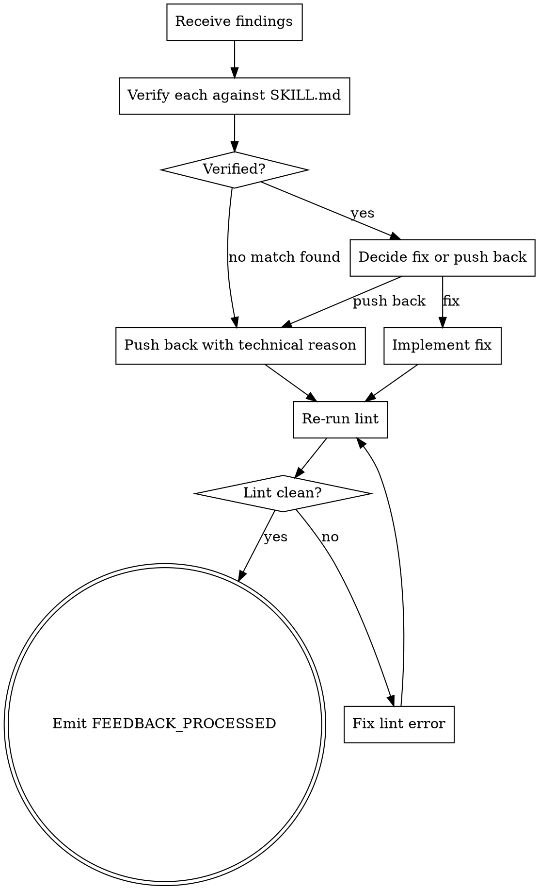

<!-- design-region-clean-of-hard-gates -->

# receiving-voice-review

<HARD-GATE>
Do NOT agree performatively. STOP and verify before implementing.
</HARD-GATE>

<HARD-GATE>
Never implement findings blindly. STOP and read each finding's excerpt first.
</HARD-GATE>

## Anti-Pattern

**"You are absolutely right, let me fix that now"** — writing that phrase before verifying the cited line skips the only check that matters. Verify first, then act.

## Core Principle

Technical correctness over social comfort.

## Process Flow



## Checklist

1. Receive the verdict and findings list from /skill-voice-review.
2. Read each finding's cited excerpt in the actual SKILL.md before reacting.
3. Decide fix or push back for each finding individually.
4. Implement each fix one at a time.
5. Re-run lint after each fix and confirm it passes.
6. Emit FEEDBACK_PROCESSED after all findings are resolved.

## Step Details

### 1. Receive the verdict and findings list from /skill-voice-review

Accept the full VERDICT line and FINDINGS list. Do not begin acting until the complete output is in hand.

### 2. Read each finding's cited excerpt in the actual SKILL.md before reacting

Open the target file at the line cited by each finding. Read that line verbatim. Confirm the finding matches the actual text before forming any response.

### 3. Decide fix or push back for each finding individually

For each finding: if the cited line violates the named rule, implement a fix. If the finding does not match the actual line, prepare a technical pushback referencing the exact text.

### 4. Implement each fix one at a time

Apply one fix, write the file, and stop. Do not batch multiple fixes into a single write.

### 5. Re-run lint after each fix and confirm it passes

Run `bash skills/skill-voice-review/scripts/lint.sh <target>` after each fix. Confirm zero critical findings before addressing the following finding.

### 6. Emit FEEDBACK_PROCESSED after all findings are resolved

When every finding is either fixed and lint-verified, or formally pushed back with a technical reason, emit `VERDICT: FEEDBACK_PROCESSED`.

## Gate Functions

- BEFORE writing any response to a finding: "Did I verify the finding against the actual SKILL.md line cited?"
- BEFORE implementing a suggested fix: "Does the fix pass lint AND solve the named defect?"
- BEFORE pushing back on a finding: "Do I have a technical reason, or am I just uncomfortable?"
- BEFORE emitting FEEDBACK_PROCESSED: "Did lint re-run clean after every fix?"

## Rationalization Table

| You think... | Reality |
|---|---|
| "You are absolutely right" | State the fix or push back. No performative agreement. |
| "Batch fixes save time" | One fix per commit. Re-run lint after each. |
| "The reviewer missed context; I can override" | Push back with a technical reason or implement the fix. No silent override. |

## Red Flags

- "You are absolutely right"
- "Great catch"
- "Thanks for noticing"
- "Let me fix all of these now"

## Key Principles

- **Verify before implementing.**
- **Push back with technical reasoning.**
- **One fix per commit.**

## The Bottom Line

```bash
#!/usr/bin/env bash
set -euo pipefail
target="${1:-skills/receiving-voice-review/SKILL.md}"
report="$(mktemp)"
bash skills/skill-voice-review/scripts/lint.sh "$target" > "$report"
verdict="$(jq -r '.verdict' "$report")"
case "$verdict" in
  ACCEPT|ACCEPT_WITH_MINOR)
    echo "VERDICT: FEEDBACK_PROCESSED"
    ;;
  *)
    echo "Lint verdict: ${verdict}" >&2
    exit 1
    ;;
esac
```
