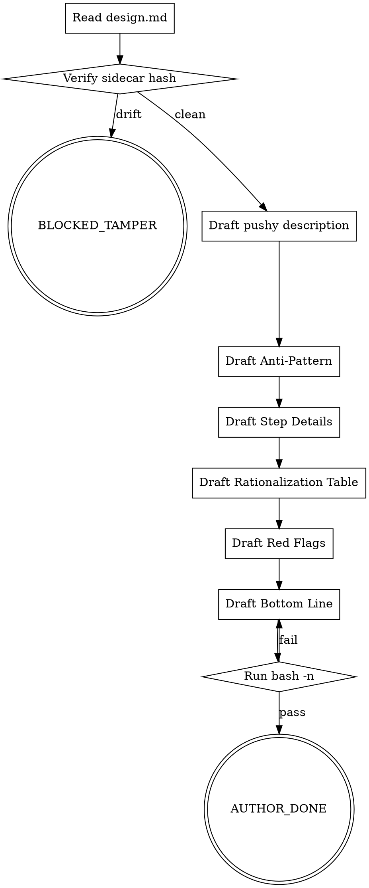

<!-- design-region-clean-of-hard-gates -->

# skill-author

<HARD-GATE>
Do NOT proceed without a verified design.md.sha256 sidecar in this session. STOP and run integrity-hash.sh.
</HARD-GATE>

<HARD-GATE>
Never edit content inside the integrity-block markers. STOP if drift is suspected.
</HARD-GATE>

<HARD-GATE>
Never name libraries or frameworks in SKILL.md body sections. STOP and rewrite the offending line.
</HARD-GATE>

## Anti-Pattern

**"The Integrity Block is close enough"** — close enough is drift. Every field in the Integrity Block is immutable once the SHA-256 sidecar lands. Any edit to the block, however small, invalidates the sidecar and must trigger BLOCKED_TAMPER.

## Core Principle

Fill the body without changing the locked contract.

## Process Flow



## Checklist

1. Read design.md and verify the SHA-256 sidecar matches.
2. Draft the pushy frontmatter description.
3. Draft the Anti-Pattern section.
4. Draft the Step Details for each checklist item.
5. Draft the Rationalization Table rows.
6. Draft the Red Flags list.
7. Draft the Bottom Line script.
8. Run bash -n on the Bottom Line fence.

## Step Details

### 1. Read design.md and verify the SHA-256 sidecar matches

Run integrity-hash.sh on design.md. Confirm the emitted hash equals the contents of design.md.sha256. Block on mismatch.

### 2. Draft the pushy frontmatter description

Write the description field so it covers the trigger surface. Name the stage, list real user phrasings in quotes (`"when the user says ..."`), and include every VERDICT token emitted at stage exit. Read references/canonical-anatomy.md section "Frontmatter description" for the template and before/after example.

### 3. Draft the Anti-Pattern section

Quote the exact rationalization an author would use to skip or shortcut the stage. First sentence must contain a quoted phrase.

### 4. Draft the Step Details for each checklist item

One H3 per checklist item, numbered to match. Keep prose imperative. Read references/canonical-anatomy.md for section shapes.

### 5. Draft the Rationalization Table rows

Three or more rows. Every Reality must be stricter than its You-think. Read references/rationalization-table-patterns.md for canonical row forms.

### 6. Draft the Red Flags list

Bulleted quoted fragments only. No em-dash explanation tails. Read references/canonical-anatomy.md for the Red Flags rule.

### 7. Draft the Bottom Line script

Write the executable bash fence. Read references/bottom-line-script-examples.md for stage-exit protocol shapes. Emit VERDICT: AUTHOR_DONE on success or VERDICT: BLOCKED_TAMPER on drift.

### 8. Run bash -n on the Bottom Line fence

Extract the fenced block and run `bash -n` against it. Fix any syntax errors before emitting AUTHOR_DONE.

## Gate Functions

- BEFORE re-reading design.md: "Did I verify its SHA-256 sidecar in this session?"
- BEFORE writing the Anti-Pattern: "Did I quote the exact rationalization that would cause skipping the stage?"
- BEFORE writing Rationalization Table rows: "Is every Reality stricter than its You-think?"
- BEFORE emitting AUTHOR_DONE: "Does the frontmatter description name trigger phrasings AND at least one verdict token?"
- BEFORE emitting AUTHOR_DONE: "Did bash -n pass on the Bottom Line fence?"

## Rationalization Table

| You think... | Reality |
|---|---|
| "The Integrity Block is close enough" | Treat any drift as BLOCKED_TAMPER. Rehash or rewrite. |
| "I can add a library name in the Step Details" | Library names in any body section fail LINT-005. Rewrite before committing. |
| "The Bottom Line does not need bash -n if it looks right" | Syntax errors surface at pipeline time, not authoring time. Run bash -n now. |

## Red Flags

- "The Integrity Block is close enough"
- "I can fix the hash after committing"
- "The library name is just a detail"
- "bash -n is optional for simple scripts"

## Key Principles

- **Integrity Block is immutable.** Any edit invalidates the sidecar.
- **No library names in the body.** Tool names belong in references only.
- **bash -n before AUTHOR_DONE.** Every Bottom Line must pass syntax check.

## The Bottom Line

```bash
#!/usr/bin/env bash
set -euo pipefail
design_path="${1:-docs/skill-cheat/skills-in-progress/<skill-name>/design.md}"
sidecar="${design_path}.sha256"
if [[ ! -f "$sidecar" ]]; then
  echo "VERDICT: BLOCKED_TAMPER"
  exit 1
fi
stored="$(cat "$sidecar")"
actual="$(shasum -a 256 "$design_path" | awk '{print $1}')"
if [[ "$stored" != "$actual" ]]; then
  echo "VERDICT: BLOCKED_TAMPER"
  exit 1
fi
echo "VERDICT: AUTHOR_DONE"
```
