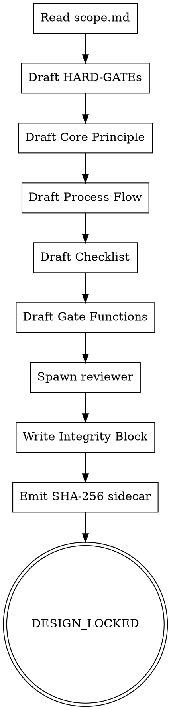

<!-- design-region-clean-of-hard-gates -->

# skill-design

<HARD-GATE>
Do NOT proceed without reading scope.md in this session. STOP and invoke /skill-scope.
</HARD-GATE>

<HARD-GATE>
Never name libraries or frameworks in HARD-GATE content. STOP and rewrite.
</HARD-GATE>

<HARD-GATE>
Never commit design.md without emitting design.md.sha256. STOP and run integrity-hash.sh.
</HARD-GATE>

## Anti-Pattern

**"I can tighten the HARD-GATEs after review"** — gates authored after the body is written reflect the body, not the contract. Write the immutable contract first or it drifts to match whatever was already written.

## Core Principle

Write the immutable contract before writing the body.

## Process Flow



## Checklist

1. Read scope.md and confirm all six fields are present.
2. Draft HARD-GATEs from the precondition list in scope.md.
3. Draft the Core Principle as one sentence.
4. Draft the Process Flow digraph.
5. Draft the Checklist and Step Details.
6. Draft Gate Functions.
7. Spawn the voice-reviewer subagent.
8. Write the Integrity Block with all six immutable fields.
9. Emit the SHA-256 sidecar file.
10. Write design.json alongside design.md (design.json follows references/design-schema.md).

## Step Details

### 1. Read scope.md and confirm all six fields are present

Confirm: skill name, triggers, verdicts, Anti-Pattern, target project path, plugin-mode. Block on any missing field.

### 2. Draft HARD-GATEs from the precondition list in scope.md

One or two imperative sentences per gate. No rationale inside the block. Read references/hard-gate-patterns.md for canonical forms.

### 3. Draft the Core Principle as one sentence

Name the shape of the work. Do not name a library, framework, or tool. One sentence.

### 4. Draft the Process Flow digraph

Use references/dot-digraph-template.md as the skeleton. Every node must reach a terminal or a declared backtrack loop.

### 5. Draft the Checklist and Step Details

Number the checklist items. Write one H3 Step Detail per item. Keep step prose imperative.

### 6. Draft Gate Functions

Every bullet must match: `- BEFORE <action>: "<question>?"`. Four or more bullets.

### 7. Spawn the voice-reviewer subagent

Dispatch a fresh subagent with the draft design.md. Wait for its verdict before writing the Integrity Block.

### 8. Write the Integrity Block with all six immutable fields

Use the exact delimiter strings from references/integrity-block.md. Include: skill name, triggers, verdict vocabulary, HARD-GATEs, Core Principle, Gate Functions.

### 9. Emit the SHA-256 sidecar file

Run `bash scripts/integrity-hash.sh <design-path>`. Confirm sidecar lands at `<design-path>.sha256`.

### 10. Write design.json alongside design.md

Save design.json to docs/skill-cheat/skills-in-progress/<skill-name>/design.json. Follow references/design-schema.md. Extract the fields mechanically from the drafted sections — do NOT hand-edit the JSON after emission. Downstream stages read design.json, not design.md.

## Gate Functions

- BEFORE drafting HARD-GATEs: "Is each precondition one or two imperative sentences?"
- BEFORE naming the Core Principle: "Am I naming the shape of the work or a tool?"
- BEFORE writing the Process Flow: "Does every node reach a terminal or a declared backtrack?"
- BEFORE emitting DESIGN_LOCKED: "Does design.md.sha256 match a fresh hash of the block?"

## Rationalization Table

| You think... | Reality |
|---|---|
| "HARD-GATEs need a rationale clause" | Keep rationale outside the block. Write gates as imperatives only. |
| "The Core Principle can reference the main tool" | Name the shape, not the tool. Strip any library name before locking. |
| "Integrity Block is overkill for a small skill" | Emit the Integrity Block regardless of skill size. No exemptions. |
| "I can tighten the gates after the review" | Gates authored after the body drift to match it. Write the contract first. |

## Red Flags

- "I'll tighten the gates later"
- "This gate needs a because clause"
- "Integrity Block is overkill for a small skill"
- "The Core Principle can name the library"

## Key Principles

- **Gates are imperatives.** No rationale inside a HARD-GATE block.
- **Integrity Block is immutable.** Never edit inside the markers after the sidecar is written.
- **Reviewer is a fresh subagent.** Dispatch with no authoring session history.

## The Bottom Line

```bash
#!/usr/bin/env bash
set -euo pipefail
design_path="${1:-docs/skill-cheat/skills-in-progress/<skill-name>/design.md}"
if bash scripts/integrity-hash.sh "$design_path"; then
    echo "VERDICT: DESIGN_LOCKED"
else
    echo "VERDICT: BLOCKED_TAMPER"
    exit 1
fi
```
