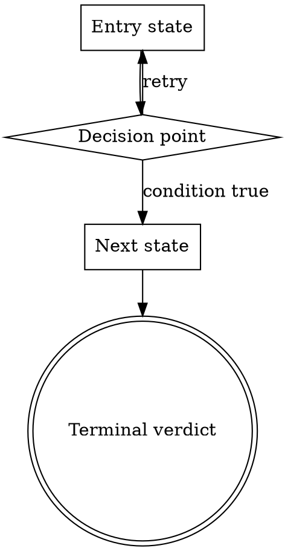

# Dot Digraph Template

The Process Flow section's dot block must parse under `dot -Tcanon` or LINT-011 fires.

## Skeleton

## Node shape conventions

- `box` — an action or step.
- `diamond` — a decision or gate.
- `doublecircle` — a terminal verdict (SCOPE_LOCKED, DESIGN_LOCKED, READY, SHIP).

## Edge conventions

- Unlabeled edges mark direct flow.
- Labeled edges distinguish branches: `[label="yes"]`, `[label="no, retry"]`, `[label="on REJECT"]`.

## Required properties

- Every node named in the graph has at least one incoming OR outgoing edge.
- Every path reaches a terminal (doublecircle) or a declared backtrack loop.
- The graph parses under `dot -Tcanon` — no syntax errors, no unresolved references.

## Rationalization Table

| You think... | Reality |
|---|---|
| "The terminal is obvious from the last node" | Name every terminal with doublecircle. A missing terminal fails the Required properties check. |
| "Prose describes the flow well enough" | Rewrite the prose as nodes and edges. Structure validates at parse time; paragraphs do not. |
| "Every step is a box; shape distinction is cosmetic" | Use diamond for decisions and doublecircle for terminals. Shape encodes semantics, not style. |

## Red Flags

- "No decision labels, the reader will figure out yes/no"
- "One stray node with no edges is fine"
- "Skip the doublecircle, the graph ends where it ends"
- "Every node is a box"
