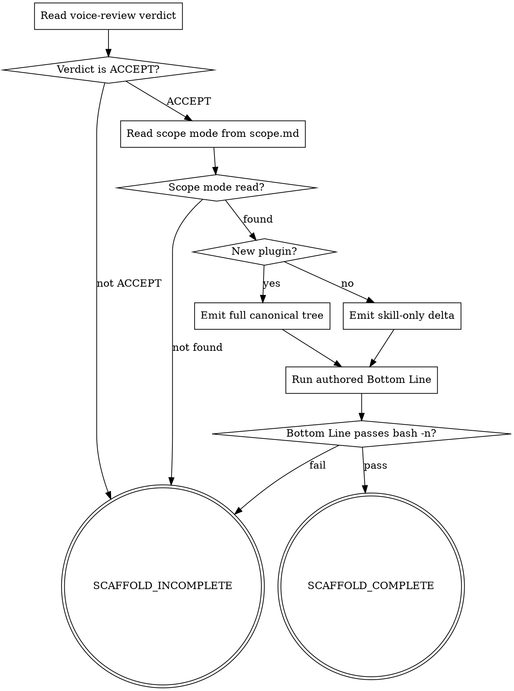

<!-- design-region-clean-of-hard-gates -->

# skill-scaffold

<HARD-GATE>
Do NOT write to the target project if voice-review did not return ACCEPT. STOP and rerun voice-review.
</HARD-GATE>

<HARD-GATE>
Never write a file with extension outside `.md`, `.js`, `.sh`, `.json`. STOP and correct the write.
</HARD-GATE>

<HARD-GATE>
Do NOT overwrite an existing plugin.json without explicit confirmation. STOP and ask the user.
</HARD-GATE>

## Anti-Pattern

**"The scaffold is just boilerplate"** — treating scaffold output as mechanical prevents verification. Every file written must be checked against the canonical tree in references/plugin-skeleton.md before SCAFFOLD_COMPLETE is emitted.

## Core Principle

Emit the canonical tree exactly; refuse anything off-grid.

## Process Flow



## Checklist

1. Read the voice-review verdict for the current session.
2. Read scope mode from scope.md.
3. Check whether plugin.json already exists at the target path.
4. Write files according to the appropriate tree branch.
5. Substitute all placeholders in every written file.
6. Run `bash -n` on the authored plugin's Bottom Line script.
7. Emit SCAFFOLD_COMPLETE or SCAFFOLD_INCOMPLETE.

## Step Details

### 1. Read the voice-review verdict for the current session

Locate the VERDICT line emitted by the voice-review stage in the current session. Any verdict other than ACCEPT blocks all writes and results in SCAFFOLD_INCOMPLETE.

### 2. Read scope mode from scope.md

Open `docs/skill-cheat/skills-in-progress/<skill-name>/scope.md`. Confirm `plugin-mode` is present and set to either `new plugin` or `existing plugin`. Block on a missing or unrecognized value.

### 3. Check whether plugin.json already exists at the target path

Stat `.claude-plugin/plugin.json` at the declared target root. If the file exists, STOP and ask the user whether to overwrite. Do NOT proceed until the user replies with an explicit yes or no. A no answer results in BLOCKED_OVERWRITE.

### 4. Write files according to the appropriate tree branch

For `new plugin`: emit every file in the canonical tree from references/plugin-skeleton.md, omitting keyword-trigger files when scope declares no triggers. For `existing plugin`: emit only the delta files listed in the existing-plugin section.

### 5. Substitute all placeholders in every written file

Replace `<PLUGIN_NAME>`, `<PLUGIN_UPPER>`, `<authored-skill-name>`, and `<primary-command>` in every file. Read references/hook-templates.md for the authoritative placeholder list. Refuse to write any file that still contains an unsubstituted placeholder token.

### 6. Run `bash -n` on the authored plugin's Bottom Line script

Extract the Bottom Line fenced block from the authored SKILL.md and run `bash -n` on it. A syntax error blocks SCAFFOLD_COMPLETE.

### 7. Emit SCAFFOLD_COMPLETE or SCAFFOLD_INCOMPLETE

After all files pass verification and `bash -n` passes, emit `VERDICT: SCAFFOLD_COMPLETE`. Emit `VERDICT: SCAFFOLD_INCOMPLETE` for any unresolved block in steps 1–6.

## Gate Functions

- BEFORE writing any file: "Does its extension match the allowlist?"
- BEFORE overwriting plugin.json: "Did the user confirm the overwrite?"
- BEFORE declaring SCAFFOLD_COMPLETE: "Does the authored Bottom Line script pass bash -n?"
- BEFORE branching on plugin mode: "Did I read scope mode from scope.md in this session?"

## Rationalization Table

| You think... | Reality |
|---|---|
| "The scaffold is just boilerplate" | Every placeholder left unsubstituted is a broken file. Verify each write against the canonical tree. |
| "Voice-review ACCEPT_WITH_MINOR is close enough" | Require ACCEPT before any write. Rerun voice-review on ACCEPT_WITH_MINOR. |
| "I can overwrite plugin.json silently to save time" | Silent clobber destroys user configuration without recovery. Always ask before overwriting. |

## Red Flags

- "The scaffold is just boilerplate"
- "ACCEPT_WITH_MINOR is close enough to proceed"
- "I can fill in the placeholders later"
- "plugin.json is auto-generated so overwriting is safe"

## Key Principles

- **Read voice-review ACCEPT before any write.** No other verdict unblocks the scaffold stage.
- **Emit the canonical tree exactly.** Files outside the allowlist are refused.
- **Substitute every placeholder.** No template token survives into the written output.
- **Ask before overwriting plugin.json.** Explicit confirmation is required every time.

## The Bottom Line

```bash
#!/usr/bin/env bash
set -euo pipefail
target_root="${1:-}"
skill_name="${2:-}"

if [[ -z "$target_root" || -z "$skill_name" ]]; then
  echo "Usage: bottom-line.sh <target-root> <skill-name>" >&2
  echo "VERDICT: SCAFFOLD_INCOMPLETE"
  exit 1
fi

# Assert the target tree exists
required_files=(
  ".claude-plugin/plugin.json"
  "CLAUDE.md"
  "hooks/hooks.json"
  "hooks/session-start"
  "skills/using-$(basename "$target_root")/SKILL.md"
  "skills/${skill_name}/SKILL.md"
  "commands/${skill_name}.md"
)

missing=0
for rel in "${required_files[@]}"; do
  if [[ ! -f "${target_root}/${rel}" ]]; then
    echo "MISSING: ${target_root}/${rel}" >&2
    missing=1
  fi
done

if (( missing )); then
  echo "VERDICT: SCAFFOLD_INCOMPLETE"
  exit 1
fi

# Verify authored Bottom Line passes bash -n
authored_skill="${target_root}/skills/${skill_name}/SKILL.md"
bottom_line_block="$(awk '/^```bash/{p=1;getline;} p && /^```/{p=0;} p{print}' "$authored_skill")"
tmpscript="$(mktemp /tmp/scaffold-bl-XXXXXX.sh)"
printf '%s\n' "$bottom_line_block" > "$tmpscript"
if ! bash -n "$tmpscript" 2>/dev/null; then
  rm -f "$tmpscript"
  echo "VERDICT: SCAFFOLD_INCOMPLETE"
  exit 1
fi
rm -f "$tmpscript"

echo "VERDICT: SCAFFOLD_COMPLETE"
```
