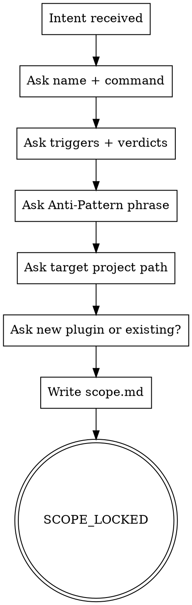

<!-- design-region-clean-of-hard-gates -->

# skill-scope

<HARD-GATE>
Do NOT proceed without a named concept and a declared target project path. STOP and ask the user.
</HARD-GATE>

<HARD-GATE>
Do NOT lock scope without naming the Anti-Pattern phrase. STOP and ask until the user names it.
</HARD-GATE>

## Anti-Pattern

**"I can skip the scope step for a simple skill"** — every skill gets a scope lock. Simple skills are where unexamined assumptions cause the most wasted authoring work. The scope document is the contract that downstream stages verify against.

## Core Principle

Lock the shape of the work before any design begins.

## Process Flow



## Checklist

1. Ask the user for a skill name and slash command.
2. Ask the user for verdict tokens and trigger kinds.
3. Ask the user to name the Anti-Pattern phrase.
4. Ask the user for the target project path.
5. Ask whether this authors a new plugin or extends an existing one.
6. Write scope.md, scope.json, and evals/eval-set-skeleton.json (run `bash scripts/emit-eval-skeleton.sh scope.json > evals/eval-set-skeleton.json`).

## Step Details

### 1. Ask the user for a skill name and slash command

One question at a time. Prefer multiple-choice phrasing. Read references/trigger-vocabulary.md first.

### 2. Ask the user for verdict tokens and trigger kinds

Confirm each token is ALL-CAPS. Confirm at least one slash-command trigger.

### 3. Ask the user to name the Anti-Pattern phrase

Refuse to proceed on "no Anti-Pattern needed". Every skill has one.

### 4. Ask the user for the target project path

Absolute path. Confirm the directory exists.

### 5. Ask whether this authors a new plugin or extends an existing one

Multiple choice: new plugin (full scaffold) or existing plugin (skill-only).

### 6. Write scope.md, scope.json, and evals/eval-set-skeleton.json

Save scope.md to docs/skill-cheat/skills-in-progress/<skill-name>/scope.md. Include name, triggers, verdicts, Anti-Pattern, target path, plugin-mode as human-readable prose.

Save scope.json to docs/skill-cheat/skills-in-progress/<skill-name>/scope.json. Follow references/scope-schema.md. Downstream stages read scope.json, not scope.md.

Run `bash scripts/emit-eval-skeleton.sh scope.json > evals/eval-set-skeleton.json` to seed the behavioral benchmark eval set with one positive case per trigger and five adversarial placeholders. The scope author fills in realistic queries before /skill-voice-review dispatches the benchmark (Plan 5).

## Gate Functions

- BEFORE asking questions: "Am I about to ask more than one thing at once?"
- BEFORE locking scope: "Does the user's Anti-Pattern name a quoted rationalization, or is it a vague statement?"
- BEFORE emitting SCOPE_LOCKED: "Does scope.json validate against references/scope-schema.md?"
- BEFORE moving on: "Did the user confirm the target project path exists on disk?"

## Rationalization Table

| You think... | Reality |
|---|---|
| "The user will figure out the Anti-Pattern later" | Later never comes. Ask now or the lint enforcement downstream has nothing to anchor on. |
| "A simple skill needs no scope" | Simple scopes hide the deepest assumptions. Lock scope regardless. |
| "Multiple questions at once saves time" | Ask one question at a time. Refuse batched prompts. |

## Red Flags

- "Let's just start drafting"
- "Scope is obvious"
- "I can derive the Anti-Pattern from context"
- "We can skip the target path question"

## Key Principles

- **One question at a time.** No compound prompts.
- **Refuse to proceed without the Anti-Pattern.** It is the anchor for downstream enforcement.
- **ALL-CAPS verdict tokens.** No lowercase, no spaces.

## The Bottom Line

```bash
echo "VERDICT: SCOPE_LOCKED"
```
