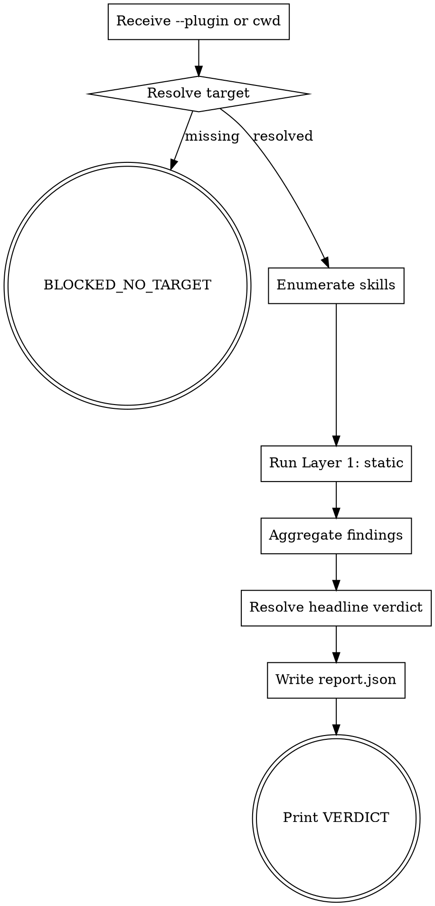

<!-- design-region-clean-of-hard-gates -->

# skill-stress-test

<HARD-GATE>
Never write a report without a verified target manifest. STOP and resolve --plugin first.
</HARD-GATE>

<HARD-GATE>
Never mutate the target plugin during a static run. STOP if any layer attempts a write outside `.skill-cheat-qa/`.
</HARD-GATE>

## Anti-Pattern

**"I can skip the static layer for a simple plugin"** — simple plugins are where unexamined lint failures hide longest. Every connected plugin gets the static layer regardless of size.

## Core Principle

Validate every SKILL.md against the same contract that authored it.

## Process Flow



## Checklist

1. Resolve the target plugin from `--plugin` or cwd.
2. Enumerate every `skills/*/SKILL.md` in the target.
3. Run the static layer on each enumerated SKILL.md.
4. Aggregate per-skill findings into a layer-level sub-verdict.
5. Resolve the headline verdict by precedence.
6. Write the report and print the verdict.

## Step Details

### 1. Resolve the target plugin from --plugin or cwd

Run `bash scripts/connect-plugin.sh --plugin <path>` or, without `--plugin`, from a directory containing `.claude-plugin/plugin.json`. The script emits a normalized manifest JSON to stdout or exits non-zero with `BLOCKED_NO_TARGET`.

### 2. Enumerate every skills/*/SKILL.md in the target

The orchestrator reads the manifest and globs `<target>/skills/*/SKILL.md`. Empty enumeration is not a failure; it is a `VALIDATION_INCONCLUSIVE` with `reason: "no skills found"`.

### 3. Run the static layer on each enumerated SKILL.md

`bash scripts/layer-static.sh --target <path>` fans `skill-voice-review/scripts/lint.sh` across every enumerated `SKILL.md` and emits a single JSON object with per-skill findings.

### 4. Aggregate per-skill findings into a layer-level sub-verdict

The layer's sub-verdict is the worst of all per-skill verdicts: `REJECT_CRITICAL > REJECT_IMPORTANT > ACCEPT_WITH_MINOR > ACCEPT`.

### 5. Resolve the headline verdict by precedence

`node scripts/verdict-resolver.js` consumes the layer sub-verdicts and emits the headline. Precedence: `BLOCKED_NO_TARGET > VALIDATION_INCONCLUSIVE > PLUGIN_DRIFT > VALIDATION_CLEAN`. (Plan 4 adds `HARNESS_GAP` above `PLUGIN_DRIFT`.)

### 6. Write the report and print the verdict

`node scripts/report-writer.js` writes `<target>/.skill-cheat-qa/runs/<run-id>/report.json`. The Bottom Line bash reads that file and prints `VERDICT: <headline>`.

## Gate Functions

- BEFORE running any layer: "Did connect-plugin.sh return a resolved manifest?"
- BEFORE writing report.json: "Does the report match references/report-schema.json?"
- BEFORE printing the headline verdict: "Did every enumerated SKILL.md produce a sub-verdict?"
- BEFORE emitting VALIDATION_CLEAN: "Did the static layer return ACCEPT for every skill?"

## Rationalization Table

| You think... | Reality |
|---|---|
| "Skip the static layer for a simple plugin" | Run every layer regardless. Simple plugins fail silently the longest. |
| "Accept ACCEPT_WITH_MINOR as clean" | Treat ACCEPT_WITH_MINOR as PLUGIN_DRIFT. Minor findings are still drift the author owns. |
| "Print the verdict before writing the report" | Write the report first. The report is the audit trail; the verdict is its summary. |

## Red Flags

- "Just lint the obvious skills"
- "Skip writing the report; the verdict is enough"
- "ACCEPT_WITH_MINOR is basically clean"
- "Layer 1 alone is the full validation"

## Key Principles

- **Connect before validating.** No target, no run.
- **Worst skill wins the layer.** Aggregation by maximum severity.
- **Write the report before the verdict.** Audit trail first.

## The Bottom Line

```bash
#!/usr/bin/env bash
set -euo pipefail
target="${1:-$PWD}"
run_id="$(date -u +%Y-%m-%dT%H-%M-%S)-$(openssl rand -hex 4)"
report_dir="${target}/.skill-cheat-qa/runs/${run_id}"
mkdir -p "$report_dir"
manifest="$(bash skills/skill-stress-test/scripts/connect-plugin.sh --plugin "$target")" \
  || { echo "VERDICT: BLOCKED_NO_TARGET"; exit 1; }
echo "$manifest" > "${report_dir}/manifest.json"
static_findings="$(bash skills/skill-stress-test/scripts/layer-static.sh --target "$target")"
echo "$static_findings" > "${report_dir}/static-findings.json"
node skills/skill-stress-test/scripts/report-writer.js \
  --manifest "${report_dir}/manifest.json" \
  --static "${report_dir}/static-findings.json" \
  --output "${report_dir}/report.json"
verdict="$(node skills/skill-stress-test/scripts/verdict-resolver.js --report "${report_dir}/report.json")"
echo "VERDICT: ${verdict}"
```
