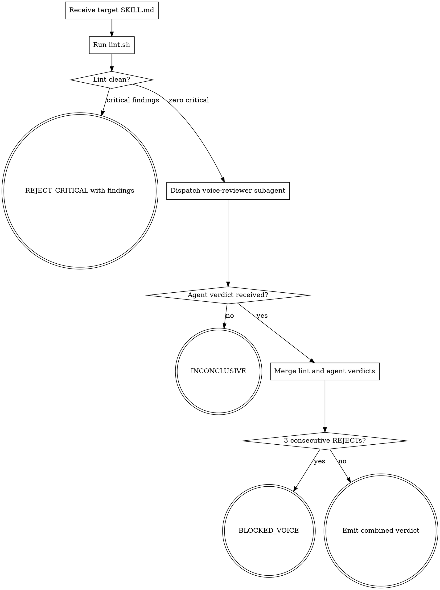

<!-- design-region-clean-of-hard-gates -->

# skill-voice-review

<HARD-GATE>
Do NOT return a verdict without running lint.sh in this session. STOP and run it.
</HARD-GATE>

<HARD-GATE>
Do NOT return ACCEPT without dispatching the voice-reviewer subagent. STOP and dispatch.
</HARD-GATE>

<HARD-GATE>
Never pass 3 consecutive REJECTs without escalating. STOP and emit BLOCKED_VOICE.
</HARD-GATE>

## Anti-Pattern

**"It reads fine to me, I can skip lint"** — skipping lint leaves structural violations for the subagent to catch, which is not the subagent's role. Run lint.sh first, every time, with no exceptions.

## Core Principle

Structural distrust — the author does not evaluate the author's work.

## Process Flow



## Checklist

1. Receive the absolute path to the target SKILL.md.
2. Run lint.sh against the target and capture the JSON report.
3. Halt and emit REJECT_CRITICAL if the report contains any critical findings.
4. Craft the dispatch prompt from prompts/voice-reviewer.md with all placeholders filled.
5. Dispatch the voice-reviewer subagent with the filled prompt.
6. Receive the agent verdict and findings list.
7. Merge lint findings and agent findings into a single verdict.
8. Check the session REJECT count and emit BLOCKED_VOICE if 3 consecutive REJECTs occurred.
9. Emit the combined verdict.

## Step Details

### 1. Receive the absolute path to the target SKILL.md

Confirm the file exists on disk before proceeding. Block if the path is missing or unresolvable.

### 2. Run lint.sh against the target and capture the JSON report

Run `bash skills/skill-voice-review/scripts/lint.sh <target>` and write the JSON report to a temp file. Read references/lint-rules.json to understand what each rule checks.

### 3. Halt and emit REJECT_CRITICAL if the report contains any critical findings

Read `summary.critical` from the JSON report. Any value greater than zero triggers an immediate REJECT_CRITICAL with the findings list. Do not proceed to subagent dispatch.

### 4. Craft the dispatch prompt from prompts/voice-reviewer.md with all placeholders filled

Read prompts/voice-reviewer.md. Replace `{SKILL_PATH}`, `{DESIGN_SHA}`, and `{LINT_REPORT_PATH}` with their resolved values. `{DESIGN_SHA}` is `n/a` when no design.md exists.

### 5. Dispatch the voice-reviewer subagent with the filled prompt

Spawn a fresh subagent context. Pass the filled prompt as the sole input. Do not include authoring session history.

### 6. Receive the agent verdict and findings list

Wait for the subagent to return a `VERDICT:` line followed by a `FINDINGS:` list. Treat no response as INCONCLUSIVE.

### 7. Merge lint findings and agent findings into a single verdict

The combined verdict is the worse of the two verdicts. REJECT_CRITICAL outranks REJECT_IMPORTANT outranks ACCEPT_WITH_MINOR outranks ACCEPT. INCONCLUSIVE from either side propagates as INCONCLUSIVE.

### 8. Check the session REJECT count and emit BLOCKED_VOICE if 3 consecutive REJECTs occurred

Count consecutive REJECT_CRITICAL or REJECT_IMPORTANT verdicts in the current session. On reaching 3, stop merging and emit BLOCKED_VOICE instead.

### 9. Emit the combined verdict

Print `VERDICT: <token>` where token is one of ACCEPT, ACCEPT_WITH_MINOR, REJECT_CRITICAL, REJECT_IMPORTANT, INCONCLUSIVE, BLOCKED_VOICE.

## Gate Functions

- BEFORE returning ACCEPT: "Did lint.sh pass with zero critical findings?"
- BEFORE dispatching the voice-reviewer: "Did I craft a fresh-context prompt from prompts/voice-reviewer.md?"
- BEFORE merging verdicts: "Is the agent verdict aligned with the lint report?"
- BEFORE emitting BLOCKED_VOICE: "Have there been 3 consecutive REJECTs in this session?"

## Rationalization Table

| You think... | Reality |
|---|---|
| "I wrote it, I can judge it" | The author's familiarity masks the exact gaps a fresh subagent finds. Dispatch always. |
| "Lint false-positived, I can override" | Commit a lint.json disable entry or accept the finding. No in-session override. |
| "The agent is slow, skip it" | A slow agent review is cheaper than a shipped skill with a structural defect. Never skip. |

## Red Flags

- "It reads fine to me, I can skip lint"
- "I reviewed it myself, no need for the subagent"
- "Lint is being too strict here"
- "One more REJECT and I'll escalate"

## Key Principles

- **Run lint first.** No subagent dispatch on a lint failure.
- **Dispatch a fresh subagent.** No authoring session context leaks into the review.
- **Merge verdicts strictly.** The worse verdict wins.
- **Escalate on 3 consecutive REJECTs.** Emit BLOCKED_VOICE and stop.

## The Bottom Line

```bash
#!/usr/bin/env bash
set -euo pipefail
target="${1:-skills/skill-voice-review/SKILL.md}"
report="$(mktemp)"
bash skills/skill-voice-review/scripts/lint.sh "$target" > "$report"
verdict="$(jq -r '.verdict' "$report")"
echo "VERDICT: ${verdict}"
```
