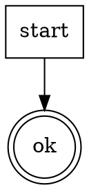

# minimal-demo

<HARD-GATE>
Do NOT proceed without a named scope. STOP and invoke /skill-scope.
</HARD-GATE>

## Anti-Pattern

**"I can skip the gate this once"** — every invocation goes through the gate. No exceptions.

## Core Principle

Verify preconditions before acting.

## Process Flow



## Checklist

1. Read the scope document.

## Step Details

### 1. Read the scope document

Open scope.md and confirm all required fields are present.

## Rationalization Table

| You think... | Reality |
|---|---|
| "Scope is obvious from context" | Context drifts. Read scope.md. |

## Gate Functions

- BEFORE proceeding: "Does scope.md exist?"

## Red Flags

- "I already know what the scope is"
- "Scope check is overkill"

## Key Principles

- **Verify.** Read before acting.

## The Bottom Line

```bash
echo "VERDICT: READY"
```
