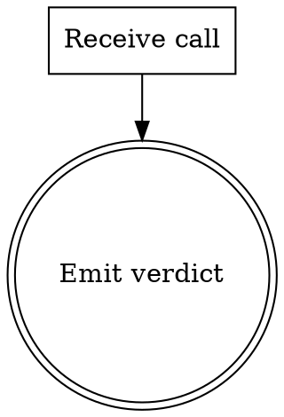

<!-- design-region-clean-of-hard-gates -->

# beta

<HARD-GATE>
Never invoke this fixture in production. STOP if seen outside the test harness.
</HARD-GATE>

## Anti-Pattern

**"Skip linting the test fixture"** — fixtures are the only ground truth the lint engine has. Lint them like real skills.

## Core Principle

Demonstrate every canonical section in a minimal shape.

## Process Flow



## Checklist

1. Receive a call.
2. Emit the verdict.

## Step Details

### 1. Receive a call

Accept any input.

### 2. Emit the verdict

Print VERDICT: BETA_VERDICT.

## Gate Functions

- BEFORE emitting the verdict: "Did the call arrive cleanly?"

## Rationalization Table

| You think... | Reality |
|---|---|
| "The fixture is too simple to need a Rationalization Table" | Keep the table. Every canonical section ships. |
| "Skip the dot digraph for a 2-node flow" | Keep the digraph. Lint requires it. |
| "Drop the Bottom Line for a fixture" | Keep the Bottom Line. The fixture exercises the bash detector. |

## Red Flags

- "Fixtures don't need full anatomy"
- "Skip the hard-gate"
- "Tighten the description later"

## Key Principles

- **Ship every section.**
- **Keep the verdict ALL-CAPS.**

## The Bottom Line

```bash
#!/usr/bin/env bash
echo "VERDICT: BETA_VERDICT"
```
